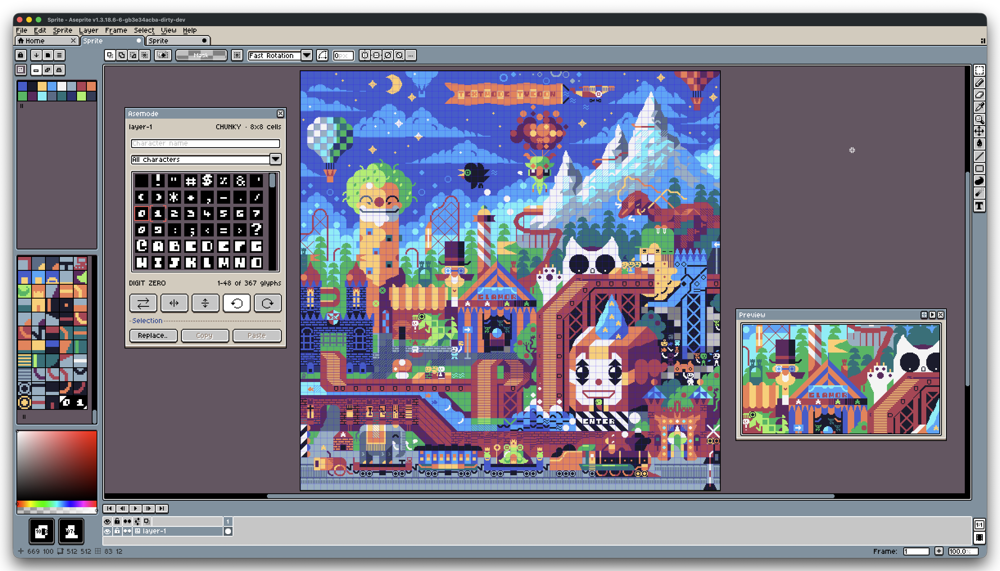

# Asemode

<table align="center">
  <tr>
    <td></td>
    <td> </td>
    <td> </td>
  </tr>
</table>

Asemode brings textmode art to [Aseprite](https://www.aseprite.org/). Draw and
edit glyphs directly on the canvas with native tools.

## Features

- **Native drawing** - Paint glyphs with Aseprite's native drawing tools.
- **Fonts and glyphs** - Choose from bundled fonts or upload a static TrueType font; search characters by Unicode name or block.
- **Textmode layers** - Combine textmode, pixel art, and animation in the same RGB sprite, with a different font for each Textmode layer.
- **Colors and stamps** - Set ink and cell colors, swap colors, and flip or rotate glyph stamps.
- **Editing and resizing** - Replace selected glyphs or colors and adjust cell and grid dimensions.
- **Portable artwork** - Exchange editable [Textmode Document](https://github.com/humanbydefinition/textmode-document) JSON with tools across the `textmode.art` ecosystem.
- **Customizable controls** - Assign keyboard shortcuts and adjust the glyph picker and panel settings.

### Connect with the `textmode.art` ecosystem

Bring artwork into Asemode as a Textmode Document (`.textmode.json`):

- Import conversions from [export.textmode.art](https://export.textmode.art/).
- Exchange artwork in both directions with [create.textmode.art](https://create.textmode.art/).
- Import JSON exports from [textmode.js](https://github.com/humanbydefinition/textmode.js) sketches using [textmode.export.js](https://github.com/humanbydefinition/textmode.export.js).
- Import JSON exports from the [Textmode Overlay browser extension](https://extension.textmode.art/).

Asemode imports `textmode.document` and uses version 4 and later.

## Requirements

- A standard build of **Aseprite 1.3.18.6 or later** (Lua API 41+).
- An **RGB sprite** when adding Textmode layers to existing artwork. Convert
  indexed or grayscale sprites to RGB first. Asemode creates new sprites in
  RGB mode. Projects assigned to another tile-management extension are not
  supported.

## Install

1. Download the `.aseprite-extension` file from [GitHub Releases](https://github.com/humanbydefinition/Asemode/releases)
   or the [Asemode itch.io page](https://humanbydefinition.itch.io/asemode).
2. In Aseprite, open **Edit > Preferences... > Extensions > Add Extension**.
3. Select the downloaded file and enable Asemode.
4. Open **Sprite > Asemode > New Textmode Sprite..** to start drawing. To
   add a Textmode layer to an existing RGB sprite, choose **Add Textmode Layer..**.

Commands are also available in **View > Run Command** and the keyboard shortcut
settings. Aseprite may ask to read a font or write an export. Grant access to that
file; the extension does not require full script trust.

## Next steps

Read the [User Guide](docs/guide/README.md) to get started with drawing, fonts,
layers, and exchanging artwork with the `textmode.art` ecosystem.

- [Getting Started](docs/guide/00-getting-started.md) covers installation and your first canvas.
- [Fonts & Typography](docs/guide/03-fonts-and-typography.md) explains bundled fonts and TrueType imports.
- [Portable Interchange](docs/guide/05-portable-interchange.md) describes Textmode Document import and export.
- [Quick Reference](docs/guide/08-quick-reference.md) lists commands, shortcuts, and troubleshooting answers.

## Contributing

Thank you for considering a contribution to Asemode! (✿◠‿◠)

Read the [Contributing Guide](CONTRIBUTING.md) to get started.

## License

Asemode is licensed under the [MIT License](LICENSE).

## Acknowledgements

Asemode includes fonts and data by other creators. See the
[third-party notices](THIRD_PARTY_NOTICES.md) for credits and source details.
