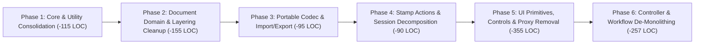

# Asemode Architecture Analysis & Phased Refactoring Plan

## 1. Executive Summary

`Asemode` is a feature-rich Aseprite extension providing native character-cell drawing, TrueType/bitmap font management, and portable `.textmode` tilemap import/export. While the extension has strong test coverage and a well-defined user experience, rapid feature growth has resulted in several architectural monoliths, cross-cutting DRY violations, redundant proxy layers, and subtle boundary leaks between the pure document model, the Aseprite host session, and the UI layer.

### Codebase Baseline

The repository contains **217,302 total lines of Lua**, of which **203,320 LOC** are build-generated font and Unicode tables (ignored by StyLua and LuaLS via [`.styluaignore`](file:///Users/christopherdietrich/Desktop/textmode/tools/asemode/.styluaignore) and [`.luarc.ci.json`](file:///Users/christopherdietrich/Desktop/textmode/tools/asemode/.luarc.ci.json)), leaving **44 hand-written Lua source files totaling 13,982 LOC**:

| Architectural Layer | Directory / Files | Hand-Written Files | Current LOC | Share of Source |Est. Post-Refactor LOC | Est. Net Reduction |
| :--- | :--- | ---: | ---: | ---: | ---: | ---: |
| **Entrypoint & Actions** | [`src/main.lua`](file:///Users/christopherdietrich/Desktop/textmode/tools/asemode/src/main.lua), [`src/actions/stamps.lua`](file:///Users/christopherdietrich/Desktop/textmode/tools/asemode/src/actions/stamps.lua) | 2 | 400 | 2.9% | ~345 | **-55 LOC (-13.8%)** |
| **UI & Workflows** | `src/ui/*.lua` | 11 | 5,440 | 38.9% | ~4,835 | **-605 LOC (-11.1%)** |
| **Document Domain** | `src/document/*.lua` | 14 | 3,566 | 25.5% | ~3,375 | **-191 LOC (-5.4%)** |
| **Fonts Subsystem** | `src/fonts/*.lua` *(hand-written)* | 7 | 1,708 | 12.2% | ~1,675 | **-33 LOC (-1.9%)** |
| **Interactive Session** | `src/session/*.lua` | 4 | 1,305 | 9.3% | ~1,240 | **-65 LOC (-5.0%)** |
| **Portable Format** | `src/portable/*.lua` | 2 | 819 | 5.9% | ~785 | **-34 LOC (-4.2%)** |
| **Core Primitives** | `src/core/*.lua` *(excl. `version.lua`)* | 5 | 744 | 5.3% | ~660 | **-84 LOC (-11.3%)** |
| **Total (Hand-Written)** | **`src/`** | **45** | **13,982** | **100.0%** | **~12,915** | **~-1,067 LOC (-7.6%)** |

### Primary Goals

1. **Eliminate Monoliths & Improve Approachability**: Decompose God objects and 300–1,169 LOC closures ([`src/ui/controller.lua`](file:///Users/christopherdietrich/Desktop/textmode/tools/asemode/src/ui/controller.lua), [`src/session/drawing.lua`](file:///Users/christopherdietrich/Desktop/textmode/tools/asemode/src/session/drawing.lua), [`src/ui/portable.lua`](file:///Users/christopherdietrich/Desktop/textmode/tools/asemode/src/ui/portable.lua), [`src/document/portable_import.lua`](file:///Users/christopherdietrich/Desktop/textmode/tools/asemode/src/document/portable_import.lua), [`src/ui/document_workflow.lua`](file:///Users/christopherdietrich/Desktop/textmode/tools/asemode/src/ui/document_workflow.lua), [`src/ui/font_workflow.lua`](file:///Users/christopherdietrich/Desktop/textmode/tools/asemode/src/ui/font_workflow.lua), [`src/document/edit.lua`](file:///Users/christopherdietrich/Desktop/textmode/tools/asemode/src/document/edit.lua)) into cohesive, single-responsibility units with flat control flow and minimal closure state.
2. **Shrink Code Surface via DRY Consolidation**: Remove **~1,067 lines of duplicated and boilerplate code** across 22 identified DRY violation clusters (including 255 lines of redundant 1-to-1 proxy wrapper tables, duplicate JSON pretty-printers, 9 hex-color validators, 8 cel grid-coordinate formulas, duplicate cel auto-expansion routines, and repeated UI preview/control helpers).
3. **Enforce Clean Layering & Strict Dependency Direction**: Fix upward dependency inversions (such as [`src/document/edit.lua`](file:///Users/christopherdietrich/Desktop/textmode/tools/asemode/src/document/edit.lua#L7) importing [`src/session/stamp_state.lua`](file:///Users/christopherdietrich/Desktop/textmode/tools/asemode/src/session/stamp_state.lua)) and standardize dependency injection across UI modules.
4. **Zero Behavioral or Visual Regression**: Guarantee 100% compatibility with all panels, dialogs, alerts, keyboard/menu commands, pure and host Lua tests, LuaLS diagnostics, and the automated screenshot suite (`npm run docs:screenshots` producing **zero unstaged changes**).

---

## 2. Architectural Assessment & System Topology

### 2.1 Current vs. Target Layer Topology

```mermaid
flowchart TD
  subgraph Entry["Entrypoint Layer"]
    Main["src/main.lua (176 LOC)"]
  end

  subgraph UI["UI & Workflow Layer (5,440 LOC)"]
    Controller["src/ui/controller.lua (1,169 LOC)"]
    PortableUI["src/ui/portable.lua (923 LOC)"]
    DocWorkflow["src/ui/document_workflow.lua (846 LOC)"]
    FontWorkflow["src/ui/font_workflow.lua (706 LOC)"]
    GlyphBrowser["src/ui/glyph_browser.lua (634 LOC)"]
    About["src/ui/about.lua (319 LOC)"]
    TaskRunner["src/ui/task_runner.lua (196 LOC)"]
    ReplacePreview["src/ui/replace_preview.lua (190 LOC)"]
    Controls["src/ui/controls.lua (165 LOC)"]
    Theme["src/ui/theme.lua (156 LOC)"]
    FontPreview["src/ui/font_preview.lua (136 LOC)"]
  end

  subgraph Session["Interactive Session & Actions Layer (1,529 LOC)"]
    Drawing["src/session/drawing.lua (1,036 LOC)"]
    Stamps["src/actions/stamps.lua (224 LOC)"]
    NativeOps["src/session/native_operations.lua (105 LOC)"]
    StampState["src/session/stamp_state.lua (90 LOC)"]
    Projects["src/session/projects.lua (74 LOC)"]
  end

  subgraph Domain["Document & Font Domain Layer (6,093 LOC)"]
    PortableImport["src/document/portable_import.lua (860 LOC)"]
    Edit["src/document/edit.lua (676 LOC)"]
    Codec["src/portable/codec.lua (515 LOC)"]
    Loader["src/fonts/loader.lua (478 LOC)"]
    Model["src/document/model.lua (437 LOC)"]
    TrueType["src/fonts/truetype.lua (403 LOC)"]
    Library["src/fonts/library.lua (376 LOC)"]
    Profile["src/document/profile.lua (344 LOC)"]
    Validate["src/document/validate.lua (273 LOC)"]
    PortableExport["src/document/portable_export.lua (220 LOC)"]
    Clipboard["src/document/clipboard.lua (214 LOC)"]
  end

  subgraph Core["Core & Portable Primitives Layer (1,048 LOC)"]
    JSON["src/portable/json.lua (304 LOC)"]
    Binary["src/core/binary.lua (202 LOC)"]
    Util["src/core/util.lua (198 LOC)"]
    Settings["src/core/settings.lua (160 LOC)"]
    Metrics["src/core/metrics.lua (84 LOC)"]
    Task["src/core/task.lua (84 LOC)"]
  end

  Main --> Controller
  Controller --> PortableUI & DocWorkflow & FontWorkflow & GlyphBrowser & About & TaskRunner & Controls & Theme
  Controller --> Drawing & Projects
  PortableUI & DocWorkflow & FontWorkflow --> Drawing
  Drawing --> Stamps & NativeOps & StampState
  Edit -. "DEPENDENCY INVERSION (edit.lua:7)" .-> StampState
  About -. "BYPASSES LOADER (about.lua:4-6)" .-> TrueType
```



### 2.2 Systemic Architectural Smells

#### 1. Upward Dependency Inversion (`src/document/` $\rightarrow$ `src/session/`)
[`src/document/edit.lua`](file:///Users/christopherdietrich/Desktop/textmode/tools/asemode/src/document/edit.lua#L7) requires [`src/session/stamp_state.lua`](file:///Users/christopherdietrich/Desktop/textmode/tools/asemode/src/session/stamp_state.lua) to implement [`prepareSavedStamps`](file:///Users/christopherdietrich/Desktop/textmode/tools/asemode/src/document/edit.lua#L11-L25) inside [`Edit.replaceFont`](file:///Users/christopherdietrich/Desktop/textmode/tools/asemode/src/document/edit.lua#L324) and [`Edit.regrid`](file:///Users/christopherdietrich/Desktop/textmode/tools/asemode/src/document/edit.lua#L564). `src/document/` is the lower-level document mutation layer, whereas `src/session/` is the higher-level interactive host session layer. Meanwhile, [`src/session/stamp_state.lua`](file:///Users/christopherdietrich/Desktop/textmode/tools/asemode/src/session/stamp_state.lua) has zero session state of its own—it purely serializes and validates `layer.properties("asemode").stampStateJson` using `Model.meta`/`Model.setMeta`.

#### 2. Two Separate JSON Stacks (`src/core/util.lua` vs. `src/portable/json.lua`)
- [`src/core/util.lua`](file:///Users/christopherdietrich/Desktop/textmode/tools/asemode/src/core/util.lua#L56-L100) implements a 45-line character-by-character state-machine lexer (`U.prettyJson`) on top of Aseprite's `json.encode`, used at **only one call site** in the entire codebase ([`src/document/export.lua`](file:///Users/christopherdietrich/Desktop/textmode/tools/asemode/src/document/export.lua#L97)).
- [`src/portable/json.lua`](file:///Users/christopherdietrich/Desktop/textmode/tools/asemode/src/portable/json.lua) is a complete, deterministic, pure-Lua JSON parser and serializer (`JSON.parse`, `JSON.stringify`) that already supports pretty-printing with 2-space indentation by default.

#### 3. Triple Full-AST Validation on Portable Document Import
When importing a `.textmode` file:
1. [`PortableImport.read`](file:///Users/christopherdietrich/Desktop/textmode/tools/asemode/src/document/portable_import.lua#L109) calls [`Codec.decodeWithFontRecovery`](file:///Users/christopherdietrich/Desktop/textmode/tools/asemode/src/portable/codec.lua#L406), which walks the entire document AST (frames, layers, fonts, grids, rows, cells).
2. [`PortableImport.read`](file:///Users/christopherdietrich/Desktop/textmode/tools/asemode/src/document/portable_import.lua#L190-L243) immediately walks the entire AST a **second time** to check Aseprite-native constraints (`frameCountProblem`, `frameProblem`, `gridProblem`, `blendProblem`, `cellProblem`).
3. [`PortableImport.prepareImport`](file:///Users/christopherdietrich/Desktop/textmode/tools/asemode/src/document/portable_import.lua#L250) calls [`Codec.decodeValue(document)`](file:///Users/christopherdietrich/Desktop/textmode/tools/asemode/src/portable/codec.lua#L421)—walking the entire AST a **third time**—and then loops over every frame, layer, row, and cell **a fourth time** (`L328-L435`) re-running `frameCountProblem`, `frameProblem`, `gridProblem`, `blendProblem`, and `cellProblem`.

#### 4. Three Concurrent `0.15s` Polling Timers on the UI Thread
- [`src/session/drawing.lua`](file:///Users/christopherdietrich/Desktop/textmode/tools/asemode/src/session/drawing.lua#L606-L617) runs a permanent `0.15s` `state.backgroundTimer` when `app.isUIAvailable` is true.
- [`src/ui/controller.lua`](file:///Users/christopherdietrich/Desktop/textmode/tools/asemode/src/ui/controller.lua#L996-L1015) runs a second `0.15s` `self.timer` whenever the main panel is open.
- [`src/ui/controller.lua`](file:///Users/christopherdietrich/Desktop/textmode/tools/asemode/src/ui/controller.lua#L457-L465) runs a third `0.15s` `self.themeTimer` whenever any dialog is open.

#### 5. Inconsistent Object Construction & Redundant Proxy Tables
- [`src/ui/controller.lua`](file:///Users/christopherdietrich/Desktop/textmode/tools/asemode/src/ui/controller.lua), [`src/ui/controls.lua`](file:///Users/christopherdietrich/Desktop/textmode/tools/asemode/src/ui/controls.lua), [`src/ui/task_runner.lua`](file:///Users/christopherdietrich/Desktop/textmode/tools/asemode/src/ui/task_runner.lua), [`src/session/drawing.lua`](file:///Users/christopherdietrich/Desktop/textmode/tools/asemode/src/session/drawing.lua), and [`src/session/projects.lua`](file:///Users/christopherdietrich/Desktop/textmode/tools/asemode/src/session/projects.lua) define methods on `self`/`session`/`tracker` and return that table directly.
- Conversely, [`src/ui/glyph_browser.lua`](file:///Users/christopherdietrich/Desktop/textmode/tools/asemode/src/ui/glyph_browser.lua#L436-L633) (198 LOC), [`src/ui/document_workflow.lua`](file:///Users/christopherdietrich/Desktop/textmode/tools/asemode/src/ui/document_workflow.lua#L804-L832) (29 LOC), [`src/ui/font_workflow.lua`](file:///Users/christopherdietrich/Desktop/textmode/tools/asemode/src/ui/font_workflow.lua#L683-L703) (21 LOC), and [`src/ui/portable.lua`](file:///Users/christopherdietrich/Desktop/textmode/tools/asemode/src/ui/portable.lua#L914-L920) (7 LOC) construct manual `api` proxy tables that merely forward `api.foo(_, ...) -> self:foo(...)`, adding **255 lines of pure boilerplate**.

#### 6. Unwired Dead Code in `document_workflow.lua`
[`src/ui/document_workflow.lua`](file:///Users/christopherdietrich/Desktop/textmode/tools/asemode/src/ui/document_workflow.lua#L153) tracks `self.activeReplaceTick` (`L153`, `L385`) and exposes [`self:tick()`](file:///Users/christopherdietrich/Desktop/textmode/tools/asemode/src/ui/document_workflow.lua#L798-L802), but [`Controller:tick()`](file:///Users/christopherdietrich/Desktop/textmode/tools/asemode/src/ui/controller.lua#L1023-L1041) never calls `self.document:tick()`—in production, the dialog's internal `0.05s` `Timer` (`L372`) drives `checkSelection`, while `workflow:tick()` is only ever called by [`tests/pure/replace-preview.lua`](file:///Users/christopherdietrich/Desktop/textmode/tools/asemode/tests/pure/replace-preview.lua).

---

## 3. Deep-Dive Monolith & Code-Smell Analysis

### 3.1 `src/ui/controller.lua` (1,169 LOC) — God Object / Mediator
[`Controller.new(plugin, options)`](file:///Users/christopherdietrich/Desktop/textmode/tools/asemode/src/ui/controller.lua#L97-L1166) is a 1,070-line closure with **22 mutable fields on `self`** mixing **7 distinct responsibilities**:
1. **Dependency Injection & Service Wiring** (`L109-L168`, `L1094-L1165`): Instantiates 9 sub-modules and creates 8 forwarding closures (`dialog`, `guard`, `invalidate`, `openPanel`, `positionPanel`, `onDialogClose`, `isDialogOpen`, `timer`).
2. **Error Handling & Alert Guarding** ([`guard`](file:///Users/christopherdietrich/Desktop/textmode/tools/asemode/src/ui/controller.lua#L354-L392), [`backgroundGuard`](file:///Users/christopherdietrich/Desktop/textmode/tools/asemode/src/ui/controller.lua#L397-L420)): Strips file/line prefixes, prints stack traces, guards against recursive error dialogs (`self.errorDialogOpen`), and displays modal `app.alert`.
3. **Triple-Table Dialog Registry & Theme Polling** ([`dialog`](file:///Users/christopherdietrich/Desktop/textmode/tools/asemode/src/ui/controller.lua#L425-L469), [`refreshTheme`](file:///Users/christopherdietrich/Desktop/textmode/tools/asemode/src/ui/controller.lua#L472-L481)): Tracks open dialogs in three parallel structures (`self.openDialogs`, `self.dialogs`, and `self.dialogCloseCallbacks`).
4. **Panel Window Geometry & Sidebar Positioning** ([`boundsAtLeftSidebar`](file:///Users/christopherdietrich/Desktop/textmode/tools/asemode/src/ui/controller.lua#L27-L35), [`panelBoundsFromPreferences`](file:///Users/christopherdietrich/Desktop/textmode/tools/asemode/src/ui/controller.lua#L37-L61), [`keepPanelBoundsOnscreen`](file:///Users/christopherdietrich/Desktop/textmode/tools/asemode/src/ui/controller.lua#L63-L74), [`positionPanelAtLeftSidebar`](file:///Users/christopherdietrich/Desktop/textmode/tools/asemode/src/ui/controller.lua#L484-L491), [`savePanelBounds`](file:///Users/christopherdietrich/Desktop/textmode/tools/asemode/src/ui/controller.lua#L495-L507)).
5. **Settings Dialog UI & Validation State Machine** ([`self:settings()`](file:///Users/christopherdietrich/Desktop/textmode/tools/asemode/src/ui/controller.lua#L183-L346), **164 LOC**): Maintains an over-engineered `errors` map + `errorOrder` stack (`L192-L265`) that constructs a dummy preferences table (`local preview = { newSpriteDefaults = ... }`) and re-runs `Settings.update` across all 5 fields on every keystroke.
6. **Action Bar Pixel-Art Icons & Hit-Testing** ([`pixelIcons`](file:///Users/christopherdietrich/Desktop/textmode/tools/asemode/src/ui/controller.lua#L566-L662), [`actionBounds`](file:///Users/christopherdietrich/Desktop/textmode/tools/asemode/src/ui/controller.lua#L663-L674), [`actionEnabled`](file:///Users/christopherdietrich/Desktop/textmode/tools/asemode/src/ui/controller.lua#L676-L680), [`actionAt`](file:///Users/christopherdietrich/Desktop/textmode/tools/asemode/src/ui/controller.lua#L682-L688), [`paintActionIcons`](file:///Users/christopherdietrich/Desktop/textmode/tools/asemode/src/ui/controller.lua#L690-L702), and mouse handlers `L925-L958`): Embeds 97 lines of expanded 16×16 ASCII icon bitmaps and button state tracking (`actionHot`, `actionDown`).
7. **Main Panel Construction & Dirty Refresh** ([`refresh`](file:///Users/christopherdietrich/Desktop/textmode/tools/asemode/src/ui/controller.lua#L705-L777), [`open`](file:///Users/christopherdietrich/Desktop/textmode/tools/asemode/src/ui/controller.lua#L789-L1020), [`tick`](file:///Users/christopherdietrich/Desktop/textmode/tools/asemode/src/ui/controller.lua#L1023-L1041)).

### 3.2 `src/session/drawing.lua` (1,036 LOC) — Stateful Session Monolith
[`Drawing.new(options)`](file:///Users/christopherdietrich/Desktop/textmode/tools/asemode/src/session/drawing.lua#L84-L1034) is a single 950-line closure with **24 mutable fields on `state`** combining 5 distinct subsystems:
1. **Aseprite Host Mode / Context Switching** ([`leaveDrawingContext`](file:///Users/christopherdietrich/Desktop/textmode/tools/asemode/src/session/drawing.lua#L186-L202), [`restoreHostModes`](file:///Users/christopherdietrich/Desktop/textmode/tools/asemode/src/session/drawing.lua#L204-L227), [`enter`](file:///Users/christopherdietrich/Desktop/textmode/tools/asemode/src/session/drawing.lua#L229-L249)): Managing `preferences.grid.snap`, `preferences.show.grid`, `TilesetMode`, `TilemapMode`, and `pendingMode` retry ticks.
2. **Debounced Color Synchronization** ([`queueColorCommit`](file:///Users/christopherdietrich/Desktop/textmode/tools/asemode/src/session/drawing.lua#L104-L133), [`commitPendingColors`](file:///Users/christopherdietrich/Desktop/textmode/tools/asemode/src/session/drawing.lua#L135-L161), [`setColors`](file:///Users/christopherdietrich/Desktop/textmode/tools/asemode/src/session/drawing.lua#L303-L324)): Arbitrating between `"dialog"` and `"external"` (`fgcolorchange`/`bgcolorchange`) color updates and `quietTicks`.
3. **Stamp Selection, Native Tile Sync & Layer Persistence** ([`prepare`](file:///Users/christopherdietrich/Desktop/textmode/tools/asemode/src/session/drawing.lua#L250-L295), [`selectGlyph`](file:///Users/christopherdietrich/Desktop/textmode/tools/asemode/src/session/drawing.lua#L326-L340), [`persist`](file:///Users/christopherdietrich/Desktop/textmode/tools/asemode/src/session/drawing.lua#L391-L407), [`restore`](file:///Users/christopherdietrich/Desktop/textmode/tools/asemode/src/session/drawing.lua#L417-L497), [`syncNative`](file:///Users/christopherdietrich/Desktop/textmode/tools/asemode/src/session/drawing.lua#L499-L535), [`flush`](file:///Users/christopherdietrich/Desktop/textmode/tools/asemode/src/session/drawing.lua#L537-L560)).
4. **Stamp Action Dispatch** ([`canRunAction`](file:///Users/christopherdietrich/Desktop/textmode/tools/asemode/src/session/drawing.lua#L342-L353), [`runAction`](file:///Users/christopherdietrich/Desktop/textmode/tools/asemode/src/session/drawing.lua#L355-L389)).
5. **Host Event Wiring & Command Interception** ([`bindSprite`](file:///Users/christopherdietrich/Desktop/textmode/tools/asemode/src/session/drawing.lua#L561-L598), [`start`](file:///Users/christopherdietrich/Desktop/textmode/tools/asemode/src/session/drawing.lua#L600-L794)): Subscribes to `beforesitechange`, `sitechange`, `beforecommand` (intercepting `RotateCanvas`, `FlipCanvas`, flatten commands, `SaveFile*`, `Undo`/`Redo`, `CloseFile`), and `aftercommand`. Notably, `beforesitechange` (`L634-L645`) and `sitechange` (`L653-L664`) contain duplicate 12-line deferred-stamp queuing blocks, and `beforecommand` (`L697-L700`, `L748-L751`) duplicates error-message stripping.

### 3.3 `src/ui/portable.lua` (923 LOC) — 490-Line Closure (`portableImportOptions`)
- [`portableImportOptions(document, warnings, invalidFonts, resolvedCatalog)`](file:///Users/christopherdietrich/Desktop/textmode/tools/asemode/src/ui/portable.lua#L199-L688) spans **490 lines** with **26 local upvalues** (`pending`, `closed`, `d`, `controls`, `controlsReady`, `updatePrepare`, `updatePage`, `fixedGeometry`, `savedWidth`, `savedHeight`, `syncing`, `catalog`, `labelsByFont`, `fontsByLabel`, `layers`, `sourceLabels`, `first`, `matches`, `pageSize`, `page`, `pages`, `layerState`, `overrides`, `recoveryOverrides`, `slotCount`, `hasFontDetail`).
- It begins with recursive self-invocation (`L200-L221`) when `resolvedCatalog == nil`, embeds a 130-line 2-slot pagination controller (`L449-L581`), and reaches **6 levels of callback nesting** inside `prepare.onclick` (`L584-L682`).

### 3.4 `src/document/portable_import.lua` (860 LOC) — Multi-Phase Import Monolith
- Mixes target snapshot/stale verification ([`captureTarget`](file:///Users/christopherdietrich/Desktop/textmode/tools/asemode/src/document/portable_import.lua#L19-L64), [`checkTarget`](file:///Users/christopherdietrich/Desktop/textmode/tools/asemode/src/document/portable_import.lua#L66-L98)), native limit validation ([`M.read`](file:///Users/christopherdietrich/Desktop/textmode/tools/asemode/src/document/portable_import.lua#L108-L245)), a **285-line** staging/deduplication/mask-rendering function ([`M.prepareImport`](file:///Users/christopherdietrich/Desktop/textmode/tools/asemode/src/document/portable_import.lua#L247-L531)), and a **165-line** transactional commit function ([`M.commitImport`](file:///Users/christopherdietrich/Desktop/textmode/tools/asemode/src/document/portable_import.lua#L533-L697)).

### 3.5 `src/ui/document_workflow.lua` (846 LOC) — Unrelated Workflows + 355-Line Live Scanner
- Bundles 4 distinct workflows: Cell Clipboard (`L27-L89`), New Sprite Dialog (`L91-L137`), Replace in Selection (`L140-L494`, **355 LOC** with 19 closure variables and its own `0.05s` polling loop), Export Dialog (`L497-L568`), and Regrid/Canvas Resize Dialogs (`L571-L795`, **225 LOC**).

### 3.6 `src/ui/font_workflow.lua` (706 LOC) — Flag-Multiplexed Dialog & Callback Pyramid
- [`self:importFont(libraryOnly)`](file:///Users/christopherdietrich/Desktop/textmode/tools/asemode/src/ui/font_workflow.lua#L383-L675) (**293 LOC**) uses `libraryOnly` across **8 separate conditional branches** (`L388`, `L412`, `L454`, `L499`, `L524`, `L589`, `L645`, `L653`, `L669`) to morph one dialog between "Add Textmode Layer.." and "Fonts..", reaching 6 levels of nested callbacks inside `startImport` (`L446-L522`).

### 3.7 `src/document/edit.lua` (676 LOC) — Catch-All Document Mutator
- Combines selection inspection and cell recoloring ([`selectedCells`](file:///Users/christopherdietrich/Desktop/textmode/tools/asemode/src/document/edit.lua#L43-L81), [`change`](file:///Users/christopherdietrich/Desktop/textmode/tools/asemode/src/document/edit.lua#L83-L134), [`recolor`](file:///Users/christopherdietrich/Desktop/textmode/tools/asemode/src/document/edit.lua#L136-L171)), multiline text insertion ([`insert`](file:///Users/christopherdietrich/Desktop/textmode/tools/asemode/src/document/edit.lua#L173-L248)), layer font replacement ([`replaceFont`](file:///Users/christopherdietrich/Desktop/textmode/tools/asemode/src/document/edit.lua#L305-L330), [`remapLayer`](file:///Users/christopherdietrich/Desktop/textmode/tools/asemode/src/document/edit.lua#L332-L359)), and grid/cell resizing ([`previewRegrid`](file:///Users/christopherdietrich/Desktop/textmode/tools/asemode/src/document/edit.lua#L409-L433), [`prepareRegrid`](file:///Users/christopherdietrich/Desktop/textmode/tools/asemode/src/document/edit.lua#L435-L497), [`previewGridSize`](file:///Users/christopherdietrich/Desktop/textmode/tools/asemode/src/document/edit.lua#L499-L522), [`resizeGrid`](file:///Users/christopherdietrich/Desktop/textmode/tools/asemode/src/document/edit.lua#L524-L539), [`regrid`](file:///Users/christopherdietrich/Desktop/textmode/tools/asemode/src/document/edit.lua#L541-L584)).

---

## 4. Comprehensive Catalog of DRY Violations & Redundancies

| # | Redundancy / DRY Violation | Duplicated Locations (Exact Files & Lines) | Consolidation Target | Est. LOC Saved |
| :--- | :--- | :--- | :--- | ---: |
| **1** | **1-to-1 Proxy Wrapper Tables (`api.foo -> self:foo`)** | [`src/ui/glyph_browser.lua:436-633`](file:///Users/christopherdietrich/Desktop/textmode/tools/asemode/src/ui/glyph_browser.lua#L436-L633) (198 LOC), [`src/ui/document_workflow.lua:804-832`](file:///Users/christopherdietrich/Desktop/textmode/tools/asemode/src/ui/document_workflow.lua#L804-L832) (29 LOC), [`src/ui/font_workflow.lua:683-703`](file:///Users/christopherdietrich/Desktop/textmode/tools/asemode/src/ui/font_workflow.lua#L683-L703) (21 LOC), [`src/ui/portable.lua:914-920`](file:///Users/christopherdietrich/Desktop/textmode/tools/asemode/src/ui/portable.lua#L914-L920) (7 LOC) | Return `self` directly (matching `controller.lua`, `drawing.lua`, `task_runner.lua`); rename colliding internal fields `self.groups`/`self.grid` in `glyph_browser.lua`. | **~220 LOC** |
| **2** | **Duplicate JSON Pretty-Printer (`U.prettyJson` vs. `JSON.stringify`)** | [`src/core/util.lua:56-100`](file:///Users/christopherdietrich/Desktop/textmode/tools/asemode/src/core/util.lua#L56-L100) (45-line custom state-machine lexer) vs. [`src/portable/json.lua:206-255`](file:///Users/christopherdietrich/Desktop/textmode/tools/asemode/src/portable/json.lua#L206-L255) (`JSON.stringify`) | Delegate `U.prettyJson` in `util.lua` (or call `JSON.stringify` in [`src/document/export.lua:97`](file:///Users/christopherdietrich/Desktop/textmode/tools/asemode/src/document/export.lua#L97)). | **~42 LOC** |
| **3** | **Hex Color Validation (`^#%x%x%x%x%x%x%x%x$`) & `Color` $\leftrightarrow$ `#rrggbbaa` Conversion** | Regex in 9 places: [`util.lua:130`](file:///Users/christopherdietrich/Desktop/textmode/tools/asemode/src/core/util.lua#L130), [`settings.lua:45,84,116`](file:///Users/christopherdietrich/Desktop/textmode/tools/asemode/src/core/settings.lua#L45), [`model.lua:129,277`](file:///Users/christopherdietrich/Desktop/textmode/tools/asemode/src/document/model.lua#L129), [`stamp_state.lua:9`](file:///Users/christopherdietrich/Desktop/textmode/tools/asemode/src/session/stamp_state.lua#L9), [`stamps.lua:60-63`](file:///Users/christopherdietrich/Desktop/textmode/tools/asemode/src/actions/stamps.lua#L60-L63), [`codec.lua:68,432`](file:///Users/christopherdietrich/Desktop/textmode/tools/asemode/src/portable/codec.lua#L68). `color(hex)`/`hex(c)` in [`controller.lua:19-25`](file:///Users/christopherdietrich/Desktop/textmode/tools/asemode/src/ui/controller.lua#L19-L25), [`drawing.lua:10-16`](file:///Users/christopherdietrich/Desktop/textmode/tools/asemode/src/session/drawing.lua#L10-L16), [`stamps.lua:106-108`](file:///Users/christopherdietrich/Desktop/textmode/tools/asemode/src/actions/stamps.lua#L106-L108), [`controls.lua:146-159`](file:///Users/christopherdietrich/Desktop/textmode/tools/asemode/src/ui/controls.lua#L146-L159), [`portable_import.lua:566`](file:///Users/christopherdietrich/Desktop/textmode/tools/asemode/src/document/portable_import.lua#L566) | Add `U.isHexColor(v)`, `U.color(hex)`, and `U.colorHex(c)` to [`src/core/util.lua`](file:///Users/christopherdietrich/Desktop/textmode/tools/asemode/src/core/util.lua); share named background normalization (`"white"`/`"black"`/`"transparent"`) in `model.lua`. | **~35 LOC** |
| **4** | **3x Duplicated Settings Validation Logic** | [`src/core/settings.lua:21-61`](file:///Users/christopherdietrich/Desktop/textmode/tools/asemode/src/core/settings.lua#L21-L61) (`M.read`), [`L71-L105`](file:///Users/christopherdietrich/Desktop/textmode/tools/asemode/src/core/settings.lua#L71-L105) (`M.update`), [`L114-L142`](file:///Users/christopherdietrich/Desktop/textmode/tools/asemode/src/core/settings.lua#L114-L142) (`M.save`), plus 40-line `errors`/`errorOrder` loop in [`src/ui/controller.lua:226-263`](file:///Users/christopherdietrich/Desktop/textmode/tools/asemode/src/ui/controller.lua#L226-L263) | Unify field validators (`columns`, `rows`, `size`, `backgroundColor`, `font`, and `columns * rows <= 4M`) in [`src/core/settings.lua`](file:///Users/christopherdietrich/Desktop/textmode/tools/asemode/src/core/settings.lua). | **~55 LOC** |
| **5** | **Cel Grid-Coordinate Math & Auto-Expanding Tilemap Cels** | Cel origin math `(cel.position.x - g.originX) // g.cellWidth` in 8 places: [`clipboard.lua:21,134,141`](file:///Users/christopherdietrich/Desktop/textmode/tools/asemode/src/document/clipboard.lua#L21), [`edit.lua:214,222,401,571`](file:///Users/christopherdietrich/Desktop/textmode/tools/asemode/src/document/edit.lua#L214), [`snapshot.lua:34`](file:///Users/christopherdietrich/Desktop/textmode/tools/asemode/src/document/snapshot.lua#L34), [`validate.lua:199`](file:///Users/christopherdietrich/Desktop/textmode/tools/asemode/src/document/validate.lua#L199). Near-identical 25-line cel expansion/copy block in [`clipboard.lua:130-169`](file:///Users/christopherdietrich/Desktop/textmode/tools/asemode/src/document/clipboard.lua#L130-L169) and [`edit.lua:209-245`](file:///Users/christopherdietrich/Desktop/textmode/tools/asemode/src/document/edit.lua#L209-L245) | Add `Model.celOrigin(cel, geometry)` and shared `Edit.expandCel(sprite, layer, frame, geometry, extent)` helper. | **~45 LOC** |
| **6** | **Layer Font Rebinding, Linked-Cel Remapping & Foreign Tilemap Check** | Layer rebind in [`edit.lua:319-323`](file:///Users/christopherdietrich/Desktop/textmode/tools/asemode/src/document/edit.lua#L319-L323), [`edit.lua:559-563`](file:///Users/christopherdietrich/Desktop/textmode/tools/asemode/src/document/edit.lua#L559-L563), [`rotate.lua:99-103`](file:///Users/christopherdietrich/Desktop/textmode/tools/asemode/src/document/rotate.lua#L99-L103). Linked-cel image dedup & remap loop in [`edit.lua:332-359`](file:///Users/christopherdietrich/Desktop/textmode/tools/asemode/src/document/edit.lua#L332-L359) (`remapLayer`) and [`rotate.lua:67-107`](file:///Users/christopherdietrich/Desktop/textmode/tools/asemode/src/document/rotate.lua#L67-L107). Unmanaged tilemap check in [`edit.lua:442-450`](file:///Users/christopherdietrich/Desktop/textmode/tools/asemode/src/document/edit.lua#L442-L450) and [`rotate.lua:24-30`](file:///Users/christopherdietrich/Desktop/textmode/tools/asemode/src/document/rotate.lua#L24-L30) | Parameterize `Edit.remapLayer` to support orientation flag transforms and extract `Model.checkUnmanagedTilemap(layer)` + `Profile.bindLayer(layer, targetId, targetIndex)`. | **~45 LOC** |
| **7** | **Default `"0"` / `"1"` Stamp Glyph Selection** | [`src/ui/font_workflow.lua:23-33`](file:///Users/christopherdietrich/Desktop/textmode/tools/asemode/src/ui/font_workflow.lua#L23-L33) (`defaultBrushes`), [`src/ui/portable.lua:155-165`](file:///Users/christopherdietrich/Desktop/textmode/tools/asemode/src/ui/portable.lua#L155-L165), [`src/document/portable_import.lua:652-658`](file:///Users/christopherdietrich/Desktop/textmode/tools/asemode/src/document/portable_import.lua#L652-L658), [`src/session/drawing.lua:435-445`](file:///Users/christopherdietrich/Desktop/textmode/tools/asemode/src/session/drawing.lua#L435-L445) | Extract `Profile.defaultStamps(indexOrGlyphs)` in [`src/document/profile.lua`](file:///Users/christopherdietrich/Desktop/textmode/tools/asemode/src/document/profile.lua). | **~30 LOC** |
| **8** | **Paint Variant Key & Tile Orientation Metadata Validation** | `U.key(g, fg, bg) .. ":" .. tostring(orientation)` in [`profile.lua:56,195`](file:///Users/christopherdietrich/Desktop/textmode/tools/asemode/src/document/profile.lua#L56), [`portable_import.lua:407`](file:///Users/christopherdietrich/Desktop/textmode/tools/asemode/src/document/portable_import.lua#L407), [`drawing.lua:455`](file:///Users/christopherdietrich/Desktop/textmode/tools/asemode/src/session/drawing.lua#L455). Paint tile metadata table & 128 MiB check in [`profile.lua:99-107,212-231`](file:///Users/christopherdietrich/Desktop/textmode/tools/asemode/src/document/profile.lua#L99-L107) and [`portable_import.lua:411-415`](file:///Users/christopherdietrich/Desktop/textmode/tools/asemode/src/document/portable_import.lua#L411-L415). Orientation bitmask check in [`profile.lua:264-270`](file:///Users/christopherdietrich/Desktop/textmode/tools/asemode/src/document/profile.lua#L264-L270), [`validate.lua:107-116`](file:///Users/christopherdietrich/Desktop/textmode/tools/asemode/src/document/validate.lua#L107-L116), [`stamp_state.lua:17-19`](file:///Users/christopherdietrich/Desktop/textmode/tools/asemode/src/session/stamp_state.lua#L17-L19), [`stamps.lua:64`](file:///Users/christopherdietrich/Desktop/textmode/tools/asemode/src/actions/stamps.lua#L64) | Extend `U.key(glyph, fg, bg, orientation)` in `util.lua`; add `Transforms.validFlags(flags)` in `transforms.lua` and `Profile.paintMeta(...)` / `Profile.checkVariantBudget(...)` in `profile.lua`. | **~40 LOC** |
| **9** | **Font Advance & Centering Offset Recomputation** | Computed in [`src/core/metrics.lua:32-44`](file:///Users/christopherdietrich/Desktop/textmode/tools/asemode/src/core/metrics.lua#L32-L44), recomputed identically in [`src/fonts/loader.lua:21-39`](file:///Users/christopherdietrich/Desktop/textmode/tools/asemode/src/fonts/loader.lua#L21-L39), and re-derived a 3rd time in [`src/document/clipboard.lua:63-75`](file:///Users/christopherdietrich/Desktop/textmode/tools/asemode/src/document/clipboard.lua#L63-L75) | Persist `advance` on `profile` in `Metrics.measure` and provide `Metrics.offsetX(profile, glyphWidthOrAdvance)`. | **~30 LOC** |
| **10** | **Duplicate Portable AST Native-Limit Validation Passes** | [`src/document/portable_import.lua:108-245`](file:///Users/christopherdietrich/Desktop/textmode/tools/asemode/src/document/portable_import.lua#L108-L245) (`M.read`) and [`L250, L328-L435`](file:///Users/christopherdietrich/Desktop/textmode/tools/asemode/src/document/portable_import.lua#L328-L435) (`M.prepareImport`) | Share a single native-limit validator function and avoid re-running `Codec.decodeValue` on an already-validated AST when unchanged. | **~45 LOC** |
| **11** | **Primary & Secondary Stamp Tile Orientation Duplication** | [`src/actions/stamps.lua:137-194`](file:///Users/christopherdietrich/Desktop/textmode/tools/asemode/src/actions/stamps.lua#L137-L194) repeats 3 separate primary/secondary branches for `swapColors`, square cell orientation, and rectangular cell orientation | Extract a local `orientStamp(stamp, fg, bg, nextFlags)` helper in `Stamps.apply`. | **~25 LOC** |
| **12** | **Sunken Well / Preview Surface, Centered Text & Integer Scale Math** | Sunken well in [`theme.lua:27-31`](file:///Users/christopherdietrich/Desktop/textmode/tools/asemode/src/ui/theme.lua#L27-L31), [`replace_preview.lua:12-18`](file:///Users/christopherdietrich/Desktop/textmode/tools/asemode/src/ui/replace_preview.lua#L12-L18), [`glyph_browser.lua:275-285`](file:///Users/christopherdietrich/Desktop/textmode/tools/asemode/src/ui/glyph_browser.lua#L275-L285). Centered text in [`about.lua:59-61`](file:///Users/christopherdietrich/Desktop/textmode/tools/asemode/src/ui/about.lua#L59-L61), [`replace_preview.lua:29-34`](file:///Users/christopherdietrich/Desktop/textmode/tools/asemode/src/ui/replace_preview.lua#L29-L34), [`theme.lua:69-72`](file:///Users/christopherdietrich/Desktop/textmode/tools/asemode/src/ui/theme.lua#L69-L72). Integer scale math in [`about.lua:64-69`](file:///Users/christopherdietrich/Desktop/textmode/tools/asemode/src/ui/about.lua#L64-L69), [`font_preview.lua:58-64`](file:///Users/christopherdietrich/Desktop/textmode/tools/asemode/src/ui/font_preview.lua#L58-L64), [`replace_preview.lua:55-60`](file:///Users/christopherdietrich/Desktop/textmode/tools/asemode/src/ui/replace_preview.lua#L55-L60) | Generalize `Theme.previewSurface(gc, rect, inset)`, `Theme.drawCenteredText(gc, rect, text, y)`, and `Theme.fitScale(maxScale, availW, availH, srcW, srcH)` in [`src/ui/theme.lua`](file:///Users/christopherdietrich/Desktop/textmode/tools/asemode/src/ui/theme.lua). | **~40 LOC** |
| **13** | **Glyph Mask Preview Transform (`transformPreview` vs. `Transforms.renderMask`)** | [`src/ui/glyph_browser.lua:32-47, 299-307`](file:///Users/christopherdietrich/Desktop/textmode/tools/asemode/src/ui/glyph_browser.lua#L32-L47) vs. [`src/ui/replace_preview.lua:106-112`](file:///Users/christopherdietrich/Desktop/textmode/tools/asemode/src/ui/replace_preview.lua#L106-L112) | Use `Transforms.renderMask(mask, flags)` + `Profile.colorize` directly in `glyph_browser.lua` and delete `transformPreview`. | **~20 LOC** |
| **14** | **Numeric Input Triplet Enable/Disable & Integer Clamping** | Triplet loop (`"", "Increase", "Decrease"`) in [`font_workflow.lua:436-443`](file:///Users/christopherdietrich/Desktop/textmode/tools/asemode/src/ui/font_workflow.lua#L436-L443) and [`portable.lua:230-243, 353-362`](file:///Users/christopherdietrich/Desktop/textmode/tools/asemode/src/ui/portable.lua#L230-L243). Clamping in [`controller.lua:199-215`](file:///Users/christopherdietrich/Desktop/textmode/tools/asemode/src/ui/controller.lua#L199-L215), [`document_workflow.lua:119-125, 579-580, 678-680`](file:///Users/christopherdietrich/Desktop/textmode/tools/asemode/src/ui/document_workflow.lua#L119-L125), [`portable.lua:367-374`](file:///Users/christopherdietrich/Desktop/textmode/tools/asemode/src/ui/portable.lua#L367-L374) | Add `Controls:setNumericEnabled(d, ids, enabled)` and `Controls:clampInt(value, min, max, fallback)` to [`src/ui/controls.lua`](file:///Users/christopherdietrich/Desktop/textmode/tools/asemode/src/ui/controls.lua). | **~50 LOC** |
| **15** | **Expanded 16×16 ASCII Action Icon Bitmaps & Triple Dialog Tracking in `controller.lua`** | [`src/ui/controller.lua:566-662`](file:///Users/christopherdietrich/Desktop/textmode/tools/asemode/src/ui/controller.lua#L566-L662) (97 LOC for five 16×16 ASCII strings) and [`L103-L105, L425-L469`](file:///Users/christopherdietrich/Desktop/textmode/tools/asemode/src/ui/controller.lua#L425-L469) (`openDialogs`, `dialogs`, `dialogCloseCallbacks`) | Format each 16×16 icon compactly and unify dialog tracking into `self.openDialogs[d] = callbacks` + ordered list or single table. | **~90 LOC** |
| **16** | **Menu Command Registration Split in `src/main.lua`** | [`src/main.lua:15-166`](file:///Users/christopherdietrich/Desktop/textmode/tools/asemode/src/main.lua#L15-L166) splits `commands` (positional array) from `registerStampMenu()` and `registerSelectionMenu()` injected via `if command[1] == "AsemodeLayer"` | Use a single declarative command specification table in `src/main.lua`. | **~30 LOC** |
| **17** | **Regrid & Canvas Size Confirmation Dialog Summary Rows** | [`src/ui/document_workflow.lua:585-666`](file:///Users/christopherdietrich/Desktop/textmode/tools/asemode/src/ui/document_workflow.lua#L585-L666) (`Confirm regrid`) and [`L684-L756`](file:///Users/christopherdietrich/Desktop/textmode/tools/asemode/src/ui/document_workflow.lua#L684-L756) (`Confirm canvas size`) | Extract a local `buildImpactDialog(title, sizeRows, impactRows, applyId, applyText, onApply)` helper in `document_workflow.lua`. | **~45 LOC** |
| **18** | **Visible Selection Check & Frame Number Normalization** | Selection check in [`document_workflow.lua:27-35, 282-284, 455-458`](file:///Users/christopherdietrich/Desktop/textmode/tools/asemode/src/ui/document_workflow.lua#L27-L35). Frame number normalization (`type(f) == "number" and f or f.frameNumber`) in [`edit.lua:27`](file:///Users/christopherdietrich/Desktop/textmode/tools/asemode/src/document/edit.lua#L27), [`clipboard.lua:19,108`](file:///Users/christopherdietrich/Desktop/textmode/tools/asemode/src/document/clipboard.lua#L19), [`portable_export.lua:43`](file:///Users/christopherdietrich/Desktop/textmode/tools/asemode/src/document/portable_export.lua#L43), [`snapshot.lua:16`](file:///Users/christopherdietrich/Desktop/textmode/tools/asemode/src/document/snapshot.lua#L16), [`document_workflow.lua:297,460`](file:///Users/christopherdietrich/Desktop/textmode/tools/asemode/src/ui/document_workflow.lua#L297), [`portable.lua:856`](file:///Users/christopherdietrich/Desktop/textmode/tools/asemode/src/ui/portable.lua#L856) | Reuse `visibleSelection(sprite)` in `document_workflow.lua`; add `U.frameNumber(frame)` in `src/core/util.lua`. | **~25 LOC** |
| **19** | **Control-Character Sanitization & Ellipsis Truncation** | [`src/ui/portable.lua:432-437`](file:///Users/christopherdietrich/Desktop/textmode/tools/asemode/src/ui/portable.lua#L432-L437), [`L441-L445`](file:///Users/christopherdietrich/Desktop/textmode/tools/asemode/src/ui/portable.lua#L441-L445), [`L864-L872`](file:///Users/christopherdietrich/Desktop/textmode/tools/asemode/src/ui/portable.lua#L864-L872) | Extract `sanitizeLabel(text, maxChars)` in `portable.lua` (or `U.truncate` in `util.lua`). | **~18 LOC** |
| **20** | **Layer & Ancestor Traversal Helpers** | Recursive `rankLayers` in [`portable_export.lua:97-107`](file:///Users/christopherdietrich/Desktop/textmode/tools/asemode/src/document/portable_export.lua#L97-L107) (duplicates `Model.layers(sprite)`); recursive `walk` in [`model.lua:219-229`](file:///Users/christopherdietrich/Desktop/textmode/tools/asemode/src/document/model.lua#L219-L229); ancestor `isEditable and isVisible` loop in [`model.lua:231-235, 326-332`](file:///Users/christopherdietrich/Desktop/textmode/tools/asemode/src/document/model.lua#L231-L235) and [`portable_import.lua:89-97`](file:///Users/christopherdietrich/Desktop/textmode/tools/asemode/src/document/portable_import.lua#L89-L97); `hasTextLayers` in [`native_operations.lua:16-26`](file:///Users/christopherdietrich/Desktop/textmode/tools/asemode/src/session/native_operations.lua#L16-L26) and [`projects.lua:45-50`](file:///Users/christopherdietrich/Desktop/textmode/tools/asemode/src/session/projects.lua#L45-L50) | Use `Model.layers(sprite)` for layer ranking; add `Model.hasMarkedLayers(sprite)` and `Model.ancestorsEditable(layer)` in `src/document/model.lua`. | **~35 LOC** |
| **21** | **Deferred Stamp Queuing & Error Stripping in `drawing.lua`** | Duplicate deferred stamp setup in [`drawing.lua:634-645`](file:///Users/christopherdietrich/Desktop/textmode/tools/asemode/src/session/drawing.lua#L634-L645) (`beforesitechange`) and [`L653-L664`](file:///Users/christopherdietrich/Desktop/textmode/tools/asemode/src/session/drawing.lua#L653-L664) (`sitechange`); duplicate error prefix stripping in [`drawing.lua:697-700, 748-751`](file:///Users/christopherdietrich/Desktop/textmode/tools/asemode/src/session/drawing.lua#L697-L700) and [`portable.lua:754`](file:///Users/christopherdietrich/Desktop/textmode/tools/asemode/src/ui/portable.lua#L754) | Extract `queueDeferredStamps(layer)` in `drawing.lua` and `U.cleanError(err)` in `src/core/util.lua`. | **~25 LOC** |
| **22** | **Custom IEEE-754 Limb Accumulator in `codec.lua`, SHA-256 Validation & Basename** | 45-line `durationAccumulator` in [`src/portable/codec.lua:112-156`](file:///Users/christopherdietrich/Desktop/textmode/tools/asemode/src/portable/codec.lua#L112-L156) (Lua 5.4 has native 64-bit exact integers up to $2^{63}-1 > 2^{53}-1$!); SHA-256 hex check in [`library.lua:10-12`](file:///Users/christopherdietrich/Desktop/textmode/tools/asemode/src/fonts/library.lua#L10-L12) and [`loader.lua:177-184`](file:///Users/christopherdietrich/Desktop/textmode/tools/asemode/src/fonts/loader.lua#L177-L184); inline basename regex in [`names.lua:46`](file:///Users/christopherdietrich/Desktop/textmode/tools/asemode/src/fonts/names.lua#L46) | Replace `durationAccumulator` limb array with Lua 5.4 integer addition (`SAFE - total < value`); share `U.basename` and `U.isSha256`. | **~57 LOC** |

---

## 5. Non-Breaking Invariants & Verification Constraints

Every phase of this refactoring plan is designed around the strict runtime, test, static-analysis, and screenshot invariants enforced by the repository's tooling:

> [!IMPORTANT]
> **Critical Invariants for Zero Behavioral & Screenshot Diffs**
> 1. **Aseprite Script Access Pre-Authorization ([`scripts/screenshots/generate.mjs:44`](file:///Users/christopherdietrich/Desktop/textmode/tools/asemode/scripts/screenshots/generate.mjs#L44))**:
>    Aseprite hashes the exact script file calling `io.open` to check `[script_access]` permissions in `aseprite.ini`. Because `generate.mjs` explicitly pre-authorizes `join(root, 'src/core/util.lua')`, **`U.read` and `U.write` (and all `io.open` calls in `src/`) must remain in [`src/core/util.lua`](file:///Users/christopherdietrich/Desktop/textmode/tools/asemode/src/core/util.lua)**.
> 2. **Loading Dialog & Timer Interception ([`scripts/screenshots/lib/harness.lua:481-571`](file:///Users/christopherdietrich/Desktop/textmode/tools/asemode/scripts/screenshots/lib/harness.lua#L481-L571))**:
>    The screenshot harness detects loading dialogs by checking for a `Dialog` with `:label({ id = "progress" })` and `:canvas({ id = "progressBar" })`, and intercepts `Timer` instances whose `interval == 0.015`. [`src/ui/task_runner.lua`](file:///Users/christopherdietrich/Desktop/textmode/tools/asemode/src/ui/task_runner.lua) must keep these exact widget IDs and `0.015` timer interval.
> 3. **Dialog Tracking & Runtime Titles ([`scripts/screenshots/lib/harness.lua:122-152, 383-385`](file:///Users/christopherdietrich/Desktop/textmode/tools/asemode/scripts/screenshots/lib/harness.lua#L383-L385))**:
>    `harness.lua` checks `controller.openDialogs[self.dialog] ~= nil` and generates [`docs/SCREENSHOTS.md`](file:///Users/christopherdietrich/Desktop/textmode/tools/asemode/docs/SCREENSHOTS.md) headings from live dialog titles, tab `.text` labels, loading titles, and `app.alert` titles. `controller.openDialogs` must remain a table keyed by dialog instance (`controller.openDialogs[d]` truthy while open, `nil` when closed), and all titles/labels/widget IDs must remain byte-for-byte identical.
> 4. **`package.loaded` Test Seams (`tests/pure/*.lua` & `tests/host/*.lua`)**:
>    Pure unit tests inject mocks via `package.loaded["src.document.model"]`, `package.loaded["src.document.profile"]`, `package.loaded["src.document.edit"]`, `package.loaded["src.document.validate"]`, `package.loaded["src.document.portable_import"]`, etc., or mutate functions via `rawset`. Existing `src.*` module paths and their public function signatures must remain intact (when extracting internal helpers or sub-modules, the public facade functions on the original module path must continue to delegate through the expected module tables).
> 5. **LuaLS CI Strict Mode ([`.luarc.ci.json`](file:///Users/christopherdietrich/Desktop/textmode/tools/asemode/.luarc.ci.json))**:
>    `incomplete-signature-doc`, `undefined-doc-param`, and `undefined-doc-name` are configured as `"Error!"`. Whenever a function has any `---@param` or `---@return` annotation, every parameter and return value must be annotated with matching names.

---

## 6. Phased Refactoring Plan



---

### Phase 1: Core & Utility Consolidation (`src/core/*`, `src/fonts/names.lua`, `src/document/export.lua`)

**Goal**: Eliminate the duplicate JSON serializer, centralize ubiquitous primitive helpers (hex colors, variant keys, frame numbers, SHA-256 digests, error stripping, font advance offsets), and collapse the 3x duplicated validation logic in [`src/core/settings.lua`](file:///Users/christopherdietrich/Desktop/textmode/tools/asemode/src/core/settings.lua).

#### Files to Modify
- [`src/core/util.lua`](file:///Users/christopherdietrich/Desktop/textmode/tools/asemode/src/core/util.lua)
- [`src/core/settings.lua`](file:///Users/christopherdietrich/Desktop/textmode/tools/asemode/src/core/settings.lua)
- [`src/core/metrics.lua`](file:///Users/christopherdietrich/Desktop/textmode/tools/asemode/src/core/metrics.lua)
- [`src/fonts/names.lua`](file:///Users/christopherdietrich/Desktop/textmode/tools/asemode/src/fonts/names.lua)
- [`src/fonts/library.lua`](file:///Users/christopherdietrich/Desktop/textmode/tools/asemode/src/fonts/library.lua)
- [`src/fonts/loader.lua`](file:///Users/christopherdietrich/Desktop/textmode/tools/asemode/src/fonts/loader.lua)
- [`src/document/export.lua`](file:///Users/christopherdietrich/Desktop/textmode/tools/asemode/src/document/export.lua)

#### Concrete Actions
1. **Replace `U.prettyJson` Lexer with `JSON.stringify` ([`src/core/util.lua:56-100`](file:///Users/christopherdietrich/Desktop/textmode/tools/asemode/src/core/util.lua#L56-L100), [`src/document/export.lua:97`](file:///Users/christopherdietrich/Desktop/textmode/tools/asemode/src/document/export.lua#L97))**:
   - Have `U.prettyJson(value)` delegate to `require("src.portable.json").stringify(value)` (or call `JSON.stringify` in `export.lua`), deleting the 45-line custom character-by-character JSON pretty-printer in `util.lua` while keeping `U.read`/`U.write` in `src/core/util.lua` so screenshot script-access pre-authorization (`generate.mjs:44`) is untouched.
2. **Add Shared Micro-Primitives to [`src/core/util.lua`](file:///Users/christopherdietrich/Desktop/textmode/tools/asemode/src/core/util.lua)**:
   - `U.isHexColor(value)`: Checks `type(value) == "string" and value:match("^#%x%x%x%x%x%x%x%x$") ~= nil`.
   - `U.color(hex)`: Returns `Color(M.rgba(hex))`.
   - `U.colorHex(c)`: Returns `M.hex(c.red, c.green, c.blue, c.alpha)`.
   - `U.key(glyph, fg, bg, orientation)`: When `orientation ~= nil` is passed, returns `glyph .. "\0" .. fg .. bg .. ":" .. tostring(orientation)` (preserving 3-arg compatibility).
   - `U.frameNumber(frame)`: Returns `type(frame) == "number" and frame or frame.frameNumber`.
   - `U.isSha256(value)`: Checks `type(value) == "string" and #value == 64 and value:match("^[0-9a-f]+$") ~= nil`, replacing duplicate checks in [`src/fonts/library.lua:10-12`](file:///Users/christopherdietrich/Desktop/textmode/tools/asemode/src/fonts/library.lua#L10-L12) and [`src/fonts/loader.lua:177-184`](file:///Users/christopherdietrich/Desktop/textmode/tools/asemode/src/fonts/loader.lua#L177-L184).
   - `U.cleanError(err)`: Strips leading `file:line: ` prefixes (`tostring(err):match("^.-:%d+:%s*(.*)$") or tostring(err)`).
3. **Unify Settings Validation in [`src/core/settings.lua`](file:///Users/christopherdietrich/Desktop/textmode/tools/asemode/src/core/settings.lua#L21-L142)**:
   - Extract composable field validators (`validDimension(n)`, `validGridBudget(cols, rows)`, `validFontSize(n)`, `validBackground(hex)`, `validFontChoice(font, library)`) used across `M.read`, `M.update`, and `M.save`, eliminating the 3x repeated range and regex checks.
4. **Persist `advance` & Centering Offset in [`src/core/metrics.lua`](file:///Users/christopherdietrich/Desktop/textmode/tools/asemode/src/core/metrics.lua#L32-L44)**:
   - Store `advance` on the returned `profile` in `Metrics.measure` and add `Metrics.offsetX(profile, glyphAdvance)` so [`src/fonts/loader.lua:21-39`](file:///Users/christopherdietrich/Desktop/textmode/tools/asemode/src/fonts/loader.lua#L21-L39) and [`src/document/clipboard.lua:63-75`](file:///Users/christopherdietrich/Desktop/textmode/tools/asemode/src/document/clipboard.lua#L63-L75) do not re-loop over all glyphs to recompute max advance and centering offsets.
   - Replace the inline path basename regex in [`src/fonts/names.lua:46`](file:///Users/christopherdietrich/Desktop/textmode/tools/asemode/src/fonts/names.lua#L46) with `U.basename(path)`.

- **Estimated Net Savings**: **~115 LOC**.

---

### Phase 2: Document Domain Deduplication & Layering Cleanup (`src/document/*`, `src/session/stamp_state.lua`)

**Goal**: Resolve the upward dependency inversion from `src/document/edit.lua` to `src/session/stamp_state.lua`, deduplicate cel grid math and auto-expansion across `clipboard.lua` and `edit.lua`, unify layer font rebinding and linked-cel remapping across `edit.lua` and `rotate.lua`, and centralize profile/orientation helpers.

#### Files to Modify
- [`src/document/model.lua`](file:///Users/christopherdietrich/Desktop/textmode/tools/asemode/src/document/model.lua)
- [`src/document/profile.lua`](file:///Users/christopherdietrich/Desktop/textmode/tools/asemode/src/document/profile.lua)
- [`src/document/transforms.lua`](file:///Users/christopherdietrich/Desktop/textmode/tools/asemode/src/document/transforms.lua)
- [`src/document/validate.lua`](file:///Users/christopherdietrich/Desktop/textmode/tools/asemode/src/document/validate.lua)
- [`src/document/clipboard.lua`](file:///Users/christopherdietrich/Desktop/textmode/tools/asemode/src/document/clipboard.lua)
- [`src/document/edit.lua`](file:///Users/christopherdietrich/Desktop/textmode/tools/asemode/src/document/edit.lua)
- [`src/document/rotate.lua`](file:///Users/christopherdietrich/Desktop/textmode/tools/asemode/src/document/rotate.lua)
- [`src/document/snapshot.lua`](file:///Users/christopherdietrich/Desktop/textmode/tools/asemode/src/document/snapshot.lua)
- [`src/document/flatten.lua`](file:///Users/christopherdietrich/Desktop/textmode/tools/asemode/src/document/flatten.lua)
- [`src/session/stamp_state.lua`](file:///Users/christopherdietrich/Desktop/textmode/tools/asemode/src/session/stamp_state.lua)
- [`src/session/native_operations.lua`](file:///Users/christopherdietrich/Desktop/textmode/tools/asemode/src/session/native_operations.lua)
- [`src/session/projects.lua`](file:///Users/christopherdietrich/Desktop/textmode/tools/asemode/src/session/projects.lua)

#### Concrete Actions
1. **Fix `document` $\rightarrow$ `session` Dependency Inversion & Clean `stamp_state.lua`**:
   - Use `U.isHexColor` and `Transforms.validFlags` in [`src/session/stamp_state.lua`](file:///Users/christopherdietrich/Desktop/textmode/tools/asemode/src/session/stamp_state.lua), and move the stamp-metadata re-validation on font/grid change into `StampState.reconcileLayer(sprite, layer, profileId)` (or keep `src/session/stamp_state.lua` as a thin alias/module that does not invert domain responsibilities).
2. **Consolidate Cel Grid-Coordinate Math & Auto-Expanding Tilemap Cels**:
   - Add `Model.celOrigin(cel, geometry)` returning `(cel.position.x - geometry.originX) // geometry.cellWidth, (cel.position.y - geometry.originY) // geometry.cellHeight`, replacing the 8 inline integer-division pairs in [`clipboard.lua`](file:///Users/christopherdietrich/Desktop/textmode/tools/asemode/src/document/clipboard.lua), [`edit.lua`](file:///Users/christopherdietrich/Desktop/textmode/tools/asemode/src/document/edit.lua), [`snapshot.lua`](file:///Users/christopherdietrich/Desktop/textmode/tools/asemode/src/document/snapshot.lua), and [`validate.lua`](file:///Users/christopherdietrich/Desktop/textmode/tools/asemode/src/document/validate.lua).
   - Extract `Model.expandTilemapCel(sprite, layer, frame, geometry, firstCol, firstRow, columns, rows)` to replace the duplicated 25-line cel-expansion and pixel-copy blocks in [`src/document/clipboard.lua:130-169`](file:///Users/christopherdietrich/Desktop/textmode/tools/asemode/src/document/clipboard.lua#L130-L169) and [`src/document/edit.lua:209-245`](file:///Users/christopherdietrich/Desktop/textmode/tools/asemode/src/document/edit.lua#L209-L245).
3. **Unify Layer Rebinding, Linked-Cel Remapping & Unmanaged Tilemap Checks**:
   - Add `Model.checkUnmanagedTilemap(layer)` for the verbatim check duplicated in [`edit.lua:442-450`](file:///Users/christopherdietrich/Desktop/textmode/tools/asemode/src/document/edit.lua#L442-L450) and [`rotate.lua:24-30`](file:///Users/christopherdietrich/Desktop/textmode/tools/asemode/src/document/rotate.lua#L24-L30).
   - Add `Profile.bindLayer(layer, targetId, targetIndex)` for the 3x repeated `layer.tileset = targetIndex.paint` + `metadata.fontProfileId = targetId` update in [`edit.lua:319-323, 559-563`](file:///Users/christopherdietrich/Desktop/textmode/tools/asemode/src/document/edit.lua#L319-L323) and [`rotate.lua:99-103`](file:///Users/christopherdietrich/Desktop/textmode/tools/asemode/src/document/rotate.lua#L99-L103).
   - Generalize [`Edit.remapLayer(sprite, layer, sourceIndex, targetId, flagsTransform)`](file:///Users/christopherdietrich/Desktop/textmode/tools/asemode/src/document/edit.lua#L332-L359) so [`Rotate.apply`](file:///Users/christopherdietrich/Desktop/textmode/tools/asemode/src/document/rotate.lua#L67-L107) reuses it instead of re-implementing linked-cel deduplication (`cel.image.id`) and pixel remapping.
4. **Centralize Default Stamp Resolution, Paint Metadata & Layer Predicates**:
   - Add `Profile.defaultStamps(indexOrGlyphs)` in [`src/document/profile.lua`](file:///Users/christopherdietrich/Desktop/textmode/tools/asemode/src/document/profile.lua) to unify the 4 copies of `"0"` / `"1"` fallback selection across `font_workflow.lua`, `portable.lua`, `portable_import.lua`, and `drawing.lua`.
   - Add `Profile.paintMeta(glyphKey, fg, bg, orientation)` and `Profile.checkVariantBudget(count, cellW, cellH)` in `profile.lua`, and `Transforms.validFlags(flags)` in `transforms.lua`.
   - Add `Model.hasMarkedLayers(sprite)` and `Model.ancestorsEditable(layer)` in `model.lua`, and unify named background color normalization in [`model.lua:122-130, 272-284`](file:///Users/christopherdietrich/Desktop/textmode/tools/asemode/src/document/model.lua#L122-L130).

- **Estimated Net Savings**: **~155 LOC**.

---

### Phase 3: Portable Codec & Import/Export Streamlining (`src/portable/codec.lua`, `src/document/portable_import.lua`, `src/document/portable_export.lua`)

**Goal**: Replace the 45-line custom IEEE-754 limb adder in `codec.lua` with native Lua 5.4 64-bit integer arithmetic, eliminate redundant full-AST validation passes in `portable_import.lua`, decompose `prepareImport` and `commitImport` into focused internal helpers, and remove duplicate layer-ranking traversal in `portable_export.lua`.

#### Files to Modify
- [`src/portable/codec.lua`](file:///Users/christopherdietrich/Desktop/textmode/tools/asemode/src/portable/codec.lua)
- [`src/document/portable_import.lua`](file:///Users/christopherdietrich/Desktop/textmode/tools/asemode/src/document/portable_import.lua)
- [`src/document/portable_export.lua`](file:///Users/christopherdietrich/Desktop/textmode/tools/asemode/src/document/portable_export.lua)

#### Concrete Actions
1. **Simplify `durationAccumulator` in [`src/portable/codec.lua:112-156`](file:///Users/christopherdietrich/Desktop/textmode/tools/asemode/src/portable/codec.lua#L112-L156)**:
   - Because Asemode targets Lua 5.4 (`>= 1.3.18.6`), numbers have exact 64-bit integer representation up to $2^{63}-1$ (`math.maxinteger`), whereas `SAFE` is $2^{53}-1$ (`9007199254740991`). For integer durations (`math.type(value) == "integer"`), `total + value > SAFE` never overflows 64-bit integers; for fractional durations, simple integer-part + fractional-part tracking replaces the 45-line base-$2^{26}$ 5-limb array adder in ~10 lines while passing every test in `npm run test:portable`.
2. **Eliminate Redundant AST Validation Passes in [`src/document/portable_import.lua`](file:///Users/christopherdietrich/Desktop/textmode/tools/asemode/src/document/portable_import.lua)**:
   - Extract `validateNativeLimits(document, checkpoint)` so [`M.read`](file:///Users/christopherdietrich/Desktop/textmode/tools/asemode/src/document/portable_import.lua#L190-L243) and [`M.prepareImport`](file:///Users/christopherdietrich/Desktop/textmode/tools/asemode/src/document/portable_import.lua#L328-L435) do not duplicate the frame/layer/grid/blend/cell validation loops.
   - Break [`M.prepareImport`](file:///Users/christopherdietrich/Desktop/textmode/tools/asemode/src/document/portable_import.lua#L247-L531) (285 LOC) into clear internal stage functions (`collectRepertoireAndVariants`, `buildSplitLayerGroups`, `renderStagedTilemaps`) while keeping `M.read`, `M.captureTarget`, `M.checkTarget`, `M.prepareImport`, and `M.commitImport` exported with identical signatures.
3. **Replace Recursive `rankLayers` in [`src/document/portable_export.lua:97-107`](file:///Users/christopherdietrich/Desktop/textmode/tools/asemode/src/document/portable_export.lua#L97-L107)**:
   - `Model.layers(sprite)` already returns all non-group layers in exact document traversal order; replace the 11-line recursive `rankLayers` closure with a 3-line loop over `Model.layers(sprite)`.

- **Estimated Net Savings**: **~95 LOC**.

---

### Phase 4: Stamp Actions & Drawing Session Decomposition (`src/actions/stamps.lua`, `src/session/drawing.lua`)

**Goal**: Deduplicate primary/secondary stamp orientation in [`src/actions/stamps.lua`](file:///Users/christopherdietrich/Desktop/textmode/tools/asemode/src/actions/stamps.lua) and clean up [`src/session/drawing.lua`](file:///Users/christopherdietrich/Desktop/textmode/tools/asemode/src/session/drawing.lua) by extracting shared helpers for deferred stamp queuing, error reporting, and default stamp resolution.

#### Files to Modify
- [`src/actions/stamps.lua`](file:///Users/christopherdietrich/Desktop/textmode/tools/asemode/src/actions/stamps.lua)
- [`src/session/drawing.lua`](file:///Users/christopherdietrich/Desktop/textmode/tools/asemode/src/session/drawing.lua)

#### Concrete Actions
1. **Unify Primary & Secondary Tile Orientation in [`src/actions/stamps.lua:137-194`](file:///Users/christopherdietrich/Desktop/textmode/tools/asemode/src/actions/stamps.lua#L137-L194)**:
   - Extract a local `orientStamp(state, stamp, fg, bg, nextFlags)` helper inside `M.apply` that handles both square (`pc.tile(stamp.index, nextFlags)`) and rectangular (`Profile.orientedTile(...)`) cells. Use it for both `state.primary` and `state.secondary` across `swapColors` and `orient`, removing 3 duplicated secondary blocks.
2. **Streamline [`src/session/drawing.lua`](file:///Users/christopherdietrich/Desktop/textmode/tools/asemode/src/session/drawing.lua)**:
   - Replace local `color`/`hex` (`L10-L16`) with `U.color`/`U.colorHex`.
   - Replace inline default `"0"`/`"1"` glyph fallback logic in `session:restore` (`L435-L445`) with `Profile.defaultStamps(index)`.
   - Replace manual variant key concatenation (`L455`) with `U.key(stamp.glyph, stamp.fg, stamp.bg, orientation)`.
   - Extract `queueDeferredStamps(layer)` to eliminate the duplicate 12-line blocks in `beforesitechange` (`L634-L645`) and `sitechange` (`L653-L664`).
   - Extract `reportCommandFailure(prefix, err)` using `U.cleanError(err)` to deduplicate the error formatting in `beforecommand` (`L697-L700`, `L748-L751`).

- **Estimated Net Savings**: **~90 LOC**.

---

### Phase 5: UI Primitives, Theme, Controls & Proxy Removal (`src/ui/theme.lua`, `src/ui/controls.lua`, `src/ui/glyph_browser.lua`, `src/ui/replace_preview.lua`, `src/ui/font_preview.lua`, `src/ui/about.lua`)

**Goal**: Eliminate the 255 lines of redundant 1-to-1 proxy wrapper tables across UI modules, unify canvas painting/scaling primitives in [`src/ui/theme.lua`](file:///Users/christopherdietrich/Desktop/textmode/tools/asemode/src/ui/theme.lua), and enrich [`src/ui/controls.lua`](file:///Users/christopherdietrich/Desktop/textmode/tools/asemode/src/ui/controls.lua) with numeric-triplet enable/disable and integer-clamping helpers.

#### Files to Modify
- [`src/ui/theme.lua`](file:///Users/christopherdietrich/Desktop/textmode/tools/asemode/src/ui/theme.lua)
- [`src/ui/controls.lua`](file:///Users/christopherdietrich/Desktop/textmode/tools/asemode/src/ui/controls.lua)
- [`src/ui/glyph_browser.lua`](file:///Users/christopherdietrich/Desktop/textmode/tools/asemode/src/ui/glyph_browser.lua)
- [`src/ui/replace_preview.lua`](file:///Users/christopherdietrich/Desktop/textmode/tools/asemode/src/ui/replace_preview.lua)
- [`src/ui/font_preview.lua`](file:///Users/christopherdietrich/Desktop/textmode/tools/asemode/src/ui/font_preview.lua)
- [`src/ui/about.lua`](file:///Users/christopherdietrich/Desktop/textmode/tools/asemode/src/ui/about.lua)

#### Concrete Actions
1. **Remove Redundant Proxy Tables in [`src/ui/glyph_browser.lua:436-633`](file:///Users/christopherdietrich/Desktop/textmode/tools/asemode/src/ui/glyph_browser.lua#L436-L633) (and `document_workflow.lua`, `font_workflow.lua`, `portable.lua`)**:
   - In `glyph_browser.lua`, rename internal state fields `self.groups` $\rightarrow$ `self.groupList` and `self.grid` $\rightarrow$ `self.gridLayout` so the public methods `self:groups()` and `self:geometry()` (using `U.copy(self.gridLayout)`) can live directly on `self`. Fold the 1-line `if not self.previewKey then return end` check into `self:paint(gc, drawing)` and return `self` directly, deleting **198 lines** of wrapper functions.
   - Delete `transformPreview` (`L32-L47`) in `glyph_browser.lua` and use `Transforms.renderMask(mask, drawing.flags)` + `Profile.colorize` directly (matching `replace_preview.lua`).
2. **Consolidate Canvas Drawing & Scaling in [`src/ui/theme.lua`](file:///Users/christopherdietrich/Desktop/textmode/tools/asemode/src/ui/theme.lua)**:
   - Generalize `Theme.previewSurface(gc, rect, inset)` (defaulting `rect` to `{ x = 0, y = 0, width = gc.width, height = gc.height }` and `inset` to `3`) and use it in [`src/ui/replace_preview.lua:12-18`](file:///Users/christopherdietrich/Desktop/textmode/tools/asemode/src/ui/replace_preview.lua#L12-L18) (`drawWell`) and [`src/ui/glyph_browser.lua:275-285`](file:///Users/christopherdietrich/Desktop/textmode/tools/asemode/src/ui/glyph_browser.lua#L275-L285).
   - Add `Theme.drawCenteredText(gc, rect, text, y)` and use it in [`src/ui/about.lua:59-61`](file:///Users/christopherdietrich/Desktop/textmode/tools/asemode/src/ui/about.lua#L59-L61), [`src/ui/replace_preview.lua:29-34`](file:///Users/christopherdietrich/Desktop/textmode/tools/asemode/src/ui/replace_preview.lua#L29-L34), and [`src/ui/theme.lua:69-72`](file:///Users/christopherdietrich/Desktop/textmode/tools/asemode/src/ui/theme.lua#L69-L72).
   - Add `Theme.fitScale(maxScale, availW, availH, srcW, srcH)` returning `scale, scaledW, scaledH` and use it in [`src/ui/about.lua:64-69`](file:///Users/christopherdietrich/Desktop/textmode/tools/asemode/src/ui/about.lua#L64-L69), [`src/ui/font_preview.lua:58-64`](file:///Users/christopherdietrich/Desktop/textmode/tools/asemode/src/ui/font_preview.lua#L58-L64), and [`src/ui/replace_preview.lua:55-60`](file:///Users/christopherdietrich/Desktop/textmode/tools/asemode/src/ui/replace_preview.lua#L55-L60).
3. **Add Numeric Triplet & Clamping Helpers to [`src/ui/controls.lua`](file:///Users/christopherdietrich/Desktop/textmode/tools/asemode/src/ui/controls.lua)**:
   - Add `controls:setNumericEnabled(d, ids, enabled)` to toggle `id`, `id .. "Increase"`, and `id .. "Decrease"` in a single call.
   - Add `controls:clampInt(value, minVal, maxVal, fallback)` to standardize integer input parsing and clamping across dialogs.

- **Estimated Net Savings**: **~355 LOC**.

---

### Phase 6: UI Controller, Entrypoint & Workflow De-Monolithing (`src/main.lua`, `src/ui/controller.lua`, `src/ui/document_workflow.lua`, `src/ui/font_workflow.lua`, `src/ui/portable.lua`)

**Goal**: De-monolith [`src/ui/controller.lua`](file:///Users/christopherdietrich/Desktop/textmode/tools/asemode/src/ui/controller.lua), [`src/ui/document_workflow.lua`](file:///Users/christopherdietrich/Desktop/textmode/tools/asemode/src/ui/document_workflow.lua), [`src/ui/font_workflow.lua`](file:///Users/christopherdietrich/Desktop/textmode/tools/asemode/src/ui/font_workflow.lua), [`src/ui/portable.lua`](file:///Users/christopherdietrich/Desktop/textmode/tools/asemode/src/ui/portable.lua), and [`src/main.lua`](file:///Users/christopherdietrich/Desktop/textmode/tools/asemode/src/main.lua), flattening deep callback pyramids and removing duplicated dialog construction code.

#### Files to Modify
- [`src/main.lua`](file:///Users/christopherdietrich/Desktop/textmode/tools/asemode/src/main.lua)
- [`src/ui/controller.lua`](file:///Users/christopherdietrich/Desktop/textmode/tools/asemode/src/ui/controller.lua)
- [`src/ui/document_workflow.lua`](file:///Users/christopherdietrich/Desktop/textmode/tools/asemode/src/ui/document_workflow.lua)
- [`src/ui/font_workflow.lua`](file:///Users/christopherdietrich/Desktop/textmode/tools/asemode/src/ui/font_workflow.lua)
- [`src/ui/portable.lua`](file:///Users/christopherdietrich/Desktop/textmode/tools/asemode/src/ui/portable.lua)

#### Concrete Actions
1. **Declarative Menu Table in [`src/main.lua`](file:///Users/christopherdietrich/Desktop/textmode/tools/asemode/src/main.lua#L15-L166)**:
   - Unify `commands`, `registerStampMenu`, and `registerSelectionMenu` into a single declarative list of menu groups and command entries so `init(plugin)` iterates cleanly without mid-loop special cases (`if command[1] == "AsemodeLayer"`).
2. **Slim Down [`src/ui/controller.lua`](file:///Users/christopherdietrich/Desktop/textmode/tools/asemode/src/ui/controller.lua)**:
   - Compact `pixelIcons` (`L566-L662`) from 97 lines to ~20 lines using compact row arrays.
   - Unify dialog tracking (`self.openDialogs`, `self.dialogs`, `self.dialogCloseCallbacks`) by storing callback arrays inside `self.openDialogs[d]` (preserving `controller.openDialogs[d] ~= nil` for [`scripts/screenshots/lib/harness.lua:384`](file:///Users/christopherdietrich/Desktop/textmode/tools/asemode/scripts/screenshots/lib/harness.lua#L384) and `self.dialogs` order for deterministic close).
   - Simplify `self:settings()` (`L183-L346`) using the consolidated `Settings` validation and `Controls:clampInt` helpers from Phases 1 and 5.
3. **Clean Up [`src/ui/document_workflow.lua`](file:///Users/christopherdietrich/Desktop/textmode/tools/asemode/src/ui/document_workflow.lua)**:
   - Reuse `visibleSelection(sprite)` (`L27-L35`) inside `checkSelection` (`L282-L284`) and `applyReplace` (`L455-L458`).
   - Use `U.frameNumber(app.frame)` in `L297` and `L460`.
   - Extract `openConfirmResizeDialog(...)` to deduplicate the 150-line `Confirm regrid` (`L585-L666`) and `Confirm canvas size` (`L684-L756`) dialogs.
   - Return `self` directly (keeping `self:tick()` wired to `self.activeReplaceTick` for [`tests/pure/replace-preview.lua`](file:///Users/christopherdietrich/Desktop/textmode/tools/asemode/tests/pure/replace-preview.lua)).
4. **Flatten [`src/ui/font_workflow.lua`](file:///Users/christopherdietrich/Desktop/textmode/tools/asemode/src/ui/font_workflow.lua) and [`src/ui/portable.lua`](file:///Users/christopherdietrich/Desktop/textmode/tools/asemode/src/ui/portable.lua)**:
   - Use `Profile.defaultStamps`, `Controls:setNumericEnabled`, and `Controls:clampInt`.
   - In `portable.lua`, extract `sanitizeLabel(text, maxChars)` (`L432-L445`, `L864-L872`), extract the 2-slot layer pagination state/sync helper out of the 490-line `portableImportOptions` body, and return `self` directly.
   - In `font_workflow.lua`, flatten `startImport(action)` and return `self` directly.

- **Estimated Net Savings**: **~257 LOC**.

---

## 7. Verification Protocol for Every Phase

After completing each phase, run the following verification sequence to guarantee zero regressions and zero unstaged screenshot changes:

1. **Format & Static Analysis**:
   ```sh
   mise exec -- npm run format:lua
   mise exec -- npm run check:lua
   ```
2. **Full Automated Test & Package Verification Suite**:
   ```sh
   mise exec -- npm test
   ```
   Verifies:
   - Prettier & StyLua formatting (`format:check`, `format:lua:check`)
   - ESLint JSDoc checks (`check:jsdoc`)
   - LuaLS strict diagnostics (`lint:lua`)
   - All pure Lua unit test suites (`test:lua`)
   - Cross-language `.textmode` portable codec parity (`test:portable`)
   - Font resource & identity checks (`fonts:check`, `test:fonts`, `unicode:check`, `test:font-identities`)
   - Deterministic `.aseprite-extension` archive build & policy verification (`build`, `test:package`, `test:tooling`)
3. **Visual & Screenshot Parity Verification**:
   ```sh
   ASEPRITE_PATH=/Applications/Aseprite.app/Contents/MacOS/aseprite npm run docs:screenshots
   git status
   ```
   Confirm that regenerating all 120 light/dark screenshots and [`docs/SCREENSHOTS.md`](file:///Users/christopherdietrich/Desktop/textmode/tools/asemode/docs/SCREENSHOTS.md) produces **zero unstaged changes** in `docs/images/screenshots/` and `docs/SCREENSHOTS.md`.
