# Asemode screenshots

Screenshots of Asemode panels, dialogs, transient loading states, warning variants, and modal alerts in the default Aseprite light and dark themes.

## Contents

- [Asemode Panel & Status Warnings](#asemode-panel-status-warnings)
- [About, Settings & New Sprite](#about-settings-new-sprite)
- [Document, Grid & Export Workflows](#document-grid-export-workflows)
- [Font Library, Glyph Masks & Previews](#font-library-glyph-masks-previews)
- [Portable JSON Import & Export](#portable-json-import-export)
- [Modal Alerts & Native Operation Guards](#modal-alerts-native-operation-guards)

## Asemode Panel & Status Warnings

Main dockable and floating panel states, including contextual layer and stamp warning banners.

### Asemode

| Light | Dark |
| --- | --- |
|  | 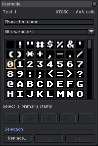 |

### Asemode: Locked layer warning

| Light | Dark |
| --- | --- |
| 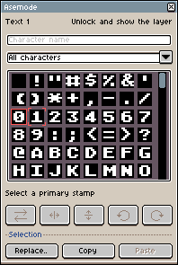 | 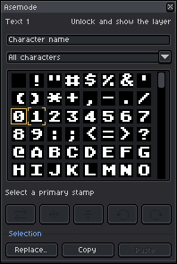 |

### Asemode: Layer unavailable

| Light | Dark |
| --- | --- |
| 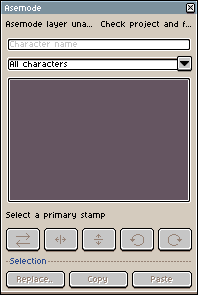 | 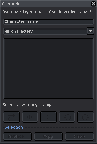 |

### Asemode: Unsupported project version

| Light | Dark |
| --- | --- |
| 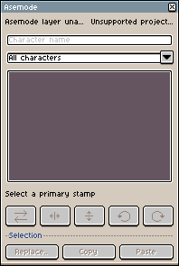 | 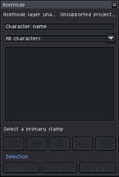 |

### Asemode: Missing primary stamp

| Light | Dark |
| --- | --- |
| 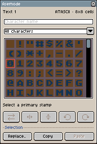 | 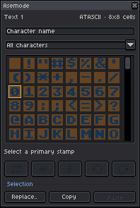 |

## About, Settings & New Sprite

Extension metadata, bundled font specimens, preferences, and new textmode document creation.

### About: Asemode tab

| Light | Dark |
| --- | --- |
| 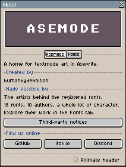 | 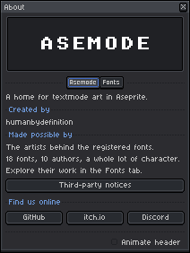 |

### About: Fonts tab

| Light | Dark |
| --- | --- |
| 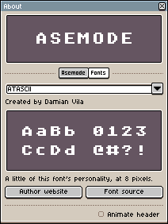 | 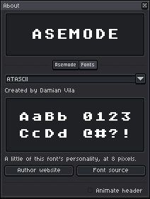 |

### About: Fonts tab (preview unavailable)

| Light | Dark |
| --- | --- |
| 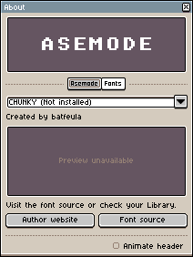 | 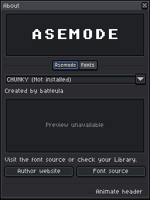 |

### Asemode Settings

| Light | Dark |
| --- | --- |
| 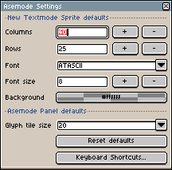 | 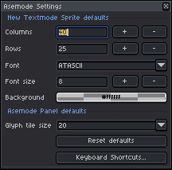 |

### New Textmode Sprite

| Light | Dark |
| --- | --- |
| 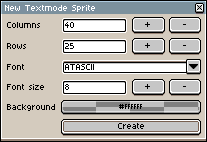 | 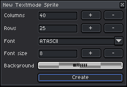 |

## Document, Grid & Export Workflows

Selection replacement, document export, cell and grid resizing, and content impact confirmations.

### Replace selection

| Light | Dark |
| --- | --- |
| 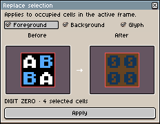 | 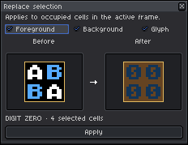 |

### Replace selection: Empty selection

| Light | Dark |
| --- | --- |
| 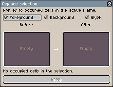 | 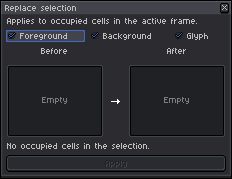 |

### Export Textmode Document

| Light | Dark |
| --- | --- |
| 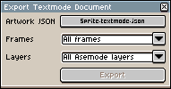 | 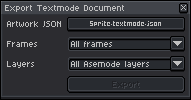 |

### Grid: Cell Size tab

| Light | Dark |
| --- | --- |
| 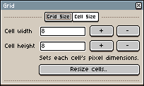 | 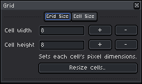 |

### Grid: Grid Size tab

| Light | Dark |
| --- | --- |
| 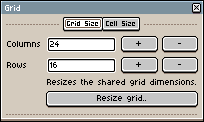 | 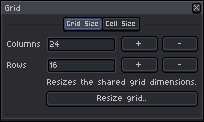 |

### Confirm regrid

| Light | Dark |
| --- | --- |
| 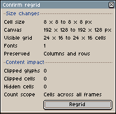 | 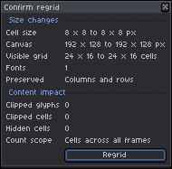 |

### Confirm regrid: Content impact warnings

| Light | Dark |
| --- | --- |
| 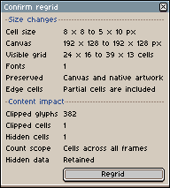 | 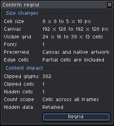 |

### Confirm canvas size

| Light | Dark |
| --- | --- |
| 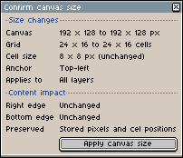 | 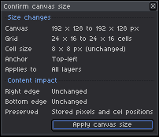 |

### Confirm canvas size: Content impact warnings

| Light | Dark |
| --- | --- |
| 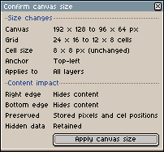 | 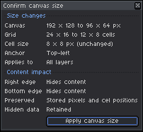 |

## Font Library, Glyph Masks & Previews

Bundled and custom user font management, TTF uploads, glyph mask building, and font metrics previews.

### Fonts: Library tab

| Light | Dark |
| --- | --- |
| 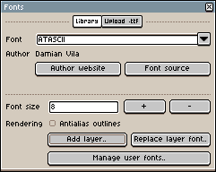 | 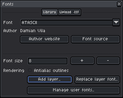 |

### Fonts: Upload .ttf tab

| Light | Dark |
| --- | --- |
| 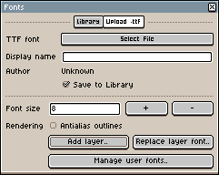 | 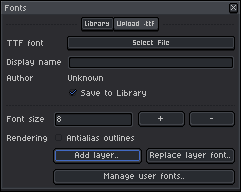 |

### Fonts: Library error state

| Light | Dark |
| --- | --- |
| 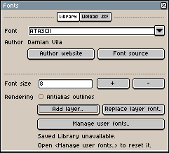 | 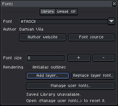 |

### Add Textmode Layer

| Light | Dark |
| --- | --- |
| 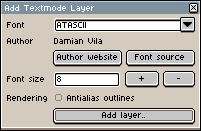 | 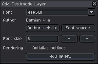 |

### Manage User Fonts

| Light | Dark |
| --- | --- |
| 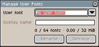 | 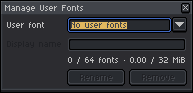 |

### Manage User Fonts: Populated

| Light | Dark |
| --- | --- |
| 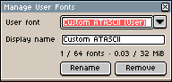 | 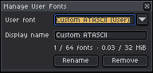 |

### Manage User Fonts: Unreadable library

| Light | Dark |
| --- | --- |
| 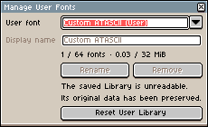 |  |

### Loading: Build Glyph Masks

| Light | Dark |
| --- | --- |
|  |  |

### Font Metrics Preview

| Light | Dark |
| --- | --- |
|  |  |

### Font Metrics Preview: Clipping and missing glyphs

| Light | Dark |
| --- | --- |
|  |  |

## Portable JSON Import & Export

Cross-project textmode JSON serialization, cooperative loading tasks, layer pagination, font recovery, and diagnostics.

### Import Textmode JSON

| Light | Dark |
| --- | --- |
|  |  |

### Loading: Read Textmode JSON

| Light | Dark |
| --- | --- |
|  |  |

### Loading: Match document fonts

| Light | Dark |
| --- | --- |
|  |  |

### Import Textmode Layers

| Light | Dark |
| --- | --- |
|  |  |

### Import Textmode Layers: Paginated and font recovery

| Light | Dark |
| --- | --- |
|  |  |

### Import Textmode Layers: Blank document

| Light | Dark |
| --- | --- |
|  |  |

### Loading: Prepare Textmode Import

| Light | Dark |
| --- | --- |
|  |  |

### Review Textmode Import

| Light | Dark |
| --- | --- |
|  |  |

### Review Textmode Import: Diagnostics and clipping

| Light | Dark |
| --- | --- |
|  |  |

### Import needs changes

| Light | Dark |
| --- | --- |
|  |  |

### Import needs changes: File read error

| Light | Dark |
| --- | --- |
|  |  |

### Loading: Prepare Textmode Export

| Light | Dark |
| --- | --- |
|  |  |

### Review Textmode Export

| Light | Dark |
| --- | --- |
|  |  |

### Review Textmode Export: Excluded layers and outside cells

| Light | Dark |
| --- | --- |
|  |  |

## Modal Alerts & Native Operation Guards

Confirmation dialogs, native Aseprite command protection, runtime error preservation, and host version checks.

### Alert: Paste cells with missing characters

| Light | Dark |
| --- | --- |
|  |  |

### Alert: Remove User Font

| Light | Dark |
| --- | --- |
|  |  |

### Alert: Reset User Library

| Light | Dark |
| --- | --- |
|  |  |

### Alert: Duplicate user font

| Light | Dark |
| --- | --- |
|  |  |

### Alert: Runtime error (artwork preserved)

| Light | Dark |
| --- | --- |
|  |  |

### Alert: Native filter blocked

| Light | Dark |
| --- | --- |
|  |  |

### Alert: Color mode change blocked

| Light | Dark |
| --- | --- |
|  |  |

### Alert: Flatten layers blocked

| Light | Dark |
| --- | --- |
|  |  |

### Alert: Convert layer blocked

| Light | Dark |
| --- | --- |
|  |  |

### Alert: Native paste blocked

| Light | Dark |
| --- | --- |
|  |  |

### Alert: Insert text blocked

| Light | Dark |
| --- | --- |
|  |  |

### Alert: Sprite size blocked

| Light | Dark |
| --- | --- |
|  |  |

### Alert: Canvas size blocked

| Light | Dark |
| --- | --- |
|  |  |

### Alert: Rotate canvas error

| Light | Dark |
| --- | --- |
|  |  |

### Alert: Preserve stamp state busy

| Light | Dark |
| --- | --- |
|  |  |

### Alert: Version requirement

| Light | Dark |
| --- | --- |
|  |  |
