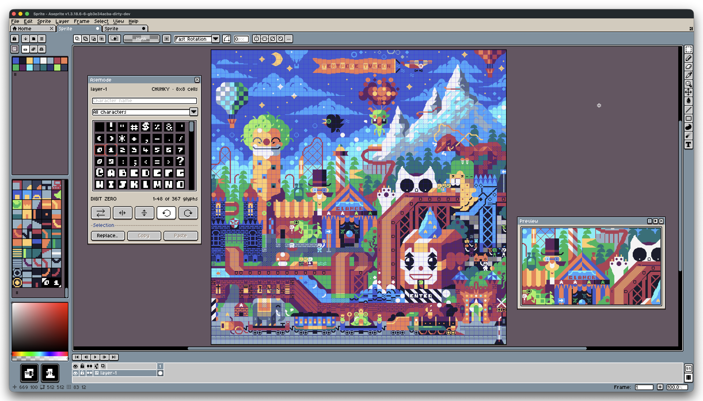

# Asemode User Guide

<div align="center">



**Native character-cell drawing, TrueType typography, and portable textmode art for Aseprite.**

[Getting Started](guide/00-getting-started.md) • [Drawing Workflow](guide/01-panel-and-drawing.md) • [Layers & Composition](guide/02-layers-and-composition.md) • [Typography System](guide/03-fonts-and-typography.md) • [Grids & Canvas](guide/04-canvas-and-grids.md) • [Portable Interchange](guide/05-portable-interchange.md) • [Safety Guards](guide/06-native-guards-and-safety.md) • [Settings & Shortcuts](guide/07-settings-and-shortcuts.md) • [Quick Reference](guide/08-quick-reference.md)

</div>

---

## Welcome to Asemode

**Asemode** is an extension for [Aseprite](https://www.aseprite.org/) that transforms the premier pixel art editor into a full-featured textmode and ANSI/ASCII character-cell creation suite. Draw with native tools, harness 18 bundled retro fonts or your own TrueType typefaces, manage independent text and pixel art layers, and exchange artwork across the [`textmode.art`](https://textmode.art) ecosystem.

### Core Architecture at a Glance

```text
┌────────────────────────────────────────────────────────────────────────┐
│                        Aseprite Workspace                              │
│                                                                        │
│   ┌───────────────────────────┐      ┌─────────────────────────────┐   │
│   │    Active RGB Canvas      │      │     Asemode Panel           │   │
│   │                           │      │                             │   │
│   │   [Textmode Tilemap]      │◄─────┤ • Primary / Secondary Stamp │   │
│   │   • Character Cells       │      │ • Ink (FG) & Cell (BG) Color│   │
│   │   • 1-Bit Font Tileset    │      │ • Stamp Flip & 90° Rotation │   │
│   │   • Dual RGBA Colors      │      │ • Unicode Glyph Browser     │   │
│   │                           │      └──────────────┬──────────────┘   │
│   │   [Pixel Art Layer]       │                     │                  │
│   │   • Sprites, Shading, FX  │                     │                  │
│   └─────────────┬─────────────┘                     │                  │
└─────────────────┼───────────────────────────────────┼──────────────────┘
                  ▼                                   ▼
       Portable Textmode JSON               TrueType (.ttf) Fonts
       • Textmode Document v4               • 18 Bundled Retro Typefaces
       • create.textmode.art                • Custom Font Rasterization
       • export.textmode.art                • Font Metrics & Clipping Guard
```

---

## Choose Your Path

Select the track that best matches your immediate creative goals:

- **New to Asemode?**
  Start with [Chapter 0: Getting Started](guide/00-getting-started.md) for step-by-step setup, installation, and painting your first 40×25 textmode canvas.
- **Looking for Drawing & Stamp Tools?**
  Explore [Chapter 1: The Asemode Panel & Drawing Workflow](guide/01-panel-and-drawing.md) to master ink and cell colors, stamp flips, rotations, and Unicode glyph search.
- **Combining Pixel Art & Text?**
  Read [Chapter 2: Multi-Layer Architecture & Composition](guide/02-layers-and-composition.md) to discover hybrid layer stacks, independent fonts per layer, cell copy/paste, and search-and-replace.
- **Working with Retro & Custom Fonts?**
  Review [Chapter 3: Fonts & Typography System](guide/03-fonts-and-typography.md) for bundled font specimens, TrueType (.ttf) imports, and font clipping diagnostics.
- **Resizing & Adjusting Dimensions?**
  Consult [Chapter 4: Canvas, Grids & Regridding](guide/04-canvas-and-grids.md) for character cell scaling, grid dimension adjustments, and content preservation.
- **Exchanging Files with the Web?**
  Check [Chapter 5: Portable Interchange & Ecosystem Integration](guide/05-portable-interchange.md) for `.textmode.json` v4 import/export with `textmode.art` tools.
- **Encountered a Warning or Blocked Command?**
  Visit [Chapter 6: Native Operation Guards & Document Integrity](guide/06-native-guards-and-safety.md) to learn why native commands are guarded and find safe alternatives.
- **Looking for Keyboard Shortcuts or Quick Lookups?**
  Jump to [Chapter 7: Settings & Shortcuts](guide/07-settings-and-shortcuts.md) and [Chapter 8: Quick Reference & Command Palette](guide/08-quick-reference.md).

---

## Complete Table of Contents

| Chapter | Title | Focus Area | Key Screenshots & Dialogs Covered |
| :---: | :--- | :--- | :--- |
| **00** | [Getting Started](guide/00-getting-started.md) | Tutorial | `new-sprite.png`, `asemode.png`, `about.png`, `alert-version-requirement.png` |
| **01** | [Panel & Drawing Workflow](guide/01-panel-and-drawing.md) | How-To / Workflow | `asemode.png`, `asemode-panel-locked.png`, `asemode-panel-unavailable.png`, `asemode-panel-missing-stamps.png` |
| **02** | [Layers & Composition](guide/02-layers-and-composition.md) | How-To / Composition | `add-layer.png`, `replace-selection.png`, `replace-selection-empty.png`, `alert-paste-missing-glyphs.png` |
| **03** | [Fonts & Typography](guide/03-fonts-and-typography.md) | How-To / Typography | `font.png`, `font-upload.png`, `about-fonts.png`, `font-metrics-preview.png`, `manage-user-fonts.png` |
| **04** | [Canvas, Grids & Regridding](guide/04-canvas-and-grids.md) | How-To / Canvas | `grid.png`, `grid-size.png`, `confirm-regrid.png`, `confirm-canvas-size.png` |
| **05** | [Portable Interchange](guide/05-portable-interchange.md) | Architecture / Interop | `import-json.png`, `export.png`, `import-layers.png`, `review-import.png`, `review-export.png` |
| **06** | [Native Operation Guards](guide/06-native-guards-and-safety.md) | Safety / Guards | `alert-native-filter.png`, `alert-native-color-mode.png`, `alert-native-flatten.png`, `alert-error-preserved.png` |
| **07** | [Settings & Customization](guide/07-settings-and-shortcuts.md) | Configuration | `settings.png` |
| **08** | [Quick Reference & FAQ](guide/08-quick-reference.md) | Reference | Command lookup matrix, keyboard shortcut map, troubleshooting FAQ |

---

## Visual Screenshot Gallery

Every dialog, warning banner, and transient loading state in Asemode has been captured in both Aseprite's default **light** and **dark** themes.

Browse the complete 59-item screenshot catalog in [`SCREENSHOTS.md`](SCREENSHOTS.md).

---

## Community & Ecosystem

- **Discord:** [Join the textmode.art Discord community](https://discord.gg/sjrw8QXNks) to share artwork, get support, and showcase projects.
- **Web Canvas:** Create and edit textmode artwork in your browser at [create.textmode.art](https://create.textmode.art/).
- **Converter:** Convert images and media to textmode JSON at [export.textmode.art](https://export.textmode.art/).
- **Code Repository:** Star, track, and contribute on [GitHub](https://github.com/humanbydefinition/Asemode).
