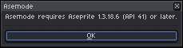
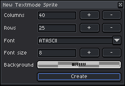
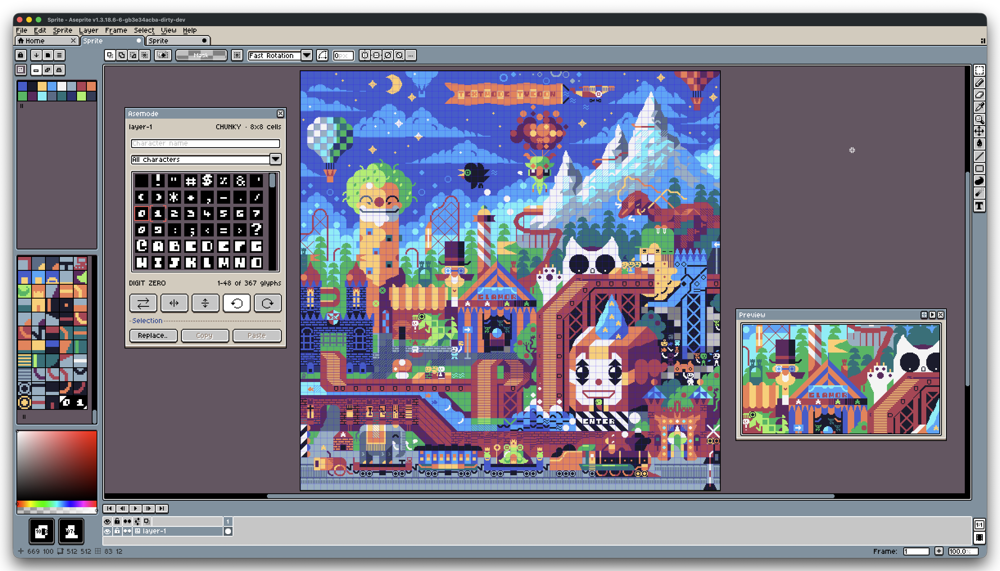

# Getting Started with Asemode

[User Guide Home](README.md) • [Next: The Asemode Panel & Drawing Workflow →](01-panel-and-drawing.md)

---

Welcome to **Asemode**, the extension that brings native character-cell and textmode art to [Aseprite](https://www.aseprite.org/). This guide walks you through system requirements, installation, and creating your very first textmode artwork from scratch.

---

## 1. System Requirements

Before installing Asemode, ensure your environment meets these specifications:

- **Aseprite Version:** Standard release of **Aseprite 1.3.18.6 or later**. Verify your version under **Help > About**.
- **Color Mode:** Asemode operates strictly on **RGB color mode** documents. Indexed and Grayscale modes are not supported due to per-cell RGBA color indexing.
- **Tile Management Conflicts:** Projects assigned to other tile-management extensions cannot be converted to Asemode layers.

> [!IMPORTANT]
> On unsupported Aseprite versions, Asemode displays a version alert and disables extension commands to protect your files:
>
> <picture>
>   <source media="(prefers-color-scheme: dark)" srcset="../images/screenshots/dark/alert-version-requirement.png">
>   <source media="(prefers-color-scheme: light)" srcset="../images/screenshots/light/alert-version-requirement.png">
>   
> </picture>

---

## 2. Installation & Permissions

1. Download the `.aseprite-extension` package from [GitHub Releases](https://github.com/humanbydefinition/Asemode/releases) or [itch.io](https://humanbydefinition.itch.io/asemode).
2. Open **Edit > Preferences... > Extensions**.
3. Click **Add Extension**, select the downloaded file, and ensure **Asemode** is enabled.
4. Click **Apply** to confirm.

> [!NOTE]
> Aseprite may request file access when loading a custom font or writing a portable JSON export. Grant access to that specific file; full script trust is not required.

---

## 3. Creating Your First Textmode Sprite

1. Choose **Sprite > Asemode > New Textmode Sprite..** (or run command `AsemodeNew`).

<picture>
  <source media="(prefers-color-scheme: dark)" srcset="../images/screenshots/dark/new-sprite.png">
  <source media="(prefers-color-scheme: light)" srcset="../images/screenshots/light/new-sprite.png">
  
</picture>

2. Configure canvas dimensions and typography:
   - **Columns / Rows:** Character cell count (defaults to `40 × 25`).
   - **Font:** Choose from 18 bundled retro fonts (e.g., `ATASCII`, `CPC464`, `UNSCII-8`).
   - **Font size:** Cell pixel dimensions (defaults to `8` for 8×8 px).
   - **Background:** Canvas fill color (defaults to transparent `#ffffff00`).
3. Click **Create**. Asemode automatically initializes an aligned tilemap layer and opens the drawing panel.

> [!TIP]
> A grid of 40 columns by 25 rows with an 8×8 font creates a 320×200 pixel canvas - matching the classic display resolution of Commodore 64, Atari 8-bit, and CGA composite displays.

---

## 4. The Textmode Workspace

- **The Canvas Grid:** Every cell snaps directly to character boundaries. Draw using standard Aseprite tools (Pencil, Line, Shapes, Bucket).
- **The Asemode Panel:** Controls your **Primary Stamp** (left-click), **Secondary Stamp** (right-click), **Ink Color** (foreground glyph), **Cell Color** (cell background), and **Glyph Browser**.

---

[User Guide Home](README.md) • [Next: The Asemode Panel & Drawing Workflow →](01-panel-and-drawing.md)
