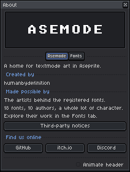
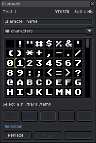

# Getting Started with Asemode

[User Guide Home](../USER_GUIDE.md) | [Next: The Asemode Panel & Drawing Workflow →](01-panel-and-drawing.md)

---

Welcome to **Asemode**, the extension that brings native character-cell and textmode art to [Aseprite](https://www.aseprite.org/). This guide walks you through system requirements, installation, and creating your very first textmode artwork from scratch.

---

## 1. System Requirements

Before installing Asemode, ensure your environment meets the following specifications:

- **Aseprite Version:** Standard release of **Aseprite 1.3.18.6 or later** (Lua API version 41 or higher).
  - You can verify your version by selecting **Help > About** inside Aseprite.
- **Color Mode:** Asemode operates strictly on **RGB color mode** documents. Indexed and Grayscale color modes are not supported for textmode layers due to per-cell RGB ink and cell color indexing requirements.
- **Tile Management Conflicts:** Projects managed by another tile-management extension cannot be converted to Asemode layers.

<picture>
  <source media="(prefers-color-scheme: dark)" srcset="../images/screenshots/dark/alert-version-requirement.png">
  <source media="(prefers-color-scheme: light)" srcset="../images/screenshots/light/alert-version-requirement.png">
  
</picture>

> [!IMPORTANT]
> If you launch Asemode on an unsupported Aseprite release, an alert dialog notifies you that version 1.3.18.6 or later is required, and plugin commands are safely disabled to protect your files.

---

## 2. Installation & Permissions

Follow these steps to install the extension package:

1. Download the latest `.aseprite-extension` package from [GitHub Releases](https://github.com/humanbydefinition/Asemode/releases) or the [Asemode itch.io page](https://humanbydefinition.itch.io/asemode).
2. Launch Aseprite and open **Edit > Preferences...** (Windows/Linux) or **Aseprite > Preferences...** (macOS).
3. In the sidebar, select **Extensions**.
4. Click **Add Extension**, select the downloaded `.aseprite-extension` file, and confirm.
5. Verify that **Asemode** appears in the list and that its checkbox is enabled.
6. Click **OK** to apply preferences.

<picture>
  <source media="(prefers-color-scheme: dark)" srcset="../images/screenshots/dark/about.png">
  <source media="(prefers-color-scheme: light)" srcset="../images/screenshots/light/about.png">
  
</picture>

> [!NOTE]
> Aseprite may display a file access prompt when you load a custom TrueType font or export a portable JSON file. Grant access to that specific file; Asemode is designed with a minimal security surface and does not require full script trust.

---

## 3. Creating Your First Textmode Sprite

Asemode documents are standard `.aseprite` files configured with dedicated textmode tilemap layers and grid metadata.

### Step 1: Open the New Textmode Sprite Dialog

From the top menu, choose **Sprite > Asemode > New Textmode Sprite..** (or use the command palette via **View > Run Command** and search for `AsemodeNew`).

<picture>
  <source media="(prefers-color-scheme: dark)" srcset="../images/screenshots/dark/new-sprite.png">
  <source media="(prefers-color-scheme: light)" srcset="../images/screenshots/light/new-sprite.png">
  
</picture>

### Step 2: Configure Canvas Dimensions and Typography

The dialog provides intuitive controls for setting your initial textmode canvas:

| Field | Description | Default Value | Notes |
| :--- | :--- | :--- | :--- |
| **Columns** | Number of horizontal character cells. | `40` | Integer between `1` and `1024`. |
| **Rows** | Number of vertical character cells. | `25` | Integer between `1` and `1024`. |
| **Font** | Bundled or user-imported font. | `atascii` | Choose from 18 bundled retro fonts. |
| **Size** | Cell pixel dimensions. | `8` (8×8 px) | Scaled automatically to font aspect ratio. |
| **Background Color** | Default canvas cell fill color. | `#ffffff00` (Transparent) | Supports RGBA hex codes or color picker. |

> [!TIP]
> A grid of 40 columns by 25 rows with an 8×8 font creates a 320×200 pixel canvas—the classic display resolution of Commodore 64, Atari 8-bit, and CGA composite displays!

### Step 3: Confirm and Initialize

Click **OK**. Asemode automatically:
1. Creates a new RGB sprite sized to `Columns * Cell Width` by `Rows * Cell Height`.
2. Sets up an Aseprite tilemap layer labeled with textmode metadata.
3. Aligns Aseprite's pixel grid with your cell dimensions.
4. Generates an initial font tileset matching the selected typeface.
5. Opens the dockable **Asemode Panel**.

---

## 4. Understanding the Workspace

Once your sprite is created, your workspace displays two primary components:

<picture>
  <source media="(prefers-color-scheme: dark)" srcset="../images/screenshots/dark/asemode.png">
  <source media="(prefers-color-scheme: light)" srcset="../images/screenshots/light/asemode.png">
  
</picture>

1. **The Canvas:** An aligned grid where each cell corresponds to exactly one character position. You draw onto this grid using Aseprite's familiar tools (Pencil, Line, Rectangle, Paint Bucket).
2. **The Asemode Panel:** A dockable or floating panel containing:
   - **Primary Stamp:** The character glyph and orientation used when drawing with your primary tool (left mouse button).
   - **Secondary Stamp:** The character glyph and orientation used for background painting or secondary drawing (right mouse button).
   - **Ink & Cell Color Wells:** Dynamic color pickers controlling foreground glyph strokes (Ink) and character cell backgrounds (Cell).
   - **Glyph Browser:** An interactive character picker with category filters and search.

---

## 5. Next Steps

Now that your workspace is set up and your first sprite is open, proceed to the drawing workflow guide:

- [Proceed to Chapter 1: The Asemode Panel & Drawing Workflow →](01-panel-and-drawing.md)
- [Jump to Chapter 3: Fonts & Typography System →](03-fonts-and-typography.md)
- [Back to User Guide Overview](../USER_GUIDE.md)
