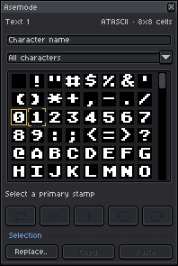

# The Asemode Panel & Drawing Workflow

[← Previous: Getting Started](00-getting-started.md) • [User Guide Home](README.md) • [Next: Multi-Layer Architecture & Composition →](02-layers-and-composition.md)

---

The **Asemode Panel** is your command center for textmode drawing. It connects Aseprite's native drawing tools with character cells, allowing you to paint glyphs, transform stamps, and browse Unicode characters seamlessly. Ink and cell colors come from Aseprite's native foreground and background colors.

Toggle the panel at any time via **Sprite > Asemode > Open/Close Asemode Panel** (Command: `AsemodePanel`).

---

## 1. Anatomy of the Panel

<picture>
  <source media="(prefers-color-scheme: dark)" srcset="../images/screenshots/dark/asemode.png">
  <source media="(prefers-color-scheme: light)" srcset="../images/screenshots/light/asemode.png">
  
</picture>

1. **Stamp Preview & Orientation:** Displays active **Primary** (left-click) and **Secondary** (right-click) stamps along with flip/rotation indicators.
2. **Ink & Cell Colors:** Use Aseprite's native color picker. The glyph uses **Foreground Color** (ink) and the cell uses **Background Color** (cell). The panel has no color wells.
3. **Stamp Transform Controls:** Quick-action buttons to swap colors, flip stamps horizontally/vertically, and rotate 90° clockwise or counter-clockwise.
4. **Interactive Glyph Browser:** Searchable character grid with Unicode block filtering.

---

## 2. Drawing with Native Aseprite Tools

- **Pencil (`B`):** Left-click paints the **Primary Stamp**; right-click paints the **Secondary Stamp**.
- **Paint Bucket (`G`):** Fills contiguous cells sharing matching glyphs or colors.
- **Line & Shapes (`L`, `U`):** Draws straight borders, hollow boxes, or filled areas using the active stamp.
- **Selection (`M`, Lasso):** Selects cell regions for copying, pasting, or search-and-replace.

> [!TIP]
> Turn on Aseprite's grid (**View > Show > Grid**) to see character boundaries as you paint.

---

## 3. The Dual Stamp & Color System

```text
Character cell
+-------+
|   A   |  A: ink color
+-------+  Surrounding area: cell color
```

- **Primary Stamp:** Bound to your primary brush action (left mouse button).
- **Secondary Stamp:** Bound to your secondary brush action (right mouse button) - ideal for shadow fills, solid blocks, or background clears.
- **Ink Color:** Comes from Aseprite's **Foreground Color**; change it in the native color picker.
- **Cell Color:** Comes from Aseprite's **Background Color**; change it in the native color picker.
- **Transparent Cells:** Set the **Background Color** alpha to `0` to let underlying pixel art or backdrop layers show through cleanly.

---

## 4. Stamp Orientation Transforms

Manipulate stamps using the panel buttons or menu commands under **Sprite > Asemode > Stamps**:

| Action | Command Identifier | Description |
| :--- | :--- | :--- |
| **Swap Colors** | `AsemodeSwapColors` | Inverts foreground and background colors. |
| **Flip Horizontal** | `AsemodeFlipHorizontal` | Mirrors glyph across the vertical axis. |
| **Flip Vertical** | `AsemodeFlipVertical` | Inverts glyph across the horizontal axis. |
| **Rotate 90° CW** | `AsemodeRotateClockwise` | Rotates the stamp 90° clockwise. |
| **Rotate 90° CCW** | `AsemodeRotateCounterclockwise` | Rotates the stamp 90° counter-clockwise. |
| **Reset Orientation**| `AsemodeResetOrientation` | Clears all rotation and flip states. |

> [!NOTE]
> All transform actions can target the **Primary Stamp**, **Secondary Stamp**, or **Both Stamps** via their respective submenus.

---

## 5. The Glyph Browser & Unicode Navigation

1. **Selecting Glyphs:** Left-click any grid cell to set the **Primary Stamp**; right-click to set the **Secondary Stamp**.
2. **Filtering by Unicode Block:** Use the category dropdown (default: `"All characters"`) to jump between blocks present in the active font (such as *Basic Latin*, *Latin-1 Supplement*, *Box Drawing*, *Block Elements*, or *Geometric Shapes*).
3. **Searching:** Type into the search field (`placeholder: "Character name"`) to filter by character name (e.g., `heart`, `arrow`, `box`) or code point (`U+2588`).

---

## 6. Panel Status Banners

When document state requires user attention, the top info area displays a contextual status banner.

| Banner Display | Status State | Recommended Action |
| :--- | :--- | :--- |
| **"Unlock and show the layer"** | Active layer is locked or hidden in the timeline. | Click the padlock or eye icon in the timeline to make it editable. |
| **"Asemode layer unavailable"** | Active layer is a raster layer or font profile is missing. | Select a Textmode layer or choose `Add Textmode Layer..`. |
| **"Unsupported project version"** | Project metadata requires a newer Asemode build. | Update Asemode to restore full editing support. |
| **"Select a primary stamp"** | Active primary stamp is missing or invalid in current font. | Click any character in the glyph grid to recreate the stamp. |

---

[← Previous: Getting Started](00-getting-started.md) • [User Guide Home](README.md) • [Next: Multi-Layer Architecture & Composition →](02-layers-and-composition.md)
