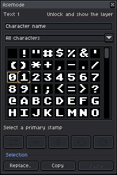
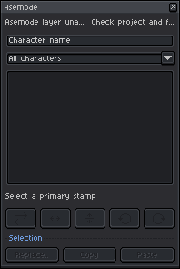
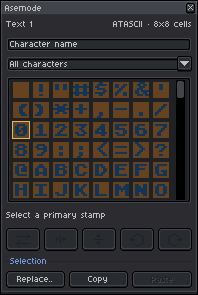
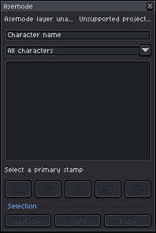

# The Asemode Panel & Drawing Workflow

[← Previous: Getting Started](00-getting-started.md) | [User Guide Home](../USER_GUIDE.md) | [Next: Multi-Layer Architecture & Composition →](02-layers-and-composition.md)

---

The **Asemode Panel** is your command center for textmode drawing. It connects Aseprite's native drawing tools directly with textmode character cells, allowing you to paint glyphs, swap ink/cell colors, rotate and flip stamps, and browse Unicode characters seamlessly.

---

## 1. Anatomy of the Asemode Panel

To open or close the panel at any time, toggle **Sprite > Asemode > Open/Close Asemode Panel** (Command: `AsemodePanel`).

<picture>
  <source media="(prefers-color-scheme: dark)" srcset="../images/screenshots/dark/asemode.png">
  <source media="(prefers-color-scheme: light)" srcset="../images/screenshots/light/asemode.png">
  
</picture>

The panel is structured into four main operational zones:

1. **Stamp Preview & Orientation Display:** Displays the currently selected Primary (left-click) and Secondary (right-click) stamps along with their active flip/rotation states.
2. **Color Wells:** Two synchronized color selectors:
   - **Ink Color:** The foreground color used to render the glyph strokes.
   - **Cell Color:** The background color filling the rectangular character cell behind the glyph.
3. **Stamp Transform Controls:** Quick-action buttons to swap colors, flip stamps horizontally or vertically, and rotate 90° clockwise or counter-clockwise.
4. **Interactive Glyph Browser:** A responsive grid displaying available characters for the active font, complete with Unicode block filtering and real-time character search.

---

## 2. Drawing with Native Aseprite Tools

Asemode turns Aseprite's standard tools into textmode brushes:

- **Pencil Tool (`B`):** Left-click paints the **Primary Stamp** into the hovered cell. Right-click paints the **Secondary Stamp**.
- **Paint Bucket Tool (`G`):** Fills contiguous cells sharing identical glyphs, ink, or background colors.
- **Line & Shape Tools (`L`, `U`):** Draws straight lines, hollow rectangles, and filled rectangles composed of the active stamp.
- **Selection Tools (`M`, `Lasso`):** Selects rectangular or arbitrary cell regions for clipboard actions or surgical replacement.

> [!TIP]
> Because textmode cells operate on a strict tile grid, drawing strokes snap directly to character boundaries. Turn on Aseprite's grid visibility (**View > Show > Grid**) to see cell borders while you paint.

---

## 3. The Dual Stamp System & Color Synchronization

Each Asemode layer supports two concurrent stamps:

- **Primary Stamp:** Bound to your primary drawing action (left-click).
- **Secondary Stamp:** Bound to your secondary drawing action (right-click). Frequently configured as a solid fill block (`█`), space glyph (` `), or shadow hatch pattern (`░`).

### Ink vs. Cell Colors

Unlike standard bitmap painting where each pixel holds one RGBA value, textmode cells have two independent color channels:

```text
┌─────────────────────────┐
│ Cell Background Color   │
│   ┌─────────────────┐   │
│   │  Ink Glyph (█)  │   │
│   │                 │   │
│   └─────────────────┘   │
└─────────────────────────┘
```

1. **Ink Color (Foreground):** Automatically synchronizes with Aseprite's native palette Foreground Color.
2. **Cell Color (Background):** Synchronizes with Aseprite's native palette Background Color.
3. **Transparent Cells:** Set the Cell Color opacity to `0` (or choose transparent in the palette) to create transparent-background text layers that overlay cleanly on top of pixel art or background illustrations.

---

## 4. Stamp Orientation Transforms

Asemode lets you manipulate stamps dynamically using the panel controls or menu commands:

| Action | Menu Path | Command Identifier | Description |
| :--- | :--- | :--- | :--- |
| **Swap Colors** | `Sprite > Asemode > Stamps > Swap Ink and Cell Colors` | `AsemodeSwapColors` | Inverts foreground and background colors. |
| **Flip Horizontal** | `Sprite > Asemode > Stamps > Flip Horizontally` | `AsemodeFlipHorizontal` | Mirrors glyph across the vertical axis. |
| **Flip Vertical** | `Sprite > Asemode > Stamps > Flip Vertically` | `AsemodeFlipVertical` | Inverts glyph across the horizontal axis. |
| **Rotate 90° CW** | `Sprite > Asemode > Stamps > Rotate 90° Clockwise` | `AsemodeRotateClockwise` | Rotates the active stamp 90 degrees clockwise. |
| **Rotate 90° CCW** | `Sprite > Asemode > Stamps > Rotate 90° Counterclockwise` | `AsemodeRotateCounterclockwise` | Rotates 90 degrees counter-clockwise. |
| **Reset Orientation**| `Sprite > Asemode > Stamps > Reset Orientation` | `AsemodeResetOrientation` | Clears all rotation and flip transformations. |

> [!NOTE]
> All transform actions can target the **Primary Stamp**, the **Secondary Stamp**, or **Both Stamps** simultaneously by choosing the corresponding submenu under `Sprite > Asemode > Stamps`.

---

## 5. The Glyph Browser & Unicode Navigation

The lower portion of the Asemode panel features a character-cell picker:

1. **Selecting a Character:** Left-click any cell to assign it as the **Primary Stamp**. Right-click to assign it as the **Secondary Stamp**.
2. **Filtering by Unicode Block:** Use the category dropdown to jump directly between standard blocks:
   - *Basic Latin (ASCII)*
   - *Latin-1 Supplement*
   - *Box Drawing* (classic single/double border connectors)
   - *Block Elements* (quarter, half, and shaded tiles)
   - *Geometric Shapes*
   - *Symbols & Arrows*
3. **Searching by Name or Code Point:** Enter text in the search input (e.g., `heart`, `arrow`, `block`, or `U+2588`) to instantly filter matching glyphs.

---

## 6. Understanding Panel Status Banners

When document state changes or constraints are encountered, the Asemode panel displays context-aware warning banners:

### Locked Layer Warning
When the active layer is locked in Aseprite's timeline, the panel disables drawing controls and informs you:

<picture>
  <source media="(prefers-color-scheme: dark)" srcset="../images/screenshots/dark/asemode-panel-locked.png">
  <source media="(prefers-color-scheme: light)" srcset="../images/screenshots/light/asemode-panel-locked.png">
  
</picture>

*Resolution:* Unlock the layer in the Aseprite timeline by clicking the padlock icon.

---

### Layer Unavailable Warning
If your active layer is an ordinary raster image layer or an unsupported format, the panel displays a banner explaining that textmode operations are disabled for that layer:

<picture>
  <source media="(prefers-color-scheme: dark)" srcset="../images/screenshots/dark/asemode-panel-unavailable.png">
  <source media="(prefers-color-scheme: light)" srcset="../images/screenshots/light/asemode-panel-unavailable.png">
  
</picture>

*Resolution:* Select an existing Textmode layer in the timeline, or create one via **Sprite > Asemode > Add Textmode Layer..**.

---

### Missing Primary Stamp Warning
If a stamp glyph reference becomes invalidated (for instance, after switching to a font that does not contain that character):

<picture>
  <source media="(prefers-color-scheme: dark)" srcset="../images/screenshots/dark/asemode-panel-missing-stamps.png">
  <source media="(prefers-color-scheme: light)" srcset="../images/screenshots/light/asemode-panel-missing-stamps.png">
  
</picture>

*Resolution:* Click any valid character in the glyph browser grid to regenerate your active stamp.

---

### Unsupported Project Version Warning
If you open a project created with an incompatible or newer version of the Asemode data schema:

<picture>
  <source media="(prefers-color-scheme: dark)" srcset="../images/screenshots/dark/asemode-panel-unsupported-version.png">
  <source media="(prefers-color-scheme: light)" srcset="../images/screenshots/light/asemode-panel-unsupported-version.png">
  
</picture>

*Resolution:* Upgrade Asemode to the latest release to restore full editing capabilities.

---

## 7. Next Steps

- [Proceed to Chapter 2: Multi-Layer Architecture & Composition →](02-layers-and-composition.md)
- [Jump to Chapter 3: Fonts & Typography System →](03-fonts-and-typography.md)
- [Back to User Guide Overview](../USER_GUIDE.md)
