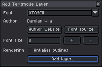
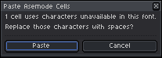
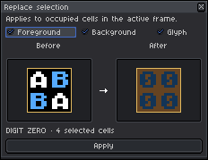

# Multi-Layer Architecture & Composition

[← Previous: The Asemode Panel & Drawing Workflow](01-panel-and-drawing.md) • [User Guide Home](README.md) • [Next: Fonts & Typography System →](03-fonts-and-typography.md)

---

Asemode features a **hybrid layer architecture**, allowing you to combine standard Aseprite pixel art layers, animation frames, and multiple textmode layers - each with its own independent typography, opacity, and blending mode.

---

## 1. Adding Textmode Layers

Add new textmode layers to any RGB sprite at any time via **Sprite > Asemode > Add Textmode Layer..** (Command: `AsemodeLayer`).

<picture>
  <source media="(prefers-color-scheme: dark)" srcset="../images/screenshots/dark/add-layer.png">
  <source media="(prefers-color-scheme: light)" srcset="../images/screenshots/light/add-layer.png">
  
</picture>

- **Font:** Choose any bundled retro font or installed user font. Each textmode layer can use a different typeface.
- **Font size:** Sets the pixel cell height for the new layer.
- **Rendering:** Check **Antialias outlines** if desired.
- **Action:** Click **Add layer** (or **Replace layer** to update the active text layer with the chosen font).

---

## 2. Hybrid Compositions: Mixing Pixel Art and Textmode

Asemode layers integrate seamlessly with Aseprite's timeline:

```text
Layer Stack Hierarchy:
┌───────────────────────────────────────────────┐
│ [Textmode Layer] "UI_HUD"       (Font: unscii)│
├───────────────────────────────────────────────┤
│ [Raster Layer]   "Character"    (Pixel Art)   │
├───────────────────────────────────────────────┤
│ [Textmode Layer] "Backdrop"     (Font: t64)   │
├───────────────────────────────────────────────┤
│ [Raster Layer]   "Background_Gradient"        │
└───────────────────────────────────────────────┘
```

- **Layer Ordering & Opacity:** Drag layers in the timeline to place text above or below pixel art. Adjust layer opacity sliders to create subtle shaded or translucent text effects.
- **Blending Modes:** Multiply, Screen, Overlay, and Addition blend modes work as expected with textmode layers.
- **Transparent Cells:** With cell background alpha at `0`, only glyph strokes are rendered, allowing underlying raster layers to show through cleanly.

---

## 3. Cell-Aware Clipboard: Copy & Paste

Standard clipboard paste (`Ctrl+V` / `Cmd+V`) injects raw pixel bitmaps, which disrupts character cell mappings. To move textmode artwork cleanly, use Asemode's cell-aware clipboard:

1. **Copy Cells:** Select an area with the Rectangular Marquee (`M`) or Lasso and choose **Sprite > Asemode > Selection > Copy** (Command: `AsemodeCopyCells`).
2. **Paste Cells:** Move to the destination coordinate or switch layers and choose **Sprite > Asemode > Selection > Paste** (Command: `AsemodePasteCells`). Cells snap cleanly to grid boundaries with character identities and colors intact.

### Missing Glyph Warnings
If pasted cells contain characters not supported by the destination layer's font, Asemode prompts you before proceeding:

> [!WARNING]
> Missing characters will be replaced by fallback glyphs (such as spaces). Review target font compatibility before confirming:
>
> <picture>
>   <source media="(prefers-color-scheme: dark)" srcset="../images/screenshots/dark/alert-paste-missing-glyphs.png">
>   <source media="(prefers-color-scheme: light)" srcset="../images/screenshots/light/alert-paste-missing-glyphs.png">
>   
> </picture>

---

## 4. Replacing Attributes in Selections

The **Replace selection** tool (`Sprite > Asemode > Selection > Replace..`, Command: `AsemodeReplace`) applies current stamp attributes to occupied cells in the active frame:

1. Make a selection box (or press `Ctrl+A` / `Cmd+A` to select the entire layer).
2. Choose **Sprite > Asemode > Selection > Replace..**.

<picture>
  <source media="(prefers-color-scheme: dark)" srcset="../images/screenshots/dark/replace-selection.png">
  <source media="(prefers-color-scheme: light)" srcset="../images/screenshots/light/replace-selection.png">
  
</picture>

Select which attributes to apply:
- **Foreground:** Replaces the ink color of selected cells with the active foreground color.
- **Background:** Replaces the cell fill color of selected cells with the active background color.
- **Glyph:** Replaces the character glyph and stamp orientation of selected cells with the active primary stamp.

Click **Apply** to confirm.

> [!NOTE]
> If no marquee selection is active when launching Replace, the Apply button remains disabled until you make a selection or press `Ctrl+A` to target the full layer.

---

[← Previous: The Asemode Panel & Drawing Workflow](01-panel-and-drawing.md) • [User Guide Home](README.md) • [Next: Fonts & Typography System →](03-fonts-and-typography.md)
