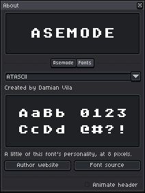
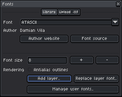
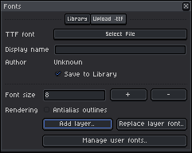
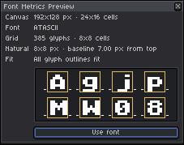
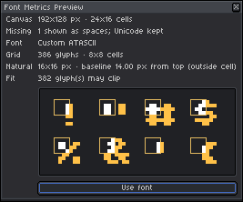
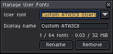

# Fonts & Typography System

[← Previous: Multi-Layer Architecture & Composition](02-layers-and-composition.md) • [User Guide Home](README.md) • [Next: Canvas, Grids & Regridding →](04-canvas-and-grids.md)

---

Typography is the core visual engine of textmode art. Asemode pairs **18 bundled retro pixel typefaces** with an extensible **TrueType font importer**, allowing you to bring classic or custom typefaces into your artwork.

---

## 1. Bundled Retro Font Catalog

Asemode comes pre-packaged with curated pixel fonts representing retro computing platforms and modern textmode art:

| Font Identifier | Display Name | Native Cell Size |
| :--- | :--- | :--- |
| `atascii` | ATASCII | 8×8 px |
| `bescii` | BESCII | 8×8 px |
| `chunky` | CHUNKY | 8×8 px |
| `cpc464` | CPC464 | 8×8 px |
| `cultist-script` | Cultist Script | 8×8 px |
| `dungeon-mode` | DUNGEON.mode | 8×8 px |
| `frogblock` | FROGBLOCK | 8×8 px |
| `ibm-cga` | IBM CGA | 8×8 px |
| `kitchen-sink` | Kitchen Sink | 6×8 px |
| `mycelium-og` | Mycelium OG | 8×8 px |
| `rook` | Rook | 8×8 px |
| `t64` | T64 | 8×8 px |
| `unscii-8` | UNSCII 8 | 8×8 px |
| `unscii-8-alt` | UNSCII 8 Alt | 8×8 px |
| `unscii-8-fantasy` | UNSCII 8 Fantasy | 8×8 px |
| `unscii-8-mcr` | UNSCII 8 MCR | 8×8 px |
| `unscii-8-thin` | UNSCII 8 Thin | 8×8 px |
| `ursafont` | UrsaFont | 8×8 px |

### Font Specimens & Licenses
Inspect character specimens, author attributions, and licenses for any font under **Sprite > Asemode > About..** on the **Fonts** tab:

<picture>
  <source media="(prefers-color-scheme: dark)" srcset="../images/screenshots/dark/about-fonts.png">
  <source media="(prefers-color-scheme: light)" srcset="../images/screenshots/light/about-fonts.png">
  
</picture>

---

## 2. Managing Fonts

Open the font manager via **Sprite > Asemode > Fonts..** (Command: `AsemodeFont`).

<picture>
  <source media="(prefers-color-scheme: dark)" srcset="../images/screenshots/dark/font.png">
  <source media="(prefers-color-scheme: light)" srcset="../images/screenshots/light/font.png">
  
</picture>

The **Library** tab lists all registered fonts, their cell dimensions, origin (`bundled` or `user`), and quick actions to apply them to your active layer.

---

## 3. Importing Custom TrueType (.ttf) Fonts

Asemode rasterizes static TrueType vector fonts into 1-bit pixel masks suitable for character cells:

1. In the Fonts dialog, switch to the **Upload .ttf** tab.

<picture>
  <source media="(prefers-color-scheme: dark)" srcset="../images/screenshots/dark/font-upload.png">
  <source media="(prefers-color-scheme: light)" srcset="../images/screenshots/light/font-upload.png">
  
</picture>

2. Choose a `.ttf` file using the **TTF font** file picker.
3. Configure font properties and rasterization parameters:
   - **Display name:** Enter an identifier for the font.
   - **Save to Library:** Keep checked to persist the font in your user font catalog.
   - **Font size:** Target pixel height (typically `8`, `12`, `16`, or `24` px).
   - **Rendering:** Toggle **Antialias outlines** if desired.
4. Click **Add layer** to compile the font and open the metrics preview.

---

## 4. Font Metrics Preview & Clipping Diagnostics

Before finalizing an import, Asemode analyzes character cell bounds and displays the **Font Metrics Preview**:

<picture>
  <source media="(prefers-color-scheme: dark)" srcset="../images/screenshots/dark/font-metrics-preview.png">
  <source media="(prefers-color-scheme: light)" srcset="../images/screenshots/light/font-metrics-preview.png">
  
</picture>

### Resolving Clipping Warnings
If a glyph's outline bounds extend beyond its cell, the preview shows pixels outside the cell in orange. The preview shows up to eight glyphs, with glyphs that may clip first. The **Fit** count covers the full font job, not only the sample.

<picture>
  <source media="(prefers-color-scheme: dark)" srcset="../images/screenshots/dark/font-metrics-preview-clipping.png">
  <source media="(prefers-color-scheme: light)" srcset="../images/screenshots/light/font-metrics-preview-clipping.png">
  
</picture>

> [!WARNING]
> If visible glyph pixels extend outside the cell, the canvas crops them. To reduce clipping, close the preview and choose a smaller font size. An existing document uses its current grid cell dimensions; change the grid if larger cells are needed.

---

## 5. User Font Management

Click **Manage user fonts..** in the Fonts dialog to view your saved user fonts, rename one, or remove it from the local Library:

<picture>
  <source media="(prefers-color-scheme: dark)" srcset="../images/screenshots/dark/manage-user-fonts-populated.png">
  <source media="(prefers-color-scheme: light)" srcset="../images/screenshots/light/manage-user-fonts-populated.png">
  
</picture>

Select a font from **User font** to edit its **Display name**, then click **Rename** to save the new name. Click **Remove** and confirm to remove the font from the local Library. This does not remove font data already embedded in existing sprites or the original font file.

If the saved Library cannot be read, the dialog offers **Reset User Library**; reset discards the unreadable Library data.

---

[← Previous: Multi-Layer Architecture & Composition](02-layers-and-composition.md) • [User Guide Home](README.md) • [Next: Canvas, Grids & Regridding →](04-canvas-and-grids.md)
