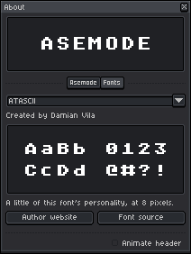
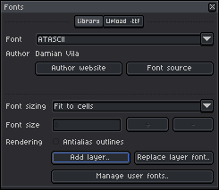
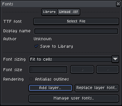
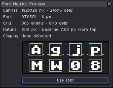
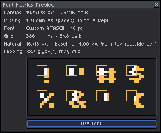
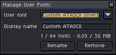

# Fonts & Typography System

[← Previous: Multi-Layer Architecture & Composition](02-layers-and-composition.md) • [User Guide Home](README.md) • [Next: Canvas, Grids & Regridding →](04-canvas-and-grids.md)

---

Typography is the core visual engine of textmode art. Asemode pairs **18 bundled retro pixel typefaces** with an extensible **TrueType font importer**, allowing you to bring classic or custom typefaces into your artwork.

---

## 1. Bundled Retro Font Catalog

Asemode comes pre-packaged with curated pixel fonts representing retro computing platforms and modern textmode art:

| Font Identifier | Display Name | Native Cell Size |
| :--- | :--- | :--- |
| `atascii` | ATASCII | 8×8 px |
| `bescii` | BESCII | 8×8 px |
| `chunky` | CHUNKY | 8×8 px |
| `cpc464` | CPC464 | 8×8 px |
| `cultist-script` | Cultist Script | 8×8 px |
| `dungeon-mode` | DUNGEON.mode | 8×8 px |
| `frogblock` | FROGBLOCK | 8×8 px |
| `ibm-cga` | IBM CGA | 8×8 px |
| `kitchen-sink` | Kitchen Sink | 6×8 px |
| `mycelium-og` | Mycelium OG | 8×8 px |
| `rook` | Rook | 8×8 px |
| `t64` | T64 | 8×8 px |
| `unscii-8` | UNSCII 8 | 8×8 px |
| `unscii-8-alt` | UNSCII 8 Alt | 8×8 px |
| `unscii-8-fantasy` | UNSCII 8 Fantasy | 8×8 px |
| `unscii-8-mcr` | UNSCII 8 MCR | 8×8 px |
| `unscii-8-thin` | UNSCII 8 Thin | 8×8 px |
| `ursafont` | UrsaFont | 8×8 px |

Use the native dimensions or matching whole-number multiples for the font’s cell size.

### Font Specimens & Licenses
Inspect character specimens, author attributions, and licenses for any font under **Sprite > Asemode > About..** on the **Fonts** tab:

<picture>
  <source media="(prefers-color-scheme: dark)" srcset="../images/screenshots/dark/about-fonts.png">
  <source media="(prefers-color-scheme: light)" srcset="../images/screenshots/light/about-fonts.png">
  
</picture>

---

## 2. Managing Fonts

Open the font manager via **Sprite > Asemode > Fonts..** (Command: `AsemodeFont`).

<picture>
  <source media="(prefers-color-scheme: dark)" srcset="../images/screenshots/dark/font.png">
  <source media="(prefers-color-scheme: light)" srcset="../images/screenshots/light/font.png">
  
</picture>

The **Library** tab lists registered bundled and user fonts. Select a font to see its author and available source links, then add a layer or replace the active layer's font.

When you add a layer to an Asemode document or replace a layer's font, the document's cell dimensions stay the same. **Fit to cells** selects a font size for those dimensions without stretching the font. It starts with the current layer's font size when replacing a font, or the cell height when adding a layer. It reduces the size only if the layer's characters would extend outside their cells. For a new or empty layer, it checks common characters instead.

Select **Custom** to choose the font size yourself. The preview reports the selected size, missing characters, and any outlines that may be clipped, including characters outside the fit check. If the font needs larger or differently shaped cells, open **Sprite > Asemode > Grid..** and select **Cell Size**. Changing cell size affects the document's textmode layers and requires a separate preview and confirmation.

---

## 3. Importing Custom TrueType (.ttf) Fonts

Asemode rasterizes static TrueType vector fonts into 1-bit pixel masks suitable for character cells:

1. In the Fonts dialog, switch to the **Upload .ttf** tab.

<picture>
  <source media="(prefers-color-scheme: dark)" srcset="../images/screenshots/dark/font-upload.png">
  <source media="(prefers-color-scheme: light)" srcset="../images/screenshots/light/font-upload.png">
  
</picture>

2. Choose a `.ttf` file using the **TTF font** file picker.
3. Configure font properties and rasterization parameters. Scroll down in the dialog if the sizing and action controls are not visible:
   - **Display name:** Enter an identifier for the font.
   - **Save to Library:** Keep checked to persist the font in your user font catalog.
   - **Font sizing:** For an existing Asemode document, use **Fit to cells** or select **Custom** to choose a font size. For an ordinary RGB sprite, choose a font size and automatic or custom cell dimensions.
   - **Rendering:** Toggle **Antialias outlines** if desired.
4. Click **Add layer** to compile the font and open the metrics preview.

---

## 4. Font Metrics Preview & Clipping Diagnostics

Before finalizing an import, Asemode analyzes character cell bounds and displays the **Font Metrics Preview**:

<picture>
  <source media="(prefers-color-scheme: dark)" srcset="../images/screenshots/dark/font-metrics-preview.png">
  <source media="(prefers-color-scheme: light)" srcset="../images/screenshots/light/font-metrics-preview.png">
  
</picture>

### Resolving Clipping Warnings
If a glyph's outline bounds extend beyond its cell, the preview shows pixels outside the cell in orange. The preview shows up to eight glyphs, with glyphs that may clip first. The **Clipping** count covers the full font job, not only the sample. When relevant, it also indicates whether glyphs already used on the layer may clip.

<picture>
  <source media="(prefers-color-scheme: dark)" srcset="../images/screenshots/dark/font-metrics-preview-clipping.png">
  <source media="(prefers-color-scheme: light)" srcset="../images/screenshots/light/font-metrics-preview-clipping.png">
  
</picture>

> [!WARNING]
> If visible glyph pixels extend outside the cell, the canvas crops them. Outline bounds can extend outside a cell even when no visible pixels are cropped. To reduce clipping, close the preview and choose a smaller custom font size, or change the document's cell dimensions. Fitting cannot supply characters that are missing from the font.

---

## 5. User Font Management

Click **Manage user fonts..** in the Fonts dialog to view your saved user fonts, rename one, or remove it from the local Library:

<picture>
  <source media="(prefers-color-scheme: dark)" srcset="../images/screenshots/dark/manage-user-fonts-populated.png">
  <source media="(prefers-color-scheme: light)" srcset="../images/screenshots/light/manage-user-fonts-populated.png">
  
</picture>

Select a font from **User font** to edit its **Display name**, then click **Rename** to save the new name. Click **Remove** and confirm to remove the font from the local Library. This does not remove font data already embedded in existing sprites or the original font file.

If the saved Library cannot be read, the dialog offers **Reset User Library**; reset discards the unreadable Library data.

---

[← Previous: Multi-Layer Architecture & Composition](02-layers-and-composition.md) • [User Guide Home](README.md) • [Next: Canvas, Grids & Regridding →](04-canvas-and-grids.md)
