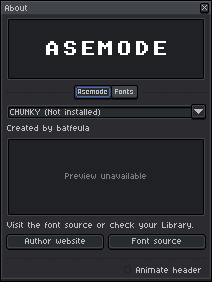
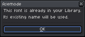
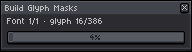
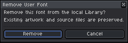
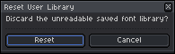
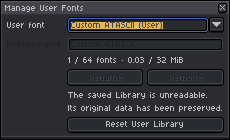
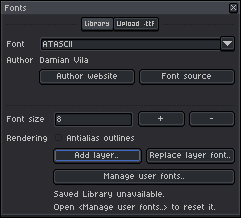

# Fonts & Typography System

[← Previous: Multi-Layer Architecture & Composition](02-layers-and-composition.md) | [User Guide Home](../USER_GUIDE.md) | [Next: Canvas, Grids & Regridding →](04-canvas-and-grids.md)

---

Typography is the core visual engine of textmode art. Asemode features a robust font subsystem that pairs **18 bundled retro pixel typefaces** with an extensible **TrueType font importer**, allowing you to bring modern or classic TTF fonts into your Aseprite workflow.

---

## 1. Bundled Retro Font Catalog

Asemode comes pre-packaged with curated bitmap fonts representing computing history and textmode culture.

| Font Identifier | Display Name | Cell Size | Vintage Origin / Aesthetic |
| :--- | :--- | :--- | :--- |
| `atascii` | ATASCII | 8×8 | Atari 8-bit home computers (400/800/XL/XE). |
| `bescii` | Bescii Mono | 8×8 | BESCII textmode standard. |
| `cpc464` | Amstrad CPC 464 | 8×8 | Classic British 1980s 8-bit microcomputer. |
| `dungeonmode` | Dungeon Mode | 8×8 | Roguelike fantasy symbols and gothic runes. |
| `rook` | Rook | 8×8 | Minimalist geometric bitmap font. |
| `t64` | T64 | 8×8 | Commodore 64 / PETSCII-inspired character set. |
| `ursafont` | UrsaFont | 8×8 | Stylized arcade bitmap font. |
| `unscii-8` | Unscii Standard | 8×8 | Comprehensive Unicode block and box drawing font. |
| `unscii-8-thin` | Unscii Thin | 8×8 | Lightweight delicate strokes for high density. |
| `unscii-8-alt` | Unscii Alternate | 8×8 | Alternate stylized glyph variants. |
| `unscii-8-mcr` | Unscii Micro | 8×8 | Dense technical computing character set. |
| `unscii-8-fantasy`| Unscii Fantasy | 8×8 | Ornate decorative lettering. |

### Inspecting Bundled Fonts & Licenses
To view specimens, author attribution, and open-source licenses for any bundled font, open **Sprite > Asemode > About..** and select the **Fonts** tab:

<picture>
  <source media="(prefers-color-scheme: dark)" srcset="../images/screenshots/dark/about-fonts.png">
  <source media="(prefers-color-scheme: light)" srcset="../images/screenshots/light/about-fonts.png">
  
</picture>

*(If font resources cannot be rendered due to sandbox restrictions, an informational fallback notice is shown).*

<picture>
  <source media="(prefers-color-scheme: dark)" srcset="../images/screenshots/dark/about-fonts-unavailable.png">
  <source media="(prefers-color-scheme: light)" srcset="../images/screenshots/light/about-fonts-unavailable.png">
  
</picture>

---

## 2. The Fonts Dialog & Library

Open the font manager at any time via **Sprite > Asemode > Fonts..** (Command: `AsemodeFont`).

<picture>
  <source media="(prefers-color-scheme: dark)" srcset="../images/screenshots/dark/font.png">
  <source media="(prefers-color-scheme: light)" srcset="../images/screenshots/light/font.png">
  
</picture>

The **Library** tab displays all registered fonts, their cell dimensions, origin (`bundled` or `user`), and quick actions to apply them to your active layer.

---

## 3. Importing Custom TrueType (.ttf) Fonts

Asemode can rasterize static TrueType vector fonts into 1-bit pixel masks suitable for character cells.

### Step 1: Open the Upload Tab
In the Fonts dialog, switch to the **Upload .ttf** tab:

<picture>
  <source media="(prefers-color-scheme: dark)" srcset="../images/screenshots/dark/font-upload.png">
  <source media="(prefers-color-scheme: light)" srcset="../images/screenshots/light/font-upload.png">
  
</picture>

### Step 2: Configure Rasterization Parameters
- **Select File:** Browse your computer for any `.ttf` font file.
- **Font Size (px):** Set the target pixel height (typically `8`, `12`, `16`, or `24`).
- **Baseline Offset:** Adjust vertical alignment within the cell box.
- **Duplicate Detection:** If you upload a font with an existing identity or identical file hash, Asemode prompts you to confirm replacement:

<picture>
  <source media="(prefers-color-scheme: dark)" srcset="../images/screenshots/dark/alert-duplicate-user-font.png">
  <source media="(prefers-color-scheme: light)" srcset="../images/screenshots/light/alert-duplicate-user-font.png">
  
</picture>

### Step 3: Mask Generation Progress
When you submit the font, Asemode executes a cooperative background task to generate 1-bit glyph masks without freezing Aseprite's UI:

<picture>
  <source media="(prefers-color-scheme: dark)" srcset="../images/screenshots/dark/loading-build-glyph-masks.png">
  <source media="(prefers-color-scheme: light)" srcset="../images/screenshots/light/loading-build-glyph-masks.png">
  
</picture>

---

## 4. Font Metrics Preview & Clipping Diagnostics

Before finalizing a font import, Asemode validates character cell bounds and displays the **Font Metrics Preview**:

<picture>
  <source media="(prefers-color-scheme: dark)" srcset="../images/screenshots/dark/font-metrics-preview.png">
  <source media="(prefers-color-scheme: light)" srcset="../images/screenshots/light/font-metrics-preview.png">
  
</picture>

### Clipping Warnings
If characters in the TTF font extend beyond the configured cell bounds (such as descenders in `g`, `j`, `p`, `q`, `y` or tall accents in `Â`, `Ê`, `Î`), Asemode flags the clipping:

<picture>
  <source media="(prefers-color-scheme: dark)" srcset="../images/screenshots/dark/font-metrics-preview-clipping.png">
  <source media="(prefers-color-scheme: light)" srcset="../images/screenshots/light/font-metrics-preview-clipping.png">
  
</picture>

> [!WARNING]
> Clipped glyphs will have their outer pixels cropped when drawn on the canvas. If you see clipping warnings, increase the font's cell size or adjust the baseline offset before accepting the font.

---

## 5. Managing User Fonts & Library Maintenance

Click **Manage User Fonts** in the Fonts dialog to view, audit, and remove custom typefaces:

<picture>
  <source media="(prefers-color-scheme: dark)" srcset="../images/screenshots/dark/manage-user-fonts-populated.png">
  <source media="(prefers-color-scheme: light)" srcset="../images/screenshots/light/manage-user-fonts-populated.png">
  
</picture>

### Removing User Fonts
Selecting **Delete** opens a confirmation dialog warning that active layers referencing this font will fall back to default typography:

<picture>
  <source media="(prefers-color-scheme: dark)" srcset="../images/screenshots/dark/alert-remove-user-font.png">
  <source media="(prefers-color-scheme: light)" srcset="../images/screenshots/light/alert-remove-user-font.png">
  
</picture>

### Resetting the User Library
If your preferences or font cache become damaged, you can reset all custom fonts back to factory defaults:

<picture>
  <source media="(prefers-color-scheme: dark)" srcset="../images/screenshots/dark/alert-reset-user-library.png">
  <source media="(prefers-color-scheme: light)" srcset="../images/screenshots/light/alert-reset-user-library.png">
  
</picture>

### Troubleshooting Unreadable Libraries
If a font file is corrupted or unreadable, Asemode displays diagnostic error states instead of crashing:

<picture>
  <source media="(prefers-color-scheme: dark)" srcset="../images/screenshots/dark/manage-user-fonts-corrupt.png">
  <source media="(prefers-color-scheme: light)" srcset="../images/screenshots/light/manage-user-fonts-corrupt.png">
  
</picture>

<picture>
  <source media="(prefers-color-scheme: dark)" srcset="../images/screenshots/dark/font-library-error.png">
  <source media="(prefers-color-scheme: light)" srcset="../images/screenshots/light/font-library-error.png">
  
</picture>

*Resolution:* Delete the corrupted font from the library and re-import the original `.ttf` file.

---

## 6. Next Steps

- [Proceed to Chapter 4: Canvas, Grids & Regridding →](04-canvas-and-grids.md)
- [Jump to Chapter 5: Portable Interchange & Ecosystem Integration →](05-portable-interchange.md)
- [Back to User Guide Overview](../USER_GUIDE.md)
