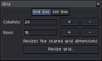
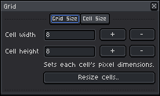
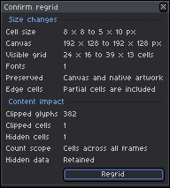
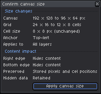

# Canvas, Grids & Regridding

[← Previous: Fonts & Typography System](03-fonts-and-typography.md) • [User Guide Home](README.md) • [Next: Portable Interchange & Ecosystem Integration →](05-portable-interchange.md)

---

In textmode art, document dimensions are measured in **character cells** rather than raw pixels. Asemode manages the mathematical relationship between character columns/rows, cell pixel sizes, and the underlying Aseprite canvas.

---

## 1. Understanding Textmode Coordinates

$$\text{Canvas Width (px)} = \text{Columns} \times \text{Cell Width (px)}$$
$$\text{Canvas Height (px)} = \text{Rows} \times \text{Cell Height (px)}$$

Because each tile in Aseprite's tilemap corresponds directly to one character cell, arbitrary pixel resizing can break grid alignment. To resize your artwork safely, always use Asemode's **Grid** command.

---

## 2. The Grid Configuration Dialog

To adjust your grid or cell dimensions, open **Sprite > Asemode > Grid..** (Command: `AsemodeRegrid`).

### Tab 1: Grid Size
Expand or contract the number of character columns and rows:

<picture>
  <source media="(prefers-color-scheme: dark)" srcset="../images/screenshots/dark/grid-size.png">
  <source media="(prefers-color-scheme: light)" srcset="../images/screenshots/light/grid-size.png">
  
</picture>

- **Columns & Rows:** Set new grid dimensions (e.g., expand from 40 to 80 columns). Existing artwork anchors to the top-left.
- Click **Resize grid..** to preview changes in the **Confirm canvas size** dialog.

### Tab 2: Cell Size
Adjust the pixel width and height of each character cell:

<picture>
  <source media="(prefers-color-scheme: dark)" srcset="../images/screenshots/dark/grid.png">
  <source media="(prefers-color-scheme: light)" srcset="../images/screenshots/light/grid.png">
  
</picture>

- **Cell width & Cell height:** Scales pixel dimensions per cell while preserving total character columns and rows.
- Useful when migrating artwork to a font with a different aspect ratio (e.g. from 8×8 square to 8×16 tall).
- Click **Resize cells..** to open the **Confirm regrid** dialog.

---

## 3. Regrid Confirmation & Content Protection

When you resize cell dimensions via `Resize cells..`, Asemode evaluates all textmode layers across every animation cel:

<picture>
  <source media="(prefers-color-scheme: dark)" srcset="../images/screenshots/dark/confirm-regrid-warnings.png">
  <source media="(prefers-color-scheme: light)" srcset="../images/screenshots/light/confirm-regrid-warnings.png">
  
</picture>

- The dialog summarizes cell size changes, visible grid dimensions, and font counts.
- If smaller dimensions truncate glyphs or cells, a yellow warning banner details the impact.
- Click **Regrid** to apply.

> [!CAUTION]
> Truncated cells outside new boundaries cannot be recovered once saved. Always review content warnings before confirming.

---

## 4. Canvas Size Interception

If you invoke Aseprite's native **Sprite > Canvas Size** while working on a textmode document, Asemode intercepts the command to prevent accidental grid misalignment:

<picture>
  <source media="(prefers-color-scheme: dark)" srcset="../images/screenshots/dark/confirm-canvas-size-warnings.png">
  <source media="(prefers-color-scheme: light)" srcset="../images/screenshots/light/confirm-canvas-size-warnings.png">
  
</picture>

- Dimensions are validated to ensure they are exact multiples of the active cell dimensions.
- If the proposed resize would crop active cells, an off-grid content warning is displayed before applying.

---

[← Previous: Fonts & Typography System](03-fonts-and-typography.md) • [User Guide Home](README.md) • [Next: Portable Interchange & Ecosystem Integration →](05-portable-interchange.md)
