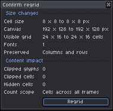
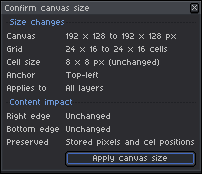

# Canvas, Grids & Regridding

[← Previous: Fonts & Typography System](03-fonts-and-typography.md) | [User Guide Home](../USER_GUIDE.md) | [Next: Portable Interchange & Ecosystem Integration →](05-portable-interchange.md)

---

In textmode art, document dimensions are measured in **character cells** rather than raw pixels. Asemode provides a dedicated grid engine that manages the mathematical relationship between character columns/rows, cell pixel sizes, and the underlying Aseprite canvas.

---

## 1. Understanding Textmode Coordinates

A textmode canvas is governed by a two-tier coordinate model:

$$\text{Canvas Width (px)} = \text{Columns} \times \text{Cell Width (px)}$$
$$\text{Canvas Height (px)} = \text{Rows} \times \text{Cell Height (px)}$$

For example:
- A $40 \times 25$ grid using an $8 \times 8$ font yields a $320 \times 200$ pixel canvas.
- A $80 \times 25$ grid using a $9 \times 16$ font yields a $720 \times 400$ pixel canvas (classic VGA text mode).

Because each tile in Aseprite's tilemap corresponds directly to one character cell, **arbitrary pixel resizing breaks grid alignment**. To resize your artwork safely, always use Asemode's **Grid** command.

---

## 2. The Grid Configuration Dialog

To modify your grid or cell dimensions, open **Sprite > Asemode > Grid..** (Command: `AsemodeRegrid`).

The dialog contains two distinct tabs:

### Tab 1: Cell Size
Use this tab to adjust the pixel width and height of each character cell:

<picture>
  <source media="(prefers-color-scheme: dark)" srcset="../images/screenshots/dark/grid.png">
  <source media="(prefers-color-scheme: light)" srcset="../images/screenshots/light/grid.png">
  
</picture>

- Changing the cell size scales the overall pixel dimensions of the sprite while preserving the total number of character columns and rows.
- Useful when migrating artwork to a font with different aspect ratios (e.g. from 8×8 square to 8×16 tall).

### Tab 2: Grid Size
Use this tab to expand or contract the number of character columns and rows:

<picture>
  <source media="(prefers-color-scheme: dark)" srcset="../images/screenshots/dark/grid-size.png">
  <source media="(prefers-color-scheme: light)" srcset="../images/screenshots/light/grid-size.png">
  
</picture>

- **Columns & Rows:** Set new grid limits (e.g., expand from 40 columns to 80 columns).
- **Anchor Positioning:** Choose which corner or center point to anchor existing artwork during expansion or cropping.

---

## 3. Confirming Regrid & Content Impact Warnings

When you apply grid or cell changes, Asemode evaluates the content of all textmode layers across every animation cel:

### Safe Regrid Confirmation
If the changes expand the canvas or preserve all existing character cells, a clean confirmation dialog summarizes the changes:

<picture>
  <source media="(prefers-color-scheme: dark)" srcset="../images/screenshots/dark/confirm-regrid.png">
  <source media="(prefers-color-scheme: light)" srcset="../images/screenshots/light/confirm-regrid.png">
  
</picture>

### Content Impact Warnings
If reducing columns or rows will truncate existing artwork, Asemode displays a warning banner highlighting affected layers and cell counts:

<picture>
  <source media="(prefers-color-scheme: dark)" srcset="../images/screenshots/dark/confirm-regrid-warnings.png">
  <source media="(prefers-color-scheme: light)" srcset="../images/screenshots/light/confirm-regrid-warnings.png">
  
</picture>

> [!CAUTION]
> Truncated cells outside the new boundaries cannot be recovered once you save the project. Always create a backup or review affected areas before confirming a destructive regrid.

---

## 4. Canvas Resizing & Native Interception

If you accidentally invoke Aseprite's native **Sprite > Canvas Size** command while working on a textmode document, Asemode intercepts the operation and opens the **Confirm Canvas Size** dialog:

<picture>
  <source media="(prefers-color-scheme: dark)" srcset="../images/screenshots/dark/confirm-canvas-size.png">
  <source media="(prefers-color-scheme: light)" srcset="../images/screenshots/light/confirm-canvas-size.png">
  
</picture>

- **Grid Alignment Validation:** The dialog ensures that requested pixel dimensions are exact multiples of the active cell width and height. Non-aligned dimensions are rounded to the nearest cell boundary.
- **Off-Grid Content Warnings:** If the proposed resize would crop active text cells, Asemode alerts you immediately:

<picture>
  <source media="(prefers-color-scheme: dark)" srcset="../images/screenshots/dark/confirm-canvas-size-warnings.png">
  <source media="(prefers-color-scheme: light)" srcset="../images/screenshots/light/confirm-canvas-size-warnings.png">
  
</picture>

---

## 5. Next Steps

- [Proceed to Chapter 5: Portable Interchange & Ecosystem Integration →](05-portable-interchange.md)
- [Jump to Chapter 6: Native Operation Guards & Document Integrity →](06-native-guards-and-safety.md)
- [Back to User Guide Overview](../USER_GUIDE.md)
