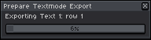
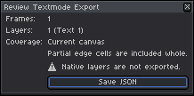
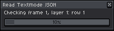
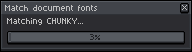
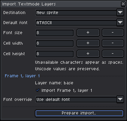
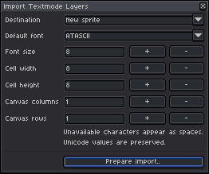
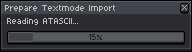
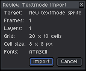
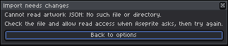

# Portable Interchange & Ecosystem Integration

[← Previous: Canvas, Grids & Regridding](04-canvas-and-grids.md) | [User Guide Home](../USER_GUIDE.md) | [Next: Native Operation Guards & Document Integrity →](06-native-guards-and-safety.md)

---

Asemode is not an isolated island—it is designed as an open creative hub within the **`textmode.art`** ecosystem. By supporting the standard **Textmode Document v4** (`.textmode.json`) format, you can exchange live, editable character-cell artwork between Aseprite and web tools, animation libraries, and external converters.

---

## 1. The Textmode Document v4 Specification

The [Textmode Document format](https://github.com/humanbydefinition/textmode-document) is a standardized, platform-independent JSON schema representing multi-layer textmode art:

- **Document Metadata:** Author credits, creation timestamp, canvas dimensions (columns and rows), and schema version.
- **Font Descriptors:** Font identity hashes, families, and glyph bounding boxes.
- **Layer Stacks:** Individual layer metadata, opacity, visibility, and per-cel cell matrices.
- **Cell Records:** Unicode code points, 32-bit RGBA foreground ink colors, and 32-bit RGBA background cell colors.

---

## 2. Exporting Textmode Documents

To export your Aseprite artwork as a portable JSON document:

### Step 1: Open the Export Dialog
Choose **Sprite > Asemode > Export..** (Command: `AsemodeExport`).

<picture>
  <source media="(prefers-color-scheme: dark)" srcset="../images/screenshots/dark/export.png">
  <source media="(prefers-color-scheme: light)" srcset="../images/screenshots/light/export.png">
  
</picture>

### Step 2: Prepare Export Staging
Asemode runs an export staging task to encode cells and resolve font dependencies:

<picture>
  <source media="(prefers-color-scheme: dark)" srcset="../images/screenshots/dark/loading-prepare-export.png">
  <source media="(prefers-color-scheme: light)" srcset="../images/screenshots/light/loading-prepare-export.png">
  
</picture>

### Step 3: Review Export Summary & Diagnostics
The **Review Textmode Export** modal presents an audit of the file to be written:

<picture>
  <source media="(prefers-color-scheme: dark)" srcset="../images/screenshots/dark/review-export.png">
  <source media="(prefers-color-scheme: light)" srcset="../images/screenshots/light/review-export.png">
  
</picture>

### Excluded Layer & Out-of-Bounds Warnings
If standard raster pixel art layers are present, or if cells extend beyond the exported boundary, Asemode displays a diagnostic summary:

<picture>
  <source media="(prefers-color-scheme: dark)" srcset="../images/screenshots/dark/review-export-warnings.png">
  <source media="(prefers-color-scheme: light)" srcset="../images/screenshots/light/review-export-warnings.png">
  
</picture>

> [!NOTE]
> Only Asemode tilemap layers are encoded into `.textmode.json`. Non-textmode pixel art layers are noted as excluded, allowing you to export clean text data without corrupting your composite `.aseprite` project.

---

## 3. Importing Textmode Documents

You can import any valid `.textmode.json` document into Aseprite.

### Step 1: Open the Import Dialog
Select **Sprite > Asemode > Import Textmode JSON..** (Command: `AsemodeImport`).

<picture>
  <source media="(prefers-color-scheme: dark)" srcset="../images/screenshots/dark/import-json.png">
  <source media="(prefers-color-scheme: light)" srcset="../images/screenshots/light/import-json.png">
  
</picture>

### Step 2: Cooperative Loading Tasks
Asemode reads the JSON file and analyzes required fonts asynchronously:

<picture>
  <source media="(prefers-color-scheme: dark)" srcset="../images/screenshots/dark/loading-read-json.png">
  <source media="(prefers-color-scheme: light)" srcset="../images/screenshots/light/loading-read-json.png">
  
</picture>

<picture>
  <source media="(prefers-color-scheme: dark)" srcset="../images/screenshots/dark/loading-match-fonts.png">
  <source media="(prefers-color-scheme: light)" srcset="../images/screenshots/light/loading-match-fonts.png">
  
</picture>

### Step 3: Layer Selection & Font Recovery
The **Import Textmode Layers** dialog lets you choose which layers to import. For multi-layer documents, pages are paginated:

<picture>
  <source media="(prefers-color-scheme: dark)" srcset="../images/screenshots/dark/import-layers.png">
  <source media="(prefers-color-scheme: light)" srcset="../images/screenshots/light/import-layers.png">
  
</picture>

If the imported document references a custom font not currently installed in your local library, Asemode provides font recovery controls:

<picture>
  <source media="(prefers-color-scheme: dark)" srcset="../images/screenshots/dark/import-layers-paginated-recovery.png">
  <source media="(prefers-color-scheme: light)" srcset="../images/screenshots/light/import-layers-paginated-recovery.png">
  
</picture>

*(If a file contains no active text layers, a blank document warning is shown).*

<picture>
  <source media="(prefers-color-scheme: dark)" srcset="../images/screenshots/dark/import-layers-blank.png">
  <source media="(prefers-color-scheme: light)" srcset="../images/screenshots/light/import-layers-blank.png">
  
</picture>

### Step 4: Staging & Import Review
Once layers are selected, Asemode prepares the import and displays a final diagnostic review:

<picture>
  <source media="(prefers-color-scheme: dark)" srcset="../images/screenshots/dark/loading-prepare-import.png">
  <source media="(prefers-color-scheme: light)" srcset="../images/screenshots/light/loading-prepare-import.png">
  
</picture>

<picture>
  <source media="(prefers-color-scheme: dark)" srcset="../images/screenshots/dark/review-import.png">
  <source media="(prefers-color-scheme: light)" srcset="../images/screenshots/light/review-import.png">
  
</picture>

If any character glyphs would clip or fall outside canvas bounds, detailed diagnostics are flagged in the warning variant:

<picture>
  <source media="(prefers-color-scheme: dark)" srcset="../images/screenshots/dark/review-import-warnings.png">
  <source media="(prefers-color-scheme: light)" srcset="../images/screenshots/light/review-import-warnings.png">
  
</picture>

---

## 4. Troubleshooting Import Issues

### Schema & Format Issues
If an imported file is invalid or predates schema version 4, Asemode opens the **Import Needs Changes** modal:

<picture>
  <source media="(prefers-color-scheme: dark)" srcset="../images/screenshots/dark/import-needs-changes.png">
  <source media="(prefers-color-scheme: light)" srcset="../images/screenshots/light/import-needs-changes.png">
  
</picture>

### File Read & Sandbox Permissions
If Aseprite cannot access the requested file due to OS filesystem permissions or sandboxing:

<picture>
  <source media="(prefers-color-scheme: dark)" srcset="../images/screenshots/dark/import-needs-changes-access.png">
  <source media="(prefers-color-scheme: light)" srcset="../images/screenshots/light/import-needs-changes-access.png">
  
</picture>

*Resolution:* Move the file to a standard user directory (e.g. Documents) and grant read permission when prompted by Aseprite.

---

## 5. Ecosystem Recipes

You can connect Asemode with popular textmode tools:

1. **[create.textmode.art](https://create.textmode.art/):** Export a `.textmode.json` from the browser canvas and open it in Asemode to add detailed pixel art layers, shading, and animation.
2. **[export.textmode.art](https://export.textmode.art/):** Convert raster images or videos into textmode representations, download the `.textmode.json`, and import directly into Aseprite.
3. **[textmode.js](https://github.com/humanbydefinition/textmode.js):** Use [textmode.export.js](https://github.com/humanbydefinition/textmode.export.js) in your JavaScript sketches to export animated text frames for editing in Aseprite.
4. **[Textmode Overlay](https://extension.textmode.art/):** Capture browser textmode sessions and inspect them directly in Aseprite.

---

## 6. Next Steps

- [Proceed to Chapter 6: Native Operation Guards & Document Integrity →](06-native-guards-and-safety.md)
- [Jump to Chapter 7: Settings, Customization & Shortcuts →](07-settings-and-shortcuts.md)
- [Back to User Guide Overview](../USER_GUIDE.md)
