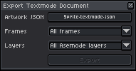
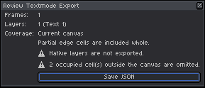
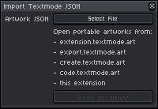
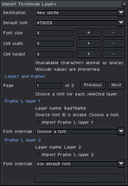
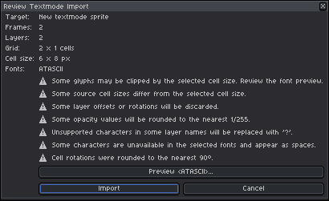
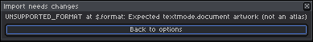

# Portable Interchange & Ecosystem Integration

[← Previous: Canvas, Grids & Regridding](04-canvas-and-grids.md) • [User Guide Home](../USER_GUIDE.md) • [Next: Native Operation Guards & Document Integrity →](06-native-guards-and-safety.md)

---

Asemode is designed as an open creative hub within the **`textmode.art`** ecosystem. By supporting the standard **Textmode Document v4** (`.textmode.json`) format, you can exchange live, editable character-cell artwork between Aseprite and web tools, animation libraries, and external converters.

---

## 1. The Textmode Document v4 Specification

The [Textmode Document format](https://github.com/humanbydefinition/textmode-document) is a platform-independent JSON schema representing multi-layer, animated textmode art:

- **Format & Metadata:** Format identifier (`textmode.document`), semantic version (`4.0.0`), and optional creation timestamp with generator info.
- **Frames & Animation:** Ordered frame array with per-frame display duration (`durationMs`) and layer collections.
- **Layer & Grid Architecture:** Unique layer IDs, grid dimensions (`cols`, `rows`), cell pixel size (`cellWidth`, `cellHeight`), opacity, blend modes, and coordinate offsets.
- **Font Descriptors:** Font identity hashes (`sfnt-v1-sha256:<digest>`) and family names.
- **Cell Records:** 2D cell matrices with UTF-8 characters, independent 32-bit RGBA `foreground` (ink) and `background` (cell) colors, and per-cell stamp transforms (`flipX`, `flipY`, `rotation`).

---

## 2. Exporting Artwork to JSON

1. Choose **Sprite > Asemode > Export..** (Command: `AsemodeExport`).

<picture>
  <source media="(prefers-color-scheme: dark)" srcset="../images/screenshots/dark/export.png">
  <source media="(prefers-color-scheme: light)" srcset="../images/screenshots/light/export.png">
  
</picture>

2. In the **Export Textmode Document** dialog, configure:
- **Artwork JSON:** Select the destination `.textmode.json` file path.
- **Frames:** Choose **All frames** or **Active frame**.
- **Layers:** Choose **All Asemode layers** or **Active Asemode layer**.
Click **Export** to prepare the export summary.

3. Review the export summary in the **Review Textmode Export** dialog:

<picture>
  <source media="(prefers-color-scheme: dark)" srcset="../images/screenshots/dark/review-export-warnings.png">
  <source media="(prefers-color-scheme: light)" srcset="../images/screenshots/light/review-export-warnings.png">
  
</picture>

- Confirms **Frames:**, **Layers:**, and **Coverage:** (**Current canvas**).
- Highlights any diagnostic notices, such as `Native layers are not exported.` or omitted occupied cells outside the canvas.
4. Click **Save JSON** to write the `.textmode.json` file.

---

## 3. Importing JSON Artwork

1. Choose **Sprite > Asemode > Import Textmode JSON..** (Command: `AsemodeImport`).

<picture>
  <source media="(prefers-color-scheme: dark)" srcset="../images/screenshots/dark/import-json.png">
  <source media="(prefers-color-scheme: light)" srcset="../images/screenshots/light/import-json.png">
  
</picture>

2. Under **Artwork JSON**, select your `.textmode.json` file and click **Read document**. Asemode reads the document and matches fonts asynchronously.
3. In the **Import Textmode Layers** dialog, configure your target and layer mappings:

<picture>
  <source media="(prefers-color-scheme: dark)" srcset="../images/screenshots/dark/import-layers-paginated-recovery.png">
  <source media="(prefers-color-scheme: light)" srcset="../images/screenshots/light/import-layers-paginated-recovery.png">
  
</picture>

- **Destination:** Choose **New sprite** or **Add layers to active sprite**.
- **Default font:** Assign the fallback typeface for unmapped layers.
- **Font size**, **Cell width**, **Cell height:** Verify pixel dimensions per character cell.
- **Font Recovery & Pagination:** For multi-layer documents, navigate pages using **Previous page** / **Next page**. Check or uncheck layers to include, and assign local substitute fonts from the dropdown for missing typefaces.
Click **Prepare import..**.

4. Confirm layer import in the **Review Textmode Import** dialog:

<picture>
  <source media="(prefers-color-scheme: dark)" srcset="../images/screenshots/dark/review-import-warnings.png">
  <source media="(prefers-color-scheme: light)" srcset="../images/screenshots/light/review-import-warnings.png">
  
</picture>

- Summarizes **Target:**, **Frames:**, **Layers:**, **Grid:**, **Cell size:**, and **Fonts:**.
- Displays yellow diagnostic warning boxes for font substitutions, metrics shifts, or out-of-bounds cells. Click **Preview ...** if glyph clipping warnings appear.
5. Click **Import** to generate or populate the sprite layers.

---

## 4. Troubleshooting Import Issues

If an imported file predates schema version 4, contains invalid syntax, or lacks filesystem permissions, Asemode displays the **Import needs changes** dialog:

<picture>
  <source media="(prefers-color-scheme: dark)" srcset="../images/screenshots/dark/import-needs-changes.png">
  <source media="(prefers-color-scheme: light)" srcset="../images/screenshots/light/import-needs-changes.png">
  
</picture>

- **Diagnostic Details:** Outlines the exact syntax error, missing font reference, or OS sandboxing notice.
- **Resolution:** Click **Back to options** to return to the configuration modal and adjust your settings. Ensure the document is formatted as Textmode Document v4 or updated via [`create.textmode.art`](https://create.textmode.art).

---

## 5. Ecosystem Recipes

- **[create.textmode.art](https://create.textmode.art/):** Export a `.textmode.json` from the web canvas and open it in Aseprite to add detailed pixel art layers, shading, and multi-frame animation.
- **[export.textmode.art](https://export.textmode.art/):** Convert photos, pixel art, or video frames into textmode representations, download the `.textmode.json`, and import directly into Aseprite.
- **[textmode.js](https://github.com/humanbydefinition/textmode.js):** Use [textmode.export.js](https://github.com/humanbydefinition/textmode.export.js) in your JavaScript sketches to export animated text cels for editing in Aseprite.
- **[Textmode Overlay](https://extension.textmode.art/):** Capture browser textmode sessions and inspect them directly in Aseprite.

---

[← Previous: Canvas, Grids & Regridding](04-canvas-and-grids.md) • [User Guide Home](../USER_GUIDE.md) • [Next: Native Operation Guards & Document Integrity →](06-native-guards-and-safety.md)
