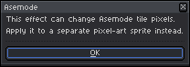
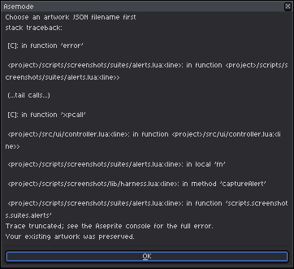

# Native Operation Guards & Document Integrity

[← Previous: Portable Interchange & Ecosystem Integration](05-portable-interchange.md) • [User Guide Home](README.md) • [Next: Settings, Customization & Shortcuts →](07-settings-and-shortcuts.md)

---

Asemode documents use Aseprite's native **tilemap** system, where each character cell references a tile in an underlying font tileset. While this architecture gives you native performance and full tool compatibility, standard raster operations (like color-format reduction, blurring filters, or non-orthogonal canvas rotation) can silently corrupt character cell identities.

To protect your artwork, Asemode includes an **Active Guard Subsystem** that monitors native Aseprite commands, blocking destructive actions, safely rewriting supported operations, and offering safe alternatives.

---

## 1. Why Guards Are Necessary

When an Aseprite layer is registered as an Asemode Textmode layer:
- **Tiles Represent Characters:** Each tile holds a character glyph rendered in a specific ink/cell color pair.
- **Grid Alignment Is Strict:** Tiles must align with character cell boundaries.
- **RGB Mode Is Required:** 32-bit RGBA color is essential for independent per-cell ink and background palettes.

If a native command bypasses these rules, character glyphs would be flattened into raw pixels, destroying the ability to search, replace, export to `.textmode.json`, or edit text.

<picture>
  <source media="(prefers-color-scheme: dark)" srcset="../images/screenshots/dark/alert-native-filter.png">
  <source media="(prefers-color-scheme: light)" srcset="../images/screenshots/light/alert-native-filter.png">
  
</picture>

---

## 2. Guarded Operations & Safe Alternatives

The table below lists all guarded native commands, their rationale, and the recommended workflow to accomplish your goal safely:

| Native Operation | Command / Trigger | Why It Is Guarded | Safe Alternative |
| :--- | :--- | :--- | :--- |
| **Raster Filters** | **Edit > Adjustments** (Invert, Hue/Sat, Brightness, Blur, Despeckle, Convolution) | Modifying tile pixels corrupts 1-bit font glyph masks and creates orphaned tiles. | To change colors on text cells, use **Sprite > Asemode > Selection > Replace..**. To apply raster filters, use a separate standard pixel art layer. |
| **Color Mode Conversion** | **Sprite > Color Mode** (Indexed, Grayscale) | Indexed mode limits the sprite to a single 256-color global palette, conflicting with per-cell RGBA pairs. | Keep your master sprite in RGB mode. Export indexed copies via **File > Export As...** or export to `.textmode.json`. |
| **Layer Flattening** | **Layer > Flatten** or **Flatten Visible** | Flattening converts tilemap layers into raw bitmaps, permanently erasing character identities. | Keep your working `.aseprite` project multi-layer, and use **File > Export As...** (`Ctrl+Shift+Alt+S`) to output a flat PNG/GIF. |
| **Layer Conversion** | **Layer > Convert To > Image Layer** | Detaches the layer from the Asemode font tileset. | Duplicate the layer first (**Layer > Duplicate**), then convert only the duplicate if you need a raster snapshot. |
| **Native Bitmap Paste** | Standard Paste (`Ctrl+V` / `Cmd+V`) | Pasting raw pixel bitmaps introduces off-grid pixel clusters that cannot resolve to font glyphs. | Use Asemode's cell-aware clipboard via **Sprite > Asemode > Selection > Copy** and **Paste**. |
| **Native Insert Text** | **Edit > Insert Text** | Inserts anti-aliased or off-grid bitmap text rather than font-cell tiles. | Paint characters using stamps from the **Asemode Panel**. |
| **Native Sprite Size** | **Sprite > Sprite Size** | Bilinear or nearest-neighbor pixel resampling distorts 1-bit font glyphs. | Use **Sprite > Asemode > Grid..** to scale cell sizes or change column/row counts cleanly. |
| **Native Canvas Size** | **Sprite > Canvas Size** | Arbitrary pixel offsets shift character cells out of grid alignment. | Asemode intercepts canvas resizing and guides you through grid-aligned dimension adjustments. |

---

## 3. Concurrency & Error Protection

### Stamp State Concurrency
If you initiate a command while a background font-rasterization or export staging task is running, Asemode displays a temporary busy notice. Wait a moment for the background task to complete before triggering the next action.

### Runtime Error Preservation (Crash Protection)
If an unexpected Lua error occurs during document processing, Asemode traps the error cleanly, logs diagnostic details to the console, and displays the **Runtime Error (Artwork Preserved)** dialog:

<picture>
  <source media="(prefers-color-scheme: dark)" srcset="../images/screenshots/dark/alert-error-preserved.png">
  <source media="(prefers-color-scheme: light)" srcset="../images/screenshots/light/alert-error-preserved.png">
  
</picture>

> [!NOTE]
> When a protected error is displayed, your canvas, tilemaps, and cell metadata remain untouched. Save your work (`Ctrl+S` / `Cmd+S`) and reopen the project.

---

[← Previous: Portable Interchange & Ecosystem Integration](05-portable-interchange.md) • [User Guide Home](README.md) • [Next: Settings, Customization & Shortcuts →](07-settings-and-shortcuts.md)
