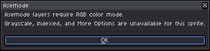
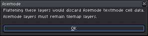
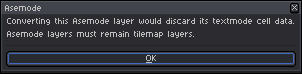
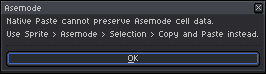
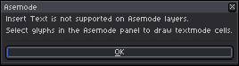
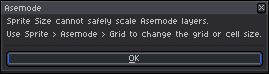
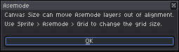
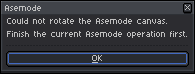
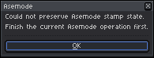

# Native Operation Guards & Document Integrity

[← Previous: Portable Interchange & Ecosystem Integration](05-portable-interchange.md) | [User Guide Home](../USER_GUIDE.md) | [Next: Settings, Customization & Shortcuts →](07-settings-and-shortcuts.md)

---

Asemode documents are built on Aseprite's native **tilemap** system, where each character cell references a tile in an underlying font tileset. While this architecture gives you native performance and full tool compatibility, standard raster operations (like color-format reduction, blurring filters, or free-form canvas rotation) would silently corrupt character cell identities.

To protect your artwork, Asemode includes an **Active Guard Subsystem** that monitors native Aseprite commands, blocking destructive actions and offering safe alternatives.

---

## 1. Why Guards Are Necessary

When an Aseprite layer is registered as an Asemode Textmode layer:
- **Tiles Represent Characters:** Each tile holds a character glyph rendered in a specific ink/cell color pair.
- **Grid Alignment Is Strict:** Tiles must align with character cell boundaries.
- **RGB Mode Is Required:** 32-bit RGBA color is essential for independent per-cell ink and background palettes.

If a native command bypasses these rules, character glyphs would be flattened into meaningless raw pixels, destroying the ability to search, replace, export to `.textmode.json`, or edit text.

---

## 2. Catalog of Guarded Operations & Alternatives

Below is the complete reference of guarded commands, their rationales, and the recommended workflows to achieve your goal safely.

---

### Guard 1: Raster Filters Blocked

Commands such as **Edit > Adjustments > Invert Color**, **Hue/Saturation**, **Brightness/Contrast**, **Despeckle**, or **Convolution Matrix** are blocked on sprites containing Asemode layers:

<picture>
  <source media="(prefers-color-scheme: dark)" srcset="../images/screenshots/dark/alert-native-filter.png">
  <source media="(prefers-color-scheme: light)" srcset="../images/screenshots/light/alert-native-filter.png">
  
</picture>

- **Why it is blocked:** Applying bitmap color alterations directly to tiles corrupts font glyph masks and creates orphaned tiles.
- **Safe Alternative:**
  - To change colors across textmode cells, use **Sprite > Asemode > Selection > Replace..** (see [Chapter 2](02-layers-and-composition.md)).
  - To apply raster filters to background art, create a separate non-textmode pixel art layer.

---

### Guard 2: Color Mode Conversion Blocked

Commands under **Sprite > Color Mode** (such as converting from RGB to **Indexed** or **Grayscale**) are blocked:

<picture>
  <source media="(prefers-color-scheme: dark)" srcset="../images/screenshots/dark/alert-native-color-mode.png">
  <source media="(prefers-color-scheme: light)" srcset="../images/screenshots/light/alert-native-color-mode.png">
  
</picture>

- **Why it is blocked:** Indexed mode limits the sprite to a single 256-color global palette, which conflicts with per-cell RGBA color pairs.
- **Safe Alternative:** Keep your master sprite in RGB mode. When ready to publish to an indexed format, export a copy via **File > Export As...** or export to `.textmode.json`.

---

### Guard 3: Layer Flattening Blocked

Commands such as **Layer > Flatten** or **Layer > Flatten Visible** are blocked if textmode layers are selected:

<picture>
  <source media="(prefers-color-scheme: dark)" srcset="../images/screenshots/dark/alert-native-flatten.png">
  <source media="(prefers-color-scheme: light)" srcset="../images/screenshots/light/alert-native-flatten.png">
  
</picture>

- **Why it is blocked:** Flattening permanently converts tilemap layers into flat raster bitmaps, erasing character identities and cell metadata.
- **Safe Alternative:** Save your working `.aseprite` document first, then use **File > Export As...** (`Ctrl+Shift+Alt+S`) to render a flat PNG or GIF while keeping your working project intact.

---

### Guard 4: Convert Layer Blocked

The command **Layer > Convert To > Image Layer** is blocked for active Asemode layers:

<picture>
  <source media="(prefers-color-scheme: dark)" srcset="../images/screenshots/dark/alert-native-convert-layer.png">
  <source media="(prefers-color-scheme: light)" srcset="../images/screenshots/light/alert-native-convert-layer.png">
  
</picture>

- **Why it is blocked:** Converting a tilemap layer to an image layer detaches it from the Asemode font tileset.
- **Safe Alternative:** Duplicate the layer first (**Layer > Duplicate**), then convert only the duplicate if you require a rasterized snapshot.

---

### Guard 5: Native Bitmap Paste Blocked

Using native paste (`Ctrl+V` or `Cmd+V`) on an active textmode layer is blocked:

<picture>
  <source media="(prefers-color-scheme: dark)" srcset="../images/screenshots/dark/alert-native-paste.png">
  <source media="(prefers-color-scheme: light)" srcset="../images/screenshots/light/alert-native-paste.png">
  
</picture>

- **Why it is blocked:** Raw pixel pasting introduces off-grid pixel clusters that cannot be resolved to font glyphs.
- **Safe Alternative:** Use Asemode's cell-aware clipboard via **Sprite > Asemode > Selection > Copy** and **Paste** (see [Chapter 2](02-layers-and-composition.md)).

---

### Guard 6: Native Insert Text Blocked

The native text tool (**Edit > Insert Text**) is blocked on Asemode layers:

<picture>
  <source media="(prefers-color-scheme: dark)" srcset="../images/screenshots/dark/alert-native-insert-text.png">
  <source media="(prefers-color-scheme: light)" srcset="../images/screenshots/light/alert-native-insert-text.png">
  
</picture>

- **Why it is blocked:** Aseprite's native text dialog renders anti-aliased or non-grid-aligned raster fonts rather than character-cell tiles.
- **Safe Alternative:** Type characters by selecting glyphs in the **Asemode Panel** or import a `.textmode.json` document.

---

### Guard 7: Native Sprite Size Blocked

The command **Sprite > Sprite Size** is blocked for projects with Asemode layers:

<picture>
  <source media="(prefers-color-scheme: dark)" srcset="../images/screenshots/dark/alert-native-sprite-size.png">
  <source media="(prefers-color-scheme: light)" srcset="../images/screenshots/light/alert-native-sprite-size.png">
  
</picture>

- **Why it is blocked:** Resampling pixels with Nearest Neighbor or Bilinear filters distorts 1-bit font glyphs.
- **Safe Alternative:** Use **Sprite > Asemode > Grid..** to adjust cell dimensions or change column/row counts cleanly (see [Chapter 4](04-canvas-and-grids.md)).

---

### Guard 8: Native Canvas Size Intercepted

The command **Sprite > Canvas Size** is intercepted:

<picture>
  <source media="(prefers-color-scheme: dark)" srcset="../images/screenshots/dark/alert-native-canvas-size.png">
  <source media="(prefers-color-scheme: light)" srcset="../images/screenshots/light/alert-native-canvas-size.png">
  
</picture>

- **Why it is intercepted:** Native canvas sizing allows arbitrary pixel offsets (e.g., adding 3 pixels), shifting text cells out of grid alignment.
- **Safe Alternative:** Use **Sprite > Asemode > Grid..** or confirm the guided resize via **Confirm Canvas Size**.

---

### Guard 9: Canvas Rotation Blocked

Arbitrary canvas rotation commands (e.g. rotating 45° or 180° via **Sprite > Rotate Canvas**) are blocked:

<picture>
  <source media="(prefers-color-scheme: dark)" srcset="../images/screenshots/dark/alert-rotate-error.png">
  <source media="(prefers-color-scheme: light)" srcset="../images/screenshots/light/alert-rotate-error.png">
  
</picture>

- **Safe Alternative:** Rotate individual stamps using **Sprite > Asemode > Stamps > Rotate 90° Clockwise** or rotate composite exported images in an external editor.

---

## 3. Concurrency & Runtime Error Protection

### Stamp State Busy Alert
If you initiate a rapid sequence of commands while a background font-rendering or export task is executing:

<picture>
  <source media="(prefers-color-scheme: dark)" srcset="../images/screenshots/dark/alert-stamp-state-busy.png">
  <source media="(prefers-color-scheme: light)" srcset="../images/screenshots/light/alert-stamp-state-busy.png">
  
</picture>

*Resolution:* Wait 1–2 seconds for the pending operation to complete before initiating the next action.

### Error Preservation (Crash Protection)
If an unexpected Lua error occurs during document processing, Asemode traps the error cleanly, logs diagnostic details to the console, and displays the **Runtime Error (Artwork Preserved)** dialog:

<picture>
  <source media="(prefers-color-scheme: dark)" srcset="../images/screenshots/dark/alert-error-preserved.png">
  <source media="(prefers-color-scheme: light)" srcset="../images/screenshots/light/alert-error-preserved.png">
  
</picture>

> [!NOTE]
> Even if a script error is encountered, your canvas, layers, and cell data remain untouched. Save your work (`Ctrl+S` / `Cmd+S`) and reopen the project.

---

## 4. Next Steps

- [Proceed to Chapter 7: Settings, Customization & Shortcuts →](07-settings-and-shortcuts.md)
- [Jump to Chapter 8: Quick Reference & Command Palette →](08-quick-reference.md)
- [Back to User Guide Overview](../USER_GUIDE.md)
