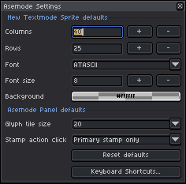

# Settings, Customization & Shortcuts

[← Previous: Native Operation Guards & Document Integrity](06-native-guards-and-safety.md) • [User Guide Home](README.md) • [Next: Quick Reference & Command Palette →](08-quick-reference.md)

---

Asemode is built to adapt to your creative pace. Through the **Settings** dialog and Aseprite's native keyboard shortcut configuration, you can establish global defaults for new projects, tune picker sizing, and map hotkeys for instant stamp transformations.

---

## 1. The Asemode Settings Dialog

To open preferences, select **Sprite > Asemode > Settings..** (Command: `AsemodeSettings`).

<picture>
  <source media="(prefers-color-scheme: dark)" srcset="../images/screenshots/dark/settings.png">
  <source media="(prefers-color-scheme: light)" srcset="../images/screenshots/light/settings.png">
  
</picture>

### Configuration Options

| Setting Group | Option | Valid Range / Options | Default | Description |
| :--- | :--- | :--- | :--- | :--- |
| **New Textmode Sprite defaults** | **Columns** | `1` to `1024` | `40` | Default horizontal cell count for new sprites. |
| | **Rows** | `1` to `1024` | `25` | Default vertical cell count for new sprites. |
| | **Font** | Any registered font | `ATASCII` | Initial typeface assigned to new textmode layers. |
| | **Font size** | `8` to `128` px | `8` | Default pixel dimension per cell. |
| | **Background** | Valid `#rrggbbaa` hex | `#ffffff00` (Transparent) | Initial background fill color for canvas cells. |
| **Asemode Panel defaults** | **Glyph tile size** | `12`, `20`, `28`, `36` | `20` | Display size (px) of character boxes in the glyph browser grid. |
| | **Stamp action click** | `Primary stamp only`, `Both stamps` | `Primary stamp only` | Determines whether picking a glyph updates only the primary stamp or synchronizes both stamps. |

Click **Reset defaults** at the bottom of the dialog to restore all settings to their factory defaults.

> [!NOTE]
> Grid dimensions enforce an overall memory ceiling of **4,194,304 total cells** ($2048 \times 2048$). If input dimensions exceed this limit, values are automatically clamped to maintain smooth interactive performance.

---

## 2. Keyboard Shortcut Integration

Asemode registers every command and stamp transform with Aseprite's native command bus. You can bind custom keys to any action to build an ultra-fast textmode painting workflow.

### Opening the Shortcut Configuration
Choose **Sprite > Asemode > Keyboard Shortcuts...** (Command: `AsemodeKeyboardShortcuts`) or navigate to **Edit > Keyboard Shortcuts**. In the search filter, type `Asemode` to view all available commands.

### Recommended Shortcut Map

| Action | Command Identifier | Recommended Key | Notes |
| :--- | :--- | :--- | :--- |
| **Swap Ink and Cell Colors** | `AsemodeSwapColors` | `X` or `Shift+X` | Quickly invert foreground and background colors. |
| **Flip Stamp Horizontally** | `AsemodeFlipHorizontal` | `H` | Mirrors the active stamp along the vertical axis. |
| **Flip Stamp Vertically** | `AsemodeFlipVertical` | `V` | Flips the active stamp upside down. |
| **Rotate Stamp Clockwise** | `AsemodeRotateClockwise` | `R` | Rotates glyph 90° clockwise. |
| **Rotate Counterclockwise**| `AsemodeRotateCounterclockwise` | `Shift+R` | Rotates glyph 90° counter-clockwise. |
| **Reset Orientation** | `AsemodeResetOrientation` | `Alt+R` | Clears all rotation and flip states. |
| **Toggle Asemode Panel** | `AsemodePanel` | `Tab` or `F4` | Quickly hide or reveal the dockable panel. |
| **Copy Cells** | `AsemodeCopyCells` | `Ctrl+Shift+C` | Captures cells with glyphs and colors. |
| **Paste Cells** | `AsemodePasteCells` | `Ctrl+Shift+V` | Pastes cells snapping to active grid. |
| **Replace Selection** | `AsemodeReplace` | `Ctrl+Shift+R` | Opens character and color replacement dialog. |

---

## 3. Customizing the Glyph Browser

Depending on your screen resolution or drawing tablet, you can optimize the character grid display:

- **Compact Grid (`12px`):** Best for low-resolution displays or when the panel is floating over a small canvas.
- **Standard Grid (`20px` - Default):** Balanced readability and hit targets for standard 1080p and 1440p monitors.
- **Expanded Grid (`28px` / `36px`):** Excellent for 4K / high-DPI displays or touchscreen tablet workflows where larger touch targets are preferred.

---

[← Previous: Native Operation Guards & Document Integrity](06-native-guards-and-safety.md) • [User Guide Home](README.md) • [Next: Quick Reference & Command Palette →](08-quick-reference.md)
