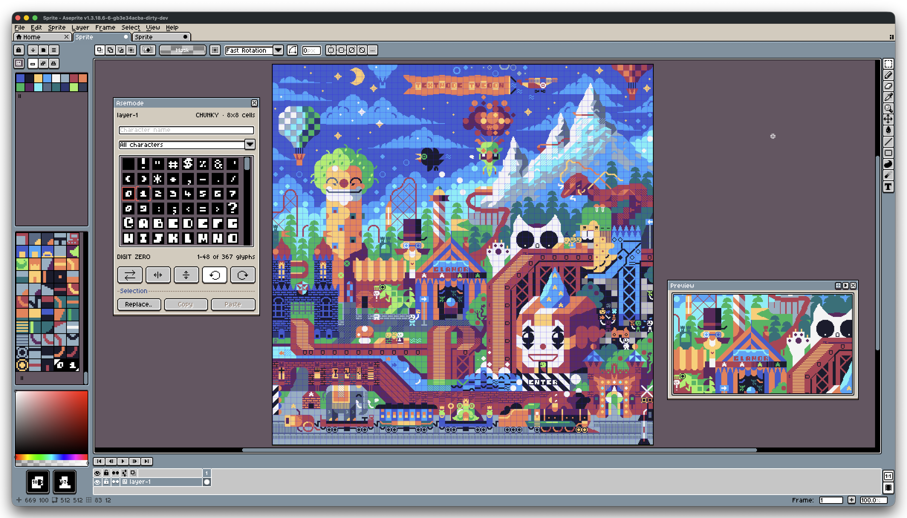

# Asemode User Guide

<div align="center">



**Native character-cell drawing, TrueType typography, and portable textmode art for Aseprite.**

[Getting Started](00-getting-started.md) • [Drawing Workflow](01-panel-and-drawing.md) • [Layers & Composition](02-layers-and-composition.md) • [Typography System](03-fonts-and-typography.md) • [Grids & Canvas](04-canvas-and-grids.md) • [Portable Interchange](05-portable-interchange.md) • [Safety Guards](06-native-guards-and-safety.md) • [Settings & Shortcuts](07-settings-and-shortcuts.md) • [Quick Reference](08-quick-reference.md)

</div>

---

## Overview

**Asemode** brings character-cell and textmode drawing to [Aseprite](https://www.aseprite.org/). It combines native Aseprite drawing tools with dedicated character stamps, independent foreground (ink) and background (cell) color channels, retro and custom TrueType typography, and full compatibility with the [`textmode.art`](https://textmode.art) ecosystem.

```text
┌────────────────────────────────────────────────────────────────────────┐
│                        Aseprite Workspace                              │
│                                                                        │
│   ┌───────────────────────────┐      ┌─────────────────────────────┐   │
│   │    Active RGB Canvas      │      │     Asemode Panel           │   │
│   │                           │      │                             │   │
│   │   [Textmode Tilemap]      │◄─────┤ • Primary / Secondary Stamp │   │
│   │   • Character Cells       │      │ • Ink (FG) & Cell (BG) Color│   │
│   │   • 1-Bit Font Tileset    │      │ • Stamp Flip & 90° Rotation │   │
│   │   • Dual RGBA Colors      │      │ • Unicode Glyph Browser     │   │
│   │                           │      └──────────────┬──────────────┘   │
│   │   [Pixel Art Layer]       │                     │                  │
│   │   • Sprites, Shading, FX  │                     │                  │
│   └─────────────┬─────────────┘                     │                  │
└─────────────────┼───────────────────────────────────┼──────────────────┘
                  ▼                                   ▼
       Portable Textmode JSON               TrueType (.ttf) Fonts
       • Textmode Document v4               • 18 Bundled Retro Typefaces
       • create.textmode.art                • Custom Font Rasterization
       • export.textmode.art                • Font Metrics & Diagnostics
```

---

## Guide Directory

| Chapter | Topic | Description |
| :---: | :--- | :--- |
| **00** | [Getting Started](00-getting-started.md) | System requirements, installation, and creating your first 40×25 textmode canvas. |
| **01** | [Panel & Drawing Workflow](01-panel-and-drawing.md) | Dual stamps, independent ink and cell colors, stamp flips/rotations, and the Unicode glyph browser. |
| **02** | [Layers & Composition](02-layers-and-composition.md) | Mixing textmode and pixel art layers, per-layer fonts, cell clipboard actions, and search-and-replace. |
| **03** | [Fonts & Typography](03-fonts-and-typography.md) | 18 bundled retro fonts, importing custom TrueType (.ttf) fonts, metrics previews, and library management. |
| **04** | [Canvas, Grids & Regridding](04-canvas-and-grids.md) | Character cell dimensions vs. canvas pixels, regridding without content loss, and canvas size safety. |
| **05** | [Portable Interchange](05-portable-interchange.md) | Exporting and importing `.textmode.json` v4 documents with `create.textmode.art`, `export.textmode.art`, and `textmode.js`. |
| **06** | [Native Operation Guards](06-native-guards-and-safety.md) | How Asemode protects character-cell data from destructive raster operations, with safe alternative workflows. |
| **07** | [Settings & Customization](07-settings-and-shortcuts.md) | Global sprite defaults, glyph picker cell sizing, and an ergonomic keyboard shortcut mapping layout. |
| **08** | [Quick Reference & FAQ](08-quick-reference.md) | Master command and hotkey dictionary, bundled font specifications, Unicode blocks, and troubleshooting answers. |

---

## Community & Resources

- **Discord:** [Join the textmode.art Discord community](https://discord.gg/sjrw8QXNks) to share artwork, exchange tips, and get support.
- **Web Editor:** Create and edit textmode artwork directly in your browser at [create.textmode.art](https://create.textmode.art/).
- **Converter:** Convert images and media to textmode documents at [export.textmode.art](https://export.textmode.art/).
- **Screenshots:** Browse complete UI captures in light and dark themes in [`SCREENSHOTS.md`](../SCREENSHOTS.md).
- **Source Code & Issues:** Star and track releases on [GitHub](https://github.com/humanbydefinition/Asemode).
